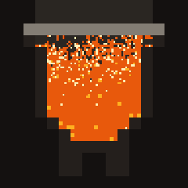
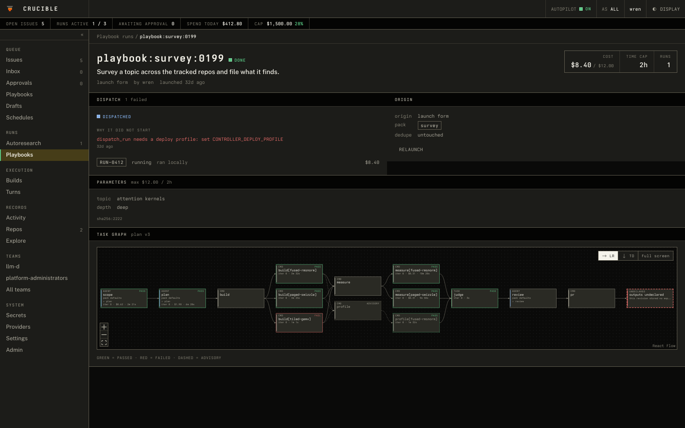
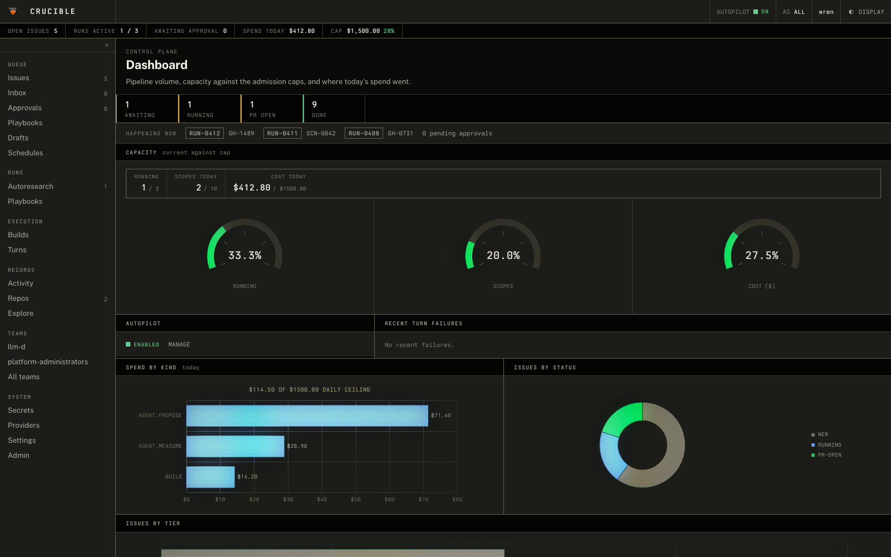
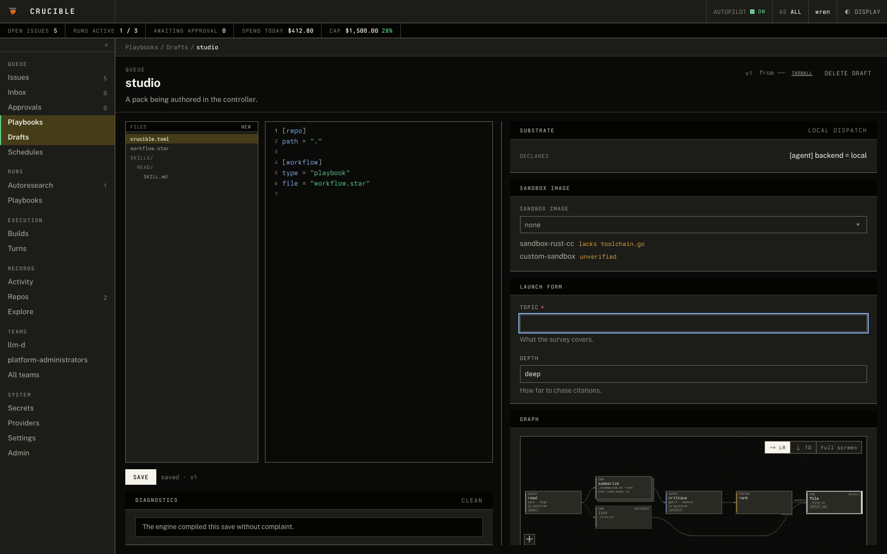

<p align="center">
  
</p>

# crucible

Crucible runs agent work as a declared graph of tasks. You write the graph in Starlark. A
task can be an agent turn, a command, an evaluation, or a decision that the engine owns.
Crucible compiles the graph into a static plan and executes it in one Git workspace under a
cost budget.

The task set is fixed at compile time, but execution can branch and repeat. A `route()` task
answers typed questions about the output of its dependencies, and downstream tasks run or
skip on those answers. A reviewer task can send its proposer back with a verdict for a
bounded number of rounds. The engine makes both decisions at run time.

Crucible has two lanes:

- A **playbook** runs the graph once and ships the result.
- An **autoresearch** run puts the graph in an optimization loop. An agent proposes a change,
  a judge from the domain measures it, and the engine keeps the candidate or restores the
  last accepted state.

<p align="center">
  
</p>

A domain is a `crucible.toml` manifest and a set of executable commands. Domain code can use
any language. It does not need a Rust integration.

## Execution model

A playbook run does these steps:

1. It compiles the plan into an IR
2. It admits the plan against the capabilities that the substrate (cluster) offers
3. It executes the tasks in dependency order in one workspace

The run ends when the result task reaches completion or the total run budget (agent cost or time) is spent.

A scored (autoresearch) run puts the same graph in a keep-or-discard loop. In each
iteration, Crucible:

1. prepares a Git workspace from `[repo]` and `[workspace]`;
2. records a baseline measurement, unless `[judge].skip_baseline` is set;
3. tells the configured agent backend to change the workspace;
4. runs the optional `[world].apply_cmd` and the required `[judge].measure_cmd`;
5. keeps a valid candidate if its score improves in the configured `direction`, or if the
   judge reports `solved: true`;
6. restores the last accepted state for all other candidates.

The default world records accepted states as Git commits and uses Git to restore rejected
states. A domain that changes state outside Git (like on the cluster itself) can add snapshot and restore commands in
`[world]`.

The manifest, the judge, and the frozen injected evaluation files make up the evaluation
boundary. The [implementation contract](docs/crucible-contract.md) gives the normative
behavior. [ADR-0001](docs/adr/0001-adaptive-harness.md) gives the trust model.

## The control plane

`crucible-controller/` runs the outer loop around the engine. It contains:

- a Postgres database of issues, scopes, runs, and launches;
- a daemon that reconciles the db into loop pods on one or more clusters;
- an HTTP API and the embedded React UI;
- teams, team workspaces, and policy-based authorization ([RFC-0003](docs/rfc/RFC-0003.md));
- native OIDC login;
- a secrets registry backed by Vault;
- a hosted MCP server.

The controller can rerun a finished playbook run from a selected task. Each run pod and
scope turn pod gets its own pod token, and the pod uses that token to upload its evidence to
the controller.

`crux/` is the CLI and the MCP tool library for the controller API. `capability/` holds the
image capability vocabulary that the controller and the image feedstock in `images/` share.
The controller links the engine in-process ([RFC-0004](docs/rfc/RFC-0004.md)). It ships as
`ghcr.io/neuralmagic/crucible-controller`, built on the runtime image.

<p align="center">
  
</p>
<p align="center">
  
</p>

## Why not Argo or Tekton

Crucible executes its own graph. It does not delegate to Argo Workflows, Tekton, or a
similar system. The differences are in the loop around the graph and the state under it.

Starlark control flow unrolls into tasks at compile time, which means that task level dynamacism interior
to a workflow run is not supported. Execution over that fixed task set can repeat. 
A `revise` pair dispatches a settled task again with the reviewer's verdict under `revision`. This continues until the task stops
failing or `max_rounds` is spent. A scored run repeats the whole graph in each iteration and
carries the accepted state, the best score, and the remaining budget forward.

A workflow engine would have to host both cycles. Tekton has no loop construct: a pipeline
cannot reference itself, and `matrix` covers only fan-out. Argo expresses iteration as
template recursion, which keeps the nodes of every round in one workflow object.

Crucible's executor has properties that neither system provides:

- **One workspace.** Tasks share one Git checkout. They stage dependency files into it and
  return results through a workspace file. Argo and Tekton pass parameters and archived
  artifacts between pods.
- **Loops.** Crucible supports `revise` style looping and re-entrancy
- **Decision Model Branching.** Use your favorite systemone or decision model to route between
  options in the graph.
- **Validity is separate from scheduling.** Capability truncation is computed before any
  dispatch. Transport failures retry. Measured failures do not retry. An advisory failure
  blocks its dependents but does not invalidate the run.
- **Cost is an input.** `budget.usd` limits a plan and `--max-cost` limits a run. Spend
  accumulates per attempt, and a spent budget is a terminal state.
- **An agent turn runs in a sandbox, not a graph pod.** The agent backend owns the sandbox
  ([ADR-0019](docs/adr/0019-openshell-kubernetes-driver.md)). The graph runner does not
  create a container for the turn.

## Requirements

To build Crucible, you need:

- Rust 1.95 or newer (the repository pins the stable toolchain);
- Cargo;
- a Git client, for the default workspace setup and Git-backed state.

Other tools depend on what you run:

- [Nushell](https://www.nushell.sh/) runs `examples/counter` and `tools/*.nu`.
- Real agent turns need the selected harness and its credentials.
- The `openshell` backend needs OpenShell and a sandbox image.
- Deployment commands that use Kubernetes need `kubectl` and cluster access.

## Installation

Build and install from source:

```bash
git clone https://github.com/neuralmagic/crucible.git
cd crucible
cargo build --release -p crucible --features autoresearch
install -m 755 target/release/crucible ~/.local/bin/crucible
```

Without `--features autoresearch`, the binary is only the playbook workflow engine. The
`init`, `check`, `ps`, `plan`, `deploy`, `build`, `flow`, and `fetch` commands work. The
optimization loop, `scope`, `rank-grounded`, `watch-pr`, and `loop-states` are not built.
Release binaries and images include the feature.

Put the destination directory on `PATH`. The
[GitHub releases page](https://github.com/neuralmagic/crucible/releases) lists published
binaries for the platforms that have them.

## Local example

The counter example runs workspace setup, proposal, measurement, acceptance, rollback, and
Git history without a model or a cluster. Its `command` backend increments the integer in
`value.txt`. The judge returns that integer as the score.

From a source checkout:

```bash
cargo run -p crucible --features autoresearch -- \
  --manifest examples/counter/crucible.toml \
  --iterations 6
```

With an installed binary:

```bash
crucible --manifest examples/counter/crucible.toml --iterations 6
```

The example writes its workspace and run state under `examples/counter/`. The full
configuration is in [examples/counter/crucible.toml](examples/counter/crucible.toml).

## Configure a repository

Run the initializer in the repository that you want to optimize:

```bash
cd /path/to/repository
crucible init
```

This creates two files:

- `crucible.toml`, with a local agent configuration and a placeholder goal;
- `crucible-measure.sh`, a valid judge that returns a constant score.

Replace the placeholder goal and the measurement logic. Then validate the configuration:

```bash
crucible check --manifest crucible.toml
```

Commit both files before the first run. If `[workspace].setup_cmd` is not set, Crucible
clones `[repo]` into `[workspace].dir`, so uncommitted files in the source repository are
not included.

Start a run with an explicit iteration limit:

```bash
crucible --manifest crucible.toml --iterations 6
```

Use `crucible --help` and `crucible <command> --help` to see all options.

## Manifest reference

The main manifest sections are:

| Section | Required | Purpose |
| --- | --- | --- |
| `[repo]` | scored runs | Selects one source repository by `url` or `path`, with an optional Git `ref`. A playbook can omit it and use a workspace seeded only from `[workspace].inject`. |
| `[workspace]` | no | Sets the workspace directory, the setup command, and the injected files. |
| `[agent]` | yes | Sets the backend, harness, model, goal, prompt, environment, and sandbox. |
| `[judge]` | no | Sets `measure_cmd`, the score `direction`, and optional gate self-tests. Without `[judge]`, the run is a task: the engine keeps every completed turn and does not score it (see [docs/task-lane.md](docs/task-lane.md)). |
| `[world]` | no | Adds apply, snapshot, and restore commands for state outside Git. |
| `[search]` | no | Sets a parallel wide round before the iterative deep loop. |
| `[workflow]` | no | Holds the task graph for an iteration. |
| `[deploy]` | no | Sets build and deployment values for rendered cluster runs. |
| `[build.<name>]` | no | Defines a named image build target. |
| `[publish]` | no | Sets where a single-repository run publishes accepted changes. |

The manifest also accepts `[measure]`, `[preflight]`, `[[secret]]`, `[outputs]`,
`[capabilities]`, and `[mcp.<key>]`. The contract describes them.

The loader rejects unknown fields. It resolves relative paths from the directory of the
manifest. A manifest with a top-level `[composite]` table combines two or more component
domains into one run with one judge.

[docs/crucible-contract.md](docs/crucible-contract.md) gives the full schema and the command
semantics.

### Minimal manifest

```toml
[repo]
path = "."

[agent]
backend = "local"
goal = "Reduce the benchmark latency without changing its output."

[judge]
measure_cmd = "./crucible-measure.sh"
direction = "lower"
objective = "latency_ms"
```

Defaults when a section or key is absent:

- No `[workspace].setup_cmd`: Crucible clones the repository into `workspace/`.
- No `[repo]`: a playbook workspace starts empty and holds only the files that
  `[workspace].inject` lists. A self-contained pack can set only `inject = ["*.py"]`.
- No world commands: Crucible uses Git for snapshots and restores.
- No `[judge]`: the run is a task. The engine keeps every completed turn
  ([docs/task-lane.md](docs/task-lane.md)).

### Workflow DSL

A domain defines its graph in a `workflow.star` file next to `crucible.toml`. The file uses
a declarative subset of Starlark to create agent, command, evaluation, and engine tasks. The
dependency edges are acyclic. Execution can still repeat a task or skip a branch: `revise`
sends a task back for another round, and `when` decides at run time if a branch runs.

`workflow.star` is the source format. Crucible compiles it into the generated `[workflow]`
and `[[workflow.task]]` tables in the manifest, and the engine runs those tables. If there is
no `workflow.star`, the loop uses the built-in propose → apply → measure → decide workflow.

This example adds two isolated evaluation tasks and combines their results before the keep
or discard decision:

```python
candidate = propose(name = "propose", session = "solver")
applied = apply(name = "apply", depends_on = [candidate])

shape = evaluate(
    name = "shape",
    run = "test -s value.txt && echo '{\"pass\": true, \"score\": 1}'",
    depends_on = [applied],
    isolated = True,
)
score = evaluate(
    name = "score",
    run = "./measure.sh",
    depends_on = [applied],
    isolated = True,
)
measurement = grade(
    name = "grade",
    evidence = [shape, score],
    score = score,
)
decision = decide(name = "decide", measurement = measurement)

workflow(
    type = "autoresearch",
    tasks = [candidate, applied, shape, score, measurement, decision],
    result = decision,
)
```

A playbook does not need a judge. This example branches on a `route()`, and a task that results as failed can
send a dependency back:

```python
read = command(name = "read", run = "./read.sh", emits = ["ticket"])

gate = route(
    name = "gate",
    depends_on = [read],
    min_confidence = 0.8,
    questions = {
        "bucket": choice(
            ask = "Which queue owns this ticket?",
            options = {
                "outage": "the product is down or unusable",
                "billing": "charges, invoices, refunds",
                "feature": "a request for something new",
            },
        ),
    },
)

oncall = command(name = "oncall", run = "./act.sh oncall", depends_on = [gate],
                 when = gate.bucket, answers = "outage")
backlog = command(name = "backlog", run = "./act.sh backlog", depends_on = [gate],
                  when = gate.bucket, otherwise = True)

filed = command(name = "filed", run = "./act.sh filed",
                depends_on = [oncall, backlog], join = "passed")

workflow(type = "playbook", tasks = [read, gate, oncall, backlog, filed], result = filed)
```

A branch that no answer selects resolves as  `not_taken`. For this reason, `filed` joins 
on `join = "passed"`. `otherwise` would be the opposite. If you add an option to the
question, the new answer goes to the `otherwise` task.

The revise pair is the other supported run-time cycle. `review` runs `author` again with its verdict
under `revision` until `review` stops failing or the rounds are spent:

```python
author = agent(name = "author", prompt = "Write PROBE.md.", emits_files = ["PROBE.md"])
review = command(name = "review", run = "./check.sh", depends_on = [author],
                 revise = author, max_rounds = 3)

workflow(type = "playbook", tasks = [author, review])
```

[docs/dsl-reference.md](docs/dsl-reference.md) lists every constructor, its lane, and its
keyword arguments. The compiler tables generate that page. To print the reference for the
binary that you have:

```bash
crucible plan dsl-reference           # markdown
crucible plan dsl-reference --format json
```

The reference does not contain two rules:

- `type = "autoresearch"` must end in `decide()`, with valid propose, apply, and measurement
  ancestors.
- `type = "custom"` needs an orchestrator that explicitly admits custom workflows.

To compile a workflow for review without changing the manifest:

```bash
crucible plan compile-workflow --file workflow.star
```

To write the generated workflow into the manifest:

```bash
crucible plan compile-workflow \
  --file workflow.star \
  --manifest crucible.toml
```

Edit `workflow.star`. Do not edit the generated manifest block. `crucible scope` compiles a
sibling `workflow.star` again before validation and freeze. When the manifest contains a
materialized engine workflow, the loop uses graph execution.

[docs/work-graphs.md](docs/work-graphs.md) describes plan execution and task output. These
examples run end to end:

- [examples/counter](examples/counter): scored;
- [examples/route](examples/route): branching;
- [examples/revise-loop](examples/revise-loop): bounded rounds.

### Measurement protocol

Crucible runs `[judge].measure_cmd` through `sh -c` in the candidate workspace. It parses
the last stdout line that starts with `{` as JSON:

```json
{
  "valid": true,
  "score": 12.5,
  "solved": false,
  "note": "p99=12.5ms",
  "detail": {}
}
```

| Field | Required | Meaning |
| --- | --- | --- |
| `valid` | yes | `false` makes the candidate unscoreable, and the engine discards it. |
| `score` | yes, for a valid result | The number that the engine compares with `direction = "lower"` or `"higher"`. |
| `solved` | no | The engine keeps a valid solved candidate and ends the run. The default is `false`. |
| `note` | no | A short summary for people. |
| `detail` | no | A free-form JSON object that the engine adds to the result data. |

A nonzero exit status from the measurement makes the result invalid. During candidate
measurements, the engine sets `CRUCIBLE_BASELINE_SCORE`, `CRUCIBLE_BASELINE_TOTAL`, and
`CRUCIBLE_BEST_SCORE` when those values are known.

### Agent backends

| Backend | Behavior | Requirements |
| --- | --- | --- |
| `local` | Runs the selected harness on the host, in the workspace. | The harness executable and its credentials. |
| `openshell` | Runs the selected harness in an OpenShell sandbox and syncs workspace changes. | OpenShell, `sandbox_image`, and an applicable egress policy. |
| `command` | Runs `[agent].agent_cmd` through `sh -c`. | The command and its local dependencies. |

The default harness is `claude`. The other harnesses are `hermes`, `codex`, `opencode`, and
`pi` (see [docs/codex-harness.md](docs/codex-harness.md) and
[docs/opencode-pi-harnesses.md](docs/opencode-pi-harnesses.md)). Use the `command` backend
for deterministic tests and for integrations that supply their own proposer.

## CLI reference

`crucible` without a subcommand starts an optimization loop and needs `--manifest`. The
loop, `scope`, `watch-pr`, `rank-grounded`, and `loop-states` need a build with
`--features autoresearch`. The main subcommands are:

| Command | Function |
| --- | --- |
| `crucible init` | Creates a minimal manifest and measurement script. It does not overwrite existing files. |
| `crucible check` | Parses and validates a manifest, resolves referenced files, probes the judge, and runs the configured gate self-tests. |
| `crucible scope` | Reads a goal, optionally proposes a domain pack, validates it, and writes the frozen scope artifacts. |
| `crucible ps` | Lists the rendered Crucible loop pods that the current Kubernetes client can see. |
| `crucible deploy render` | Writes digest-pinned loop-pod YAML (plan-runner-pod YAML with `--playbook`) and RBAC YAML to stdout. |
| `crucible deploy apply` | Renders the deployment and sends it to `kubectl apply`. |
| `crucible deploy render-turn` | Renders a one-shot grounded-ranking or scoping pod. |
| `crucible plan compile-workflow` | Compiles a Starlark workflow and can write it into a manifest. |
| `crucible plan show` | Validates and shows a work-graph plan. |
| `crucible plan run` | Executes a plan with the shell runner or a manifest-backed agent. `--rerun-of` reruns a finished run from its evidence. |
| `crucible watch-pr` | Converts authorized pull-request review comments into live steering or a reseed file. |
| `crucible fetch` | Downloads one exact S3 object URI to a local file. |
| `crucible rank-grounded` | Runs one read-only, code-grounded ranking turn over an existing checkout. |
| `crucible build` | Runs a named build configuration and prints the digest-pinned image reference. |
| `crucible flow` | Converts a run's `session.jsonl` into a flow model as JSON, Graphviz, mermaid, or HTML. |

Common loop options are `--iterations`, `--wide`, `--wide-keep`, `--max-cost`, `--max-time`,
`--ui`, `--resume`, and `--no-early-stop`.

## Repository layout

| Path | Contents |
| --- | --- |
| `crucible/` | CLI, plan executor, loop engine, manifest loading, agent backends, deployment rendering, and reporting. |
| `crucible-controller/` | The control plane: Postgres ledger, reconciling daemon, HTTP API, and the embedded React UI. |
| `crux/` | CLI and MCP tool library for the controller API. |
| `capability/` | The image capability vocabulary that the controller and the image feedstock share. |
| `crucible-contract/` | Shared wire types for events, identities, sessions, and artifacts. |
| `crucible-vcs/` | Git-backed workspace and history operations. |
| `crucible-harness/` | Harness stream processing and telemetry. |
| `crucible-broker/` | Host-side operations that the broker performs for sandboxed agents. |
| `forge/` | Container build, registry, fleet, deployment, and measurement-job support. |
| `examples/` | Executable example domains. |
| `docs/` | mdBook sources, the implementation contract, and architecture decisions. |
| `tools/` | Nushell utilities for operators and the control plane. |

## Development

Build the workspace and run the repository checks:

```bash
cargo build --workspace
just lint
```

`just lint` runs the format check, Clippy for all workspace targets, and all workspace
tests. If `mdbook` and `mdbook-mermaid` are installed, you can build or serve the
documentation locally:

```bash
just book
just book-serve
```

[CONTRIBUTING.md](CONTRIBUTING.md) gives the contribution requirements. The rendered
documentation is at [neuralmagic.github.io/crucible](https://neuralmagic.github.io/crucible/).

## License

Crucible is available under the [MIT License](LICENSE-MIT) or the
[Apache License 2.0](LICENSE-APACHE), at your option.
