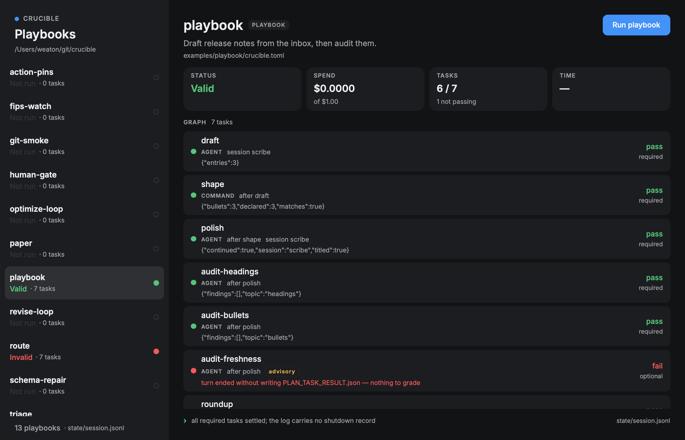

# crucible-playbooks

A native desktop tracker for Crucible playbooks, drawn with [Rune](https://github.com/anomalyco/rune).
It answers one question: what did each playbook do, and what is it doing now?

Two backends, picked with the switch under the title:

- **Controller** — the registered playbooks and their newest launch, read from the live controller
  through `crux`. This is the default.
- **Local** — every `examples/` pack whose manifest says `[workflow] type = "playbook"`, read from
  its own `state/session.jsonl`.



## The live controller

Live tracking shells out to `crux`, the controller's own CLI over its HTTP API. That means the app
reads exactly the config a terminal does: `CONTROLLER_URL`, `CONTROLLER_API_TOKEN`, then
`~/.config/crux/config.toml` (or `$XDG_CONFIG_HOME/crux`). No credential is copied, stored or
logged by the app; `crux` resolves it per call. `CRUX_BIN` points the app at another `crux`.

The account row at the bottom of the sidebar names the user `crux whoami` reports for that
credential (its tooltip adds the role and endpoint), so the list can be read against the principal
it came from.

The same sidebar narrows the launches: a search over name, status, creator, agent and origin; an
owner switch (`All` / `Just mine`, matched against the `whoami` user); an origin switch (`All` /
`Schedules` / `Drafts`); and a landing window (`All` / `1h` / `24h` / `7d`). Each row carries
the launch's status, its origin and how long ago it landed; the title's tooltip adds the launch key,
the run count and the landing stamp.

The list is each playbook's newest launch the filters keep, running first. Selecting a playbook
with one launch opens it. A playbook with more than one opens its runs page: the pass rate, spend
and last run, every launch as a dot on a time axis, twelve weeks of days coloured by how they
ended, and the full list. Picking a launch there pins it until it leaves the controller's
200-launch window; the breadcrumb goes back. The detail shows the launch's newest run (from
`crux playbook-run`): the launch status, spend against its cap, who launched it and why it stopped,
plus the task graph from `crux graph` with each task's latest status. Every fetch has a hard deadline; the live
worker fetches in the background, so a slow controller never stalls local log tracking.

Launching is not wired to the live list: a live launch needs the playbook's params schema and its
registered ceilings, so start those with `crux launch` and track them here.

It is its own Cargo workspace, like `crucible-desktop`, because Rune is pre-release and pinned to a
dev rev the engine workspace must not inherit.

## Run

```sh
cargo run
```

The **Local** backend lists every pack under `<repo>/examples` whose manifest says
`[workflow] type = "playbook"`. The search field filters those by name, goal, workflow or verdict.
Pick one to see its graph, each task's status, the spend against the plan's budget, and the last line
the run wrote. `Run playbook` starts
`crucible plan run --manifest … --max-cost … --max-time 10m` in that directory; the cost ceiling is
the pack's `[budget] usd`, or `1.0` when it has no `plan.toml`.

The repo is found by walking up from the working directory, or passed explicitly:

```sh
cargo run -- --repo /path/to/crucible
```

`CRUCIBLE_REPO` and `CRUCIBLE_BIN` do the same for the checkout and the engine binary. Without
`CRUCIBLE_BIN`, the app uses `target/debug/crucible`, then `target/release/crucible`, then `crucible`
on `PATH`.

## The run workspace

A run's views are panes: Tasks, Timeline, Graph, Pack, Launch and Log. Panes sit as tabs in groups,
groups stack in columns, and the gutters between them resize (double-click evens a pair). Drag a
tab onto another group's tab bar or middle to join it, or onto an edge to split that group. A pane
can be closed and reopened from the header.

Until a pane is moved, resized or closed, each run gets a fitted layout: the graph stacked over the
tasks, taller the deeper the graph, beside the log. Once arranged, the layout is saved to the app's
config and kept across runs; `Reset layout` goes back to the fitted one.

The Timeline places each task from its recorded duration, starting when its dependencies settle,
with a strip of how many ran at once and the critical path drawn solid.

## What the local backend tracks

`state/session.jsonl` is the record. The app folds `plan_admitted` into the graph, `task_result`
into per-task status and spend, `note` into the failure banner, and `shutdown` into the verdict. A run
started from a shell is picked up the same way, because a `state/playbook-run.json` with no
`shutdown` line means a run is live.

A log that predates the shutdown event still gets a verdict: if every required task has settled and
all of them passed, the run is shown as valid.

## Nothing blocks the window

Two worker threads, one per backend. The local worker owns discovery, log reads, `try_wait` and
spawning the engine; the live worker owns every `crux` call. Each publishes an immutable snapshot
into a shared slot and wakes the UI. `poll` takes whichever snapshot version moved and returns; no
frame ever waits on a disk, a child, a subprocess or the network. While a local run is live the
local worker republishes once a second so the elapsed time moves, and only when that second's text
actually changed.

Quitting the app does not kill a launch: the engine keeps running, and the tracker picks it up
again next time it opens.

Either list draws a persistent scroll thumb while its content overflows, so a list longer than the
window says so without waiting for a scroll.

## Check it without a window

Rune renders headlessly, so the layout is inspectable:

```sh
cargo run -- --scene local --snap /tmp/playbooks.png --size 1120x720
CRUCIBLE_LIVE_SCENE=<playbook id> cargo run -- --scene live --snap /tmp/live.png --at 200
CRUCIBLE_LIVE_SCENE=<playbook id> CRUCIBLE_TAB=pack cargo run -- --scene live --snap /tmp/pack.png --at 200
cargo run -- --scene local --chrome --snap /tmp/chrome.png   # draws the window buttons
cargo run -- --tree /tmp/playbooks.json --scene local
cargo test
```

The tests drive the real local worker. A stand-in `crucible` writes session-log events and exits,
and the test asserts the snapshots go from `Running` to `Valid` with the right spend; another stub
fails without a shutdown and the test asserts its stderr reaches the failure banner. A unit fixture turns a
`crux graph` payload into task rows.

## Limits

- Tracking and local launch only. No drafting, editing, or graph authoring.
- Playbook manifests only; scored loops are not listed.
- Live launches are started with `crux launch`; the local run ceiling is fixed at 10 minutes and
  its budget comes from the plan file.
- A local task that is in flight shows as `pending`, because the session log records terminal
  results, not dispatches. The same goes for the live graph.
- The local task list and the live graph are separate backends, not merged into one inventory.
