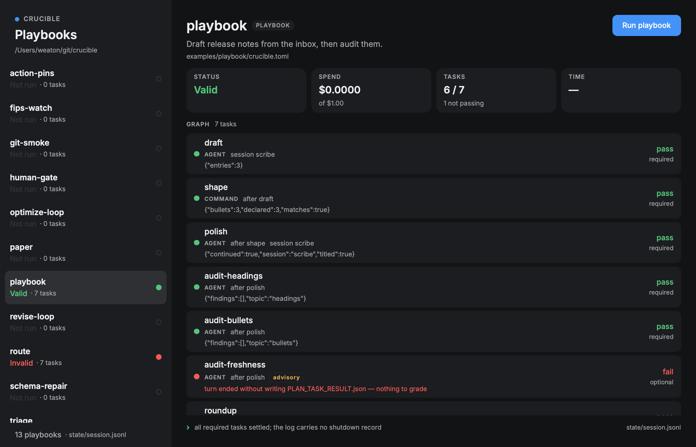

# Crucible Playbooks

The Crucible desktop app for macOS and Fedora: a native tracker for Crucible playbooks, drawn with
[Rune](https://github.com/anomalyco/rune). It answers one question: what did each playbook do, and
what is it doing now? It is its own Cargo workspace; `just desktop-check` formats, lints and tests
it, and the Desktop workflow runs the same on macOS and in a Fedora container.

```sh
just desktop-install   # builds Crucible Playbooks.app, crucible-lsp inside, into ~/Applications
```

Each release also carries `Crucible-Playbooks-<tag>-aarch64-apple-darwin.zip`. The app is signed ad
hoc, so macOS blocks a downloaded copy on first launch: allow it from System Settings, Privacy &
Security, Open Anyway, or run `xattr -d com.apple.quarantine "/Applications/Crucible Playbooks.app"`.

## Fedora

Each release also carries `crucible-playbooks-<version>-1.fc45.<arch>.rpm` for x86_64 and
aarch64; `sudo dnf install ./crucible-playbooks-*.rpm` installs the app, `crucible-lsp`, its desktop
entry and the link handler. It draws through Vulkan: a GPU's Mesa driver, or Mesa's software
renderer in a VM. Settings and profiles live in `~/.config/crucible-playbooks`, caches in
`~/.cache/crucible-playbooks`, and draft working copies in `~/.local/share/crucible-playbooks`.

```sh
just desktop-linux-check   # clippy and the tests on Fedora 45, in a podman container
just desktop-linux 0.6.0   # the RPM for this machine's architecture, into crucible-desktop/target/linux
just desktop-linux-vm      # installs that RPM in a Fedora 45 GNOME VM (Lima) and opens the app
```

The builder image is `crucible-desktop/linux/Containerfile`; Cargo's registry and target directory
persist in the `crucible-desktop-cargo` and `crucible-desktop-target` podman volumes. The VM is
`crucible-fedora`, from `crucible-desktop/linux/lima.yaml` (`brew install lima`): its first start
installs GNOME, which takes a while, and logs in on its own. Each `desktop-linux-vm` reinstalls the
newest RPM and restarts the app; `limactl shell crucible-fedora` gets a shell, `limactl stop
crucible-fedora` stops it.

On Fedora the Dock badge, menu bar item and folder drops do nothing. Links open through the
desktop entry: a second launch hands its link to the running app over the session bus.

Coming from the Tauri app (`Crucible.app`): with no profiles of its own, this app takes the ones in
`~/.config/crucible-desktop/config.toml`, the one it opened by default, and its `[drop]` ceilings.

Two backends, picked from the menu on the account row at the bottom of the sidebar:

- **Controller** — the registered playbooks and their newest launch, read from the live controller
  through `crux`. This is the default.
- **Local** — every `examples/` pack whose manifest says `[workflow] type = "playbook"`, read from
  its own `state/session.jsonl`.



## The live controller

The app talks to one controller at a time, its profile, through the `crux` client library. With no
profiles configured there is one, `default`, from crux's own resolution: `CONTROLLER_URL`, then
`~/.config/crux/config.toml`. Profiles live in `~/.config/crucible-playbooks/config.toml`, are
edited from Settings, and switch with ⌘⌥1 to ⌘⌥9 or the palette:

```toml
profile = "wdc"

[profiles.mpp]
url = "https://crucible-api.example.com"
auth = "crux"                          # the key in crux's config.toml

[profiles.wdc]
url = "https://crucible-api.wdc.example.com"
resolve = { "crucible-api.wdc.example.com" = "lb.example.net" }   # an IP, ip:port or a name

[profiles.jump]
url = "https://crucible-api.internal.example.com"
proxy = "socks5h://127.0.0.1:1080"     # http, https, socks5 or socks5h
tunnel = "ssh -N -D 1080 jumpbox"      # kept running while the app is
shell = "/bin/bash"                    # runs it as `<shell> -l -c`; `$SHELL` when unset

[profiles.local]
url = "http://127.0.0.1:8870"          # starts `just controller-local 8870` in the repo
```

A tunnel (or, for a loopback profile, the local controller) starts the first time its profile is
used, unless something already answers at its proxy or URL, and the profile waits until it does.
It runs under the app's own binary (`crucible-playbooks --keep`) as a supervisor, which kills the
tunnel's process group when the app's end of a pipe closes, so it stops with the app however the
app stops, crash included. A tunnel that stops after it has answered is started again, after 2s
and then twice as long each time up to a minute; one that never answered is left stopped, with
`Retry` on its profile in Settings. A profile that fails to read is shown with why in Settings and
left as written in the file. A `config.toml` that does not read as a whole is shown the same way,
and nothing is saved over it until it reads.

With no working credential, the sidebar offers `Sign in with browser`: the app opens the
controller's `/auth/native` page, you sign in and approve, and the controller hands the app a
90-day api key over a loopback redirect with PKCE. A profile keeps its key in
`~/.config/crucible-playbooks/profiles/<name>.toml` (owner-readable only), or in crux's
`config.toml` with `auth = "crux"`, so the `crux` CLI is signed in too. For a controller the
browser cannot reach, paste a `crk_` key instead. Keys can be revoked in the controller's Settings
like any other key.

Settings' `Keys in keychain` switch (`keychain = true` in the config) keeps those keys in the
system credential store instead: the macOS Keychain, or the Secret Service on Linux, under the
service `crucible-playbooks` and the profile's name. Turning it on or off moves the keys kept so
far. The app is ad-hoc signed, so macOS asks for the login password once per profile after each
new build. Removing a profile drops its key, and renaming one keeps it.

The account row at the bottom of the sidebar names the user `crux whoami` reports for that
credential (its tooltip adds the role and endpoint), so the list can be read against the principal
it came from.

The same sidebar narrows the launches: a search over name, status, creator, agent and origin; an
owner switch (`All` / `Just mine`, matched against the `whoami` user); an origin switch (`All` /
`Schedules` / `Drafts`); and a landing window (`All` / `1h` / `24h` / `7d`). The three switches
open from the button beside the search field, which is highlighted while any of them narrows the
list. Each row carries the launch's origin, its status unless it is done, and how long ago it
landed; the title's tooltip adds the launch key,
the run count and the landing stamp.

The list is each playbook's newest launch the filters keep, running first. Selecting a playbook
with one launch opens it. A playbook with more than one opens its runs page: the pass rate, spend
and last run, every launch as a dot on a time axis that runs from the first launch to the last,
up to twelve weeks of days coloured by the share of launches that failed, and the full list,
which says why a launch failed when the controller gave a reason. Times and days are local. Picking a launch there pins it until it leaves the controller's
200-launch window; the breadcrumb goes back. The detail shows the launch's newest run (from
`crux playbook-run`): the launch status, spend against its cap, who launched it and why it stopped,
plus the task graph from `crux graph` with each task's latest status. Every fetch has a hard deadline; the live
worker fetches in the background, so a slow controller never stalls local log tracking.

A registered playbook has a Launch button on its runs page and run header. It opens a form built
from the playbook's params schema (`crux playbook-schema`), prefilled from the launch on screen,
with cost and time ceilings held under the admin caps (`crux playbook-caps`). The controller
validates the params; a refusal shows in the form. A launch that lands opens, pinned, and streams.
The form also picks the dispatch target (from the ones the controller offers you, default first),
the agent's provider and its model, starting from where the launch on screen ran. A rerun carries
them too, so it runs where the run it repeats did.

It is its own Cargo workspace, like `crucible-desktop`, because Rune is pre-release and pinned to a
dev rev the engine workspace must not inherit.

## Run

```sh
just desktop-run       # or `cargo run` here, after rune-patches.sh
```

The **Local** backend lists every pack under `<repo>/examples` whose manifest says
`[workflow] type = "playbook"`. The search field filters those by name, goal, workflow or verdict.
Pick one to see its graph, each task's status, the spend against the plan's budget, and the last line
the run wrote. `Run playbook` starts
`crucible plan run --manifest … --max-cost … --max-time 10m` in that directory; the cost ceiling is
the pack's `[budget] usd`, or `1.0` when it has no `plan.toml`.

The repo is found by walking up from the working directory, or passed explicitly:

```sh
cargo run -- --repo /path/to/crucible
```

`CRUCIBLE_REPO` and `CRUCIBLE_BIN` do the same for the checkout and the engine binary. Without
`CRUCIBLE_BIN`, the app uses `target/debug/crucible`, then `target/release/crucible`, then `crucible`
on `PATH`.

## The run workspace

A run's views are panes: Tasks, Timeline, Graph, Data, Files, Transcript, Compare, Pack, Launch
and Log. Panes sit as tabs in groups,
groups stack in columns, and the gutters between them resize (double-click evens a pair). Drag a
tab onto another group's tab bar or middle to join it, or onto an edge to split that group. A pane
can be closed and reopened from the header.

Until a pane is moved, resized or closed, each run gets a fitted layout: the graph stacked over the
tasks, taller the deeper the graph, beside the log. Once arranged, the layout is saved to the app's
config and kept across runs; `Reset layout` goes back to the fitted one.

The Timeline draws each task and fan-out instance when it ran, and each round of a revise loop
on its task's own track, from the `at` stamps on its session events, with a strip of how many ran at once and the critical path drawn solid. A log
from before those stamps is placed from each task's duration, starting when its dependencies
settle.

## The Pack pane

The Pack pane shows a pack's files, highlighted, with `crucible-lsp`'s diagnostics: underlined in
the source, coloured in the gutter (hover a line number for the message), as a dot on each file,
and as a list under the file. The app runs `crucible-lsp` as a child process: `$CRUCIBLE_LSP`, the
copy `just desktop-install` bundles beside the executable, or the first on `PATH`. A controller's
pack is copied to `~/Library/Caches/crucible-playbooks/packs` so the server can read it.

Files are edited elsewhere. The edit button, and each listed problem, open the file in VS Code,
Cursor or Zed at the line (Settings picks the editor, else `$VISUAL`/`$EDITOR` or the first one
installed). A local pack opens by deep link; a controller's file opens as an unsaved buffer over
the editor's stdin. The copy button copies the file's path, to hand to an agent. Saving a local
pack re-reads it and re-checks it. A registered pack's files also link to their lines on the Git
host, at the commit the playbook is pinned to.

## The Files pane

The Files pane lists the files a controller run's tasks captured (their `emits_files`), by task,
with sizes, and shows one: markdown rendered (or its source), a patch in a diff view, JSON and
JSON Lines indented and highlighted, anything else as highlighted text. A shown file is copied to
`~/Library/Caches/crucible-playbooks/run-files/<run>/<key>`; the copy button copies that path and
the edit button opens it in the editor. A file over 8 MiB is not fetched; the pane gives the
`crux run-file` command instead.

## Fix and rerun

`Edit` on a draft run's pack, or `Draft` on a registered one, pulls the draft into a working copy
under `~/Library/Application Support/crucible-playbooks/drafts` (on Fedora,
`~/.local/share/crucible-playbooks/drafts`; `$CRUCIBLE_DRAFTS_DIR`
overrides it). A registered playbook's draft is `<playbook>-<user>`, created from the playbook
the first time. The Pack tab then switches between the run's pack and the working copy, which
opens in the editor, is checked by `crucible-lsp`, and is re-read once a second. `Save` sends it
as the draft's next version, refused when someone saved since; `Pull` replaces it with the
newest save; `Launch` launches the draft.

A finished run that did not pass has a `Rerun` button, and each settled task a `Rerun from here`.
Both open the launch form with the run's params, the controller's preview of which tasks are
reused and which run again, and the ceilings. A task changed since the run cannot be reused;
`Rerun those too` adds it. The controller reruns a run only as the same playbook or draft it ran
as, so a registered run's fix goes out as a fresh draft launch.

## Fix with agent

A failed run, and each failed task in it, has `Fix with agent`. It copies a brief for a coding
agent and writes the same text under `~/Library/Caches/crucible-playbooks/handoff`
(`$CRUCIBLE_HANDOFF_DIR` overrides it): what failed, the task's last log lines, crucible-lsp's
problems, the draft and the folder to work in, and the `crux` commands that save a fix and rerun
from the failure, reusing what passed. A registered playbook's brief drafts from it and launches
fresh, since the controller reruns a run only as what it ran as. Paste it into an agent, or
`claude "$(cat <brief>)"`.

## Draft with an agent

Setting up the gateway, provider and image: [Drafting with a local agent](../docs/desktop-agent-local.md).

`Agent` on a draft's working copy opens the Agent pane, which docks, splits and resizes like
any other pane (also `cmd+9`): a prompt, and each turn the agent takes, drawn as the Transcript
pane draws one, with every tool call's input and result a click away. The first prompt starts a
session: a sandbox on the local OpenShell gateway (0.1.5 or newer, the one the `openshell` CLI
has active), reached over its gRPC API, with the harness run in it once per prompt.

The agent works as the signed-in user and the team acted as. It pulls the draft into its working
directory with `crux`, edits the files with crucible-lsp checking the Starlark and the docs in
the image to read, pushes the directory back as the next version, and previews, launches and
watches through `crux` or the controller's MCP tools. Both reach the controller through a relay on a loopback port that only
the session's token opens, so the profile's key stays out of the sandbox. A save by the agent
pulls the working copy, and a launch by the agent moves the window to that launch once the
controller lists it.

A prompt sent while the agent works waits for the turn to end; `Send now` on it stops the turn
and runs it at once, and `Drop` discards it. `Stop` ends the turn. `Reset` starts over in a new
sandbox, which is also what the next prompt does once a sandbox has stopped answering. `End`
deletes the sandbox, and one that outlives the app is deleted by the next session.

The harness is `[agent]` in the config file, read when the app starts. With none, it is Claude
Code in `localhost/crucible-agent` (`just desktop-agent-image`, which also builds `crux` and
`crucible-lsp` into it and copies `docs/` and the `draft-a-playbook` skill under
`/usr/local/share/crucible-agent`) with the `claude-sub` provider, on `claude-opus-5-5` unless
`model` says otherwise:

```toml
[agent]
image = "localhost/my-agent"            # runs as a non-root user that owns its working directory
providers = ["openrouter"]              # OpenShell providers holding the harness's credentials
model = "glm-5-3"
format = "opencode"                     # how stdout reads: claude, codex, opencode, pi or text
command = ["my-agent", "--mcp", "{mcp_url}", "--mcp-token", "{mcp_token}", "-m", "{model}", "{prompt}"]
binaries = ["/usr/local/bin/my-agent", "/usr/local/bin/crux"]   # what may reach the relay
env = { MY_AGENT_BASE_URL = "https://models.example.com" }     # set for the harness
```

A harness also finds the relay in its environment: `CONTROLLER_URL` and `CONTROLLER_API_TOKEN`,
which `crux` reads, and `CRUCIBLE_MCP_URL` and `CRUCIBLE_MCP_TOKEN`.

## Links

The app opens `crucible-playbooks://` links, so a run can be handed to someone, or to an agent,
as a link:

```text
crucible-playbooks://playbook/<id>
crucible-playbooks://playbook/<id>/launch/<launch key>[?task=<task>]
crucible-playbooks://local/<pack>
```

A launch link opens that launch pinned, with the task open in the Tasks pane. The copy button in
the run header copies the link to the run on screen, and an open task card's `Copy link` copies
one to that task. The bundle `just desktop-install` builds, and the RPM's desktop entry, declare
the scheme; `open '<link>'` (`xdg-open` on Fedora) or a click anywhere opens the app on it.

It also opens the controller's web links, as the Tauri app did: `crucible://<profile>/<web path>`,
and `crucible://open?url=<web url>` for the profile on that URL's origin. The path lands on the
matching view: a launch, a playbook, a decision, Approvals, Schedules or Secrets.

Dropping a pack folder on the Dock icon, or opening one with the app from Finder, pushes it as the
next version of the draft named after the folder (created on first drop), test-fires it on the
profile in use under the ceilings in Settings ($1 and 30m unless set), and opens the launch. The
test-fire goes to the cluster the draft's newest run went to, with the same provider and model. A
draft that has never run opens its launch form instead.

## The Dock and the menu bar

The menu bar item lists the launches running on every profile, with spend, elapsed time and budget
used; picking one opens it, switching profile if it runs on another. Pin a launch under "Budget on
Dock" to draw its budget used (the larger of spend over its cost cap and time over its time cap)
as a bar on the Dock icon; it is announced when it finishes. The Dock badge counts the decisions,
scope packs and pack imports waiting across profiles, and a growing approval count raises a
notification. Profiles other than the one in use are read once a minute; their tunnels are not
started for it.

Cmd-[ and Cmd-] step back and forward through what the window showed; Cmd-R reads everything again.

## What the local backend tracks

`state/session.jsonl` is the record. The app folds `plan_admitted` into the graph, `task_result`
into per-task status and spend, `note` into the failure banner, and `shutdown` into the verdict. A run
started from a shell is picked up the same way, because a `state/playbook-run.json` with no
`shutdown` line means a run is live.

A log that predates the shutdown event still gets a verdict: if every required task has settled and
all of them passed, the run is shown as valid.

## Nothing blocks the window

The local worker owns discovery, log reads, `try_wait` and spawning the engine. Everything that
talks to a controller shares one tokio runtime, one response cache and one connection per profile
(`src/net.rs`), and runs as tasks on it: the live, admin, finder and fleet loops, each session
stream, and the reader of a draft's working copy. A launch, a save, a launch form's reads and a
file fetch each run as a task of their own, so none waits behind a slow poll, and reads that do
not depend on each other go out together. Anything that blocks (the response cache's queries,
opening a connection, reading and compiling a working copy) runs on the runtime's blocking pool.
Each publishes into a shared snapshot and wakes the UI. `poll` takes whichever snapshot version
moved and returns; no frame waits on a disk read of a pack, a child, a subprocess or the network.
A task ends when the handle the window holds for it is dropped.

What the window holds for the profile in use is one value (`src/remote.rs`), replaced whole when
the profile changes. While a local run is live the
local worker republishes once a second so the elapsed time moves, and only when that second's text
actually changed.

Quitting the app does not kill a launch: the engine keeps running, and the tracker picks it up
again next time it opens.

Either list draws a persistent scroll thumb while its content overflows, so a list longer than the
window says so without waiting for a scroll.

## Check it without a window

Rune renders headlessly, so the layout is inspectable:

```sh
cargo run -- --scene local --snap /tmp/playbooks.png --size 1120x720
CRUCIBLE_PICK=<task> CRUCIBLE_TAB=tasks cargo run -- --scene local --snap /tmp/task.png   # that task's card open
CRUCIBLE_LIVE_SCENE=<playbook id> cargo run -- --scene live --snap /tmp/live.png --at 200
CRUCIBLE_LIVE_SCENE=<playbook id> CRUCIBLE_TAB=pack cargo run -- --scene live --snap /tmp/pack.png --at 200
CRUCIBLE_LINK='crucible-playbooks://playbook/<id>/launch/<launch key>' CRUCIBLE_TAB=files \
  CRUCIBLE_FILE=report/summary.md cargo run -- --scene live --snap /tmp/files.png --at 200
cargo run -- --scene local --chrome --snap /tmp/chrome.png   # draws the window buttons
cargo run -- --tree /tmp/playbooks.json --scene local
cargo test
```

The tests drive the real local worker. A stand-in `crucible` writes session-log events and exits,
and the test asserts the snapshots go from `Running` to `Valid` with the right spend; another stub
fails without a shutdown and the test asserts its stderr reaches the failure banner. A unit fixture turns a
`crux graph` payload into task rows.

## Limits

- Packs are edited in the user's editor, not in the app. No graph authoring.
- Playbook manifests only; scored loops are not listed.
- Live launches are started with `crux launch`; the local run ceiling is fixed at 10 minutes and
  its budget comes from the plan file.
- A task shows as running from the engine's `task_started` line. A run on a spoke cluster streams
  its session through its pod's log, so a line too long to echo there arrives when the run ends.
- The local task list and the live graph are separate backends, not merged into one inventory.
