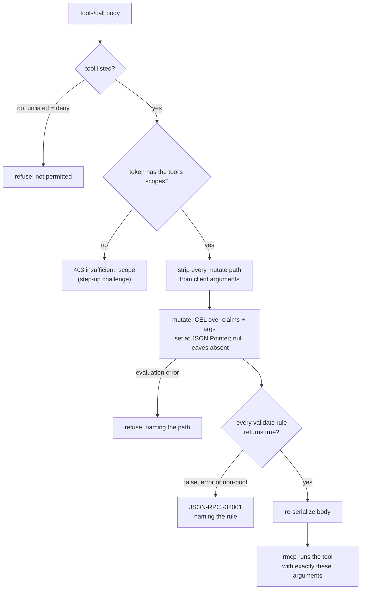
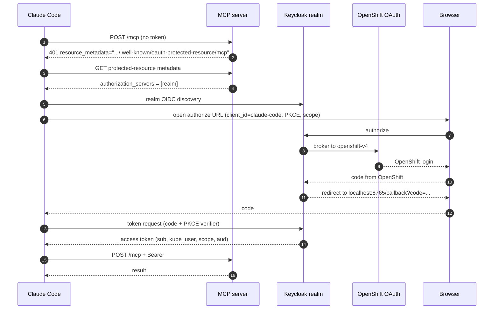
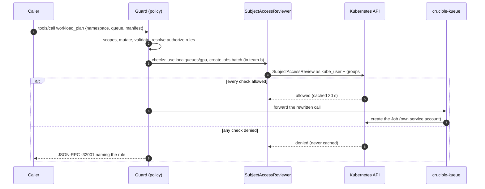

# crucible-mcp-auth

OAuth resource-server support for crucible's MCP servers. Sandboxed agents and people reach
crucible-kueue and buildit with short-lived access tokens that name both the human and the
sandbox. Each server validates them, publishes RFC 9728 metadata, and enforces a per-tool CEL
policy over the token's claims. Agents never hold a credential.

Status (2026-10-08):

- **Proven on an OpenShift cluster.** SPIRE issues each OpenShell supervisor a SPIFFE ID. Keycloak exchanges that
  JWT-SVID, sent exactly as OpenShell's provider `token_grant` sends it, for a 5-minute token with
  `sub` = the launcher and `act.sub` = the sandbox. crucible-kueue accepts it, refuses a
  policy-violating call by rule name, and stamps the launcher on the Job it creates.
- **Built.** This crate, hooked into crucible-kueue and buildit (vendored into this workspace).
- **Decided and built.** No per-run Keycloak clients and no dynamic client registration. Agent
  tokens come from a token endpoint in the crucible controller, proven with a real SVID;
  Keycloak stays for human logins.
- **Built and proven on a cluster.** Kubernetes RBAC decides tool access through SubjectAccessReview:
  a person acts as themselves, a run as its launcher. One crucible-kueue deployment serves agents,
  tenant tokens and people, and hosts can embed it.
- **Proven with a person.** From a terminal Claude Code, a person logged in through OpenShift,
  and the person-facing crucible-kueue behind its Route checked each call against their RBAC. It planned and ran a Job that printed `hello from kueue smoketest`.
- **Open.** Sandboxes do not fetch tokens until the gateway wiring lands.

A deployment needs SPIRE (with an OIDC discovery provider), a Keycloak realm with the
`claude-code` client, the controller's agent token endpoint, and each MCP server's flags; the
sections below describe each piece. Concrete manifests stay with the cluster that runs them.

## Goals

The design follows the MCP 2026-07-28 authorization model: every MCP server is an OAuth resource
server, and a token is good only for the server it names.

1. Servers publish RFC 9728 metadata, validate audience, answer 401/403 with the standard
   challenges, and never pass a client's token through to another service.
2. Agents never hold credentials. The OpenShell supervisor fetches tokens and injects the bearer
   only on egress to the bound endpoint; a failed fetch denies the request.
3. One token model for every MCP server, on any cluster that trusts the issuer.
4. A token says who launched the run (`sub`) and which sandbox presents it (`act.sub`), in RFC 8693
   form.
5. Servers validate tool arguments against claims and inject server-owned values the client cannot
   override.
6. People use the same servers through Claude Code, with a pre-registered public client and PKCE.
   Claude Code has no `client_credentials`, which is why people and agents take different routes to
   the same kind of token.

## Architecture

Two issuers mint the same shape of token: the crucible controller for agents, Keycloak for people.
Every MCP server trusts both and runs this crate.


| Component | Role | Where |
| --- | --- | --- |
| SPIRE (Zero Trust Workload Identity Manager) | Issues JWT-SVIDs to supervisor pods: `spiffe://<trust domain>/openshell/sandbox/<sandbox-id>` | `zero-trust-workload-identity-manager` |
| OpenShell supervisor | Fetches the SVID, performs the token grant, injects the bearer on egress | per sandbox, the sandbox namespace |
| Controller token endpoint | Agent issuer: verifies the SVID, maps sandbox to run, mints the token | crucible controller |
| Keycloak realm `crucible` | Human issuer; also the issuer in the proven spike | its own namespace |
| `crucible-mcp-auth` | Token validation, RFC 9728 metadata, tool policy | library in each MCP server |
| crucible-kueue | Kueue workloads in the caller's namespace and queues | `crucible-system` |
| buildit | Image builds from the sandbox workspace | loop pod |

## Sandbox identity

A sandbox proves who it is with a SPIRE JWT-SVID that only its supervisor can fetch. The supervisor
trades it for an access token on the first MCP call and caches the token until shortly before it
expires.


**SPIFFE IDs.** A `ClusterSPIFFEID` selects supervisor pods in the profile's
`[cluster] sandbox_namespace` by `openshell.ai/boundary-role=supervisor` and builds the ID from the
annotation `openshell.ai/sandbox-id` (`.ai`, not upstream's `.io`). Nothing renders it: applying it
is an operator step, alongside installing SPIRE. Its `namespaceSelector` must name the sandbox
namespace and nothing else, since any pod it selects can claim a sandbox's identity:

```yaml
apiVersion: spire.spiffe.io/v1alpha1
kind: ClusterSPIFFEID
metadata:
  name: openshell-sandbox-supervisor
spec:
  spiffeIDTemplate: 'spiffe://{{ .TrustDomain }}/openshell/sandbox/{{ index .PodMeta.Annotations "openshell.ai/sandbox-id" }}'
  namespaceSelector:
    matchLabels:
      kubernetes.io/metadata.name: <sandbox_namespace>
  podSelector:
    matchLabels:
      openshell.ai/boundary-role: supervisor
  jwtTtl: 5m
```

The CSI driver mounts the Workload API socket; the sandbox SCC already allows `csi` volumes.

**The token request.** OpenShell's `token_grant` sends `client_credentials` with the SVID as a
`jwt-bearer` client assertion and no `client_id`. The SVID's audience defaults to the issuer URL
derived from the token endpoint; `jwt_svid_audience` overrides it when the endpoint is an in-cluster
Service. Pod networks often cannot resolve the cluster's external Route hosts, so use in-cluster
Service URLs.

**What is proven: Keycloak.** Keycloak 26.6 `federated-jwt` accepts this request unchanged. The
assertion's `iss` selects an identity provider and its `sub` selects the client whose
`jwt.credential.sub` matches exactly. The assertion's `aud` must be exactly the realm issuer, and
because SVIDs carry no `jti` the provider sets `supportsClientAssertionReuse`. A tampered SVID gets
`invalid_client`.

**The controller token endpoint.** Exact subject matching means one Keycloak client per sandbox,
created and deleted by the controller. That is too much moving state, so the controller answers the
same request itself:

1. Verify the SVID against SPIRE's keys: one audience, the controller issuer; subject under the
   sandbox trust-domain path.
2. Map the sandbox ID to its run. The engine binds the ID, with the sandbox name and workdir, after
   `create_sandbox`, authenticated by its run pod's own token; a sandbox bound by another pod is
   refused, and so is one whose run pod is no longer running.
3. Mint an ES256 token for the requested audience, if allowlisted, with the run's claims. Expiry is
   5 minutes; keys are published at `/.well-known/jwks.json`.

Revocation is collecting the run: the endpoint stops minting and outstanding tokens expire within
5 minutes.

## Token shape

A token answers three questions: on whose behalf (`sub`), presented by whom (`act.sub`), and for
which server (`aud`). Servers read only claims, so agent and person tokens differ only in `act` and
the run claims.

| Claim | Agent token | Person token | Used for |
| --- | --- | --- | --- |
| `iss` | controller issuer (the realm in the spike) | Keycloak realm | which keys verify it |
| `sub` | the launcher's login | the person's realm user ID | `crucible.dev/launched-by`, policy |
| `act.sub` | `spiffe://<trust domain>/openshell/sandbox/<id>` | absent | audit, `crucible.dev/actor` |
| `aud` | the MCP servers the run may call | the servers the requested scopes name | one must be this server |
| `scope` | `kueue.read kueue.submit buildit.read buildit.build` | what Claude Code requested | per-tool checks |
| `run_id` | run pod name | absent; the subject owns its workloads | ownership labels |
| `namespace`, `role`, `queues` | from the run's grant | admin-only user attributes today | crucible-kueue scope |
| `sandbox`, `workdir` | OpenShell sandbox name and workspace | absent | buildit's caller |
| `exp` | 5 minutes | realm default | |

**Scopes carry audiences.** `kueue.read` and `kueue.submit` each add crucible-kueue's URLs to
`aud`; the buildit scopes add buildit's. Requesting a scope is what binds a token to a server, so a
crucible-kueue token is rejected by buildit despite a valid signature.

**Canonical resource URLs** are the URLs clients use:
`http://crucible-kueue.crucible-system.svc.cluster.local:8850/mcp` for sandboxes,
`http://host.openshell.internal:8849/mcp` for buildit in the loop pod, and `localhost` URLs for local
development.

## Resource server

An axum layer in front of rmcp's Streamable HTTP service. rmcp 3.5 has no server-side auth, so
validation, challenges and metadata live here. Handlers get a typed `Principal` through the request
extensions rmcp already forwards.

```rust
let issuers = vec![TrustedIssuer::runs("<issuer>=<jwks uri>")?];
let server = Arc::new(ResourceServer::new(
    ResourceServerConfig { issuers, resources, required_scopes, scopes_supported, resource_name },
    &JwksTls::default(),
)?);
let guard = PolicyGuard { policy, server: Some(server.clone()), reviewer: None };
let mcp = Router::new()
    .fallback_service(streamable_http_service)
    .layer(from_fn_with_state(Arc::new(guard), guard::enforce))
    .layer(from_fn_with_state(server.clone(), server::require_bearer));
let app = Router::new().nest_service("/mcp", mcp).merge(metadata::router(server));
```

Servers that also accept another credential (crucible-kueue's tenant tokens, buildit's tokens file)
write their own authentication middleware around `ResourceServer::authenticate` and `challenge`.

**Validation** (`jsonwebtoken` 11 on aws-lc):

- `iss` equals a configured issuer; `aud` names one of the server's canonical URLs. Each issuer
  is configured for runs or for people, and that, not the token's claims, decides which kind of
  caller a token is (`Principal::callers`).
- `exp`, `iss`, `aud`, `sub` required; `nbf` checked; 30 seconds of clock skew.
- Only RS, PS, ES and EdDSA. HS and `none` are refused before key lookup, so a public key can never
  be used as a shared secret.
- A key that declares `alg` refuses tokens signed with any other algorithm.
- Server-wide required scopes are checked after the signature.

**Key cache.** Keys are cached by `kid` for 10 minutes. Fetches, failed or not, happen at most once
per 30 seconds, so made-up kids or a failing issuer cannot turn requests into fetches. During an
issuer outage cached keys keep working and new ones fail closed. A key set over 256 KiB is refused.

**Key transport.** Whoever answers the JWKS fetch can mint accepted tokens, so `ResourceServer::new`
refuses a plain-http JWKS URI unless its host is loopback or `JwksTls::insecure_http` is set.
`JwksTls::ca_bundle` adds a PEM bundle of CAs (an in-cluster service CA) to the platform roots.

**Challenges** (MCP 2026-07-28, RFC 6750):

| Case | Status | `WWW-Authenticate` |
| --- | --- | --- |
| no bearer token | 401 | `Bearer resource_metadata="...", scope="..."` |
| bad signature, issuer, audience or expiry | 401 | `Bearer error="invalid_token", error_description="the access token is invalid or expired", resource_metadata="..."` |
| valid but missing a scope | 403 | `Bearer error="insufficient_scope", scope="<missing>"` |

**RFC 9728 metadata** is served at `/.well-known/oauth-protected-resource` and at the path-inserted
`/.well-known/oauth-protected-resource/mcp` that the challenge names. The resource is chosen from the
configured list by `Host` and never copied from it.

**Principal.** `subject` (`sub`), `actor_chain` (`act`, flattened, at most 8 deep), `client_id`
(`azp`), `namespace`, `scopes`, `callers` (from the issuer), and every claim for policy rules.
`presenter()` is the party holding the token: the first actor, else the subject.

Challenges and refusal bodies carry fixed descriptions; why a token failed goes only to the log.

## Tool policy

A TOML file decides, per tool, which scopes a call needs, which argument paths the server owns, and
which CEL rules the arguments must pass. It runs before rmcp sees the call; anything other than a
`true` rule refuses it and names the rule.



On `tools/list`, mutate paths are removed from each tool's `inputSchema` (the property and its
`required` entry), for JSON and SSE responses alike.

The CEL engine is the `cel` crate 0.15, one workspace pin shared with the controller's webhook
transforms. JSON integers reach CEL as `int`, so `args.replicas <= 8` compares like with like. The
policy loads at startup; a rule that does not compile stops the server.

From crucible-kueue's shipped policy:

```toml
[tools.workload_plan]
scopes = ["kueue.submit"]

# Plan and submit inject the same value, so the plan hash still matches.
[[tools.workload_plan.mutate]]
path = "/manifest/metadata/annotations/crucible.dev~1actor"
value = "has(claims.act) ? claims.act.sub : null"

[[tools.workload_plan.validate]]
name = "queue-allowed"
rule = "!has(claims.queues) || size(claims.queues) == 0 || args.queue in claims.queues"
message = "the queue is not in this run's allowlist"
```

## Servers

Both servers accept a realm token or their older credential side by side, told apart by shape (a
compact JWT is never looked up as a static token), and log `auth=oidc` or the other source. Older
credentials get an equivalent `Principal` so one policy covers both.

| | crucible-kueue | buildit |
| --- | --- | --- |
| Older credential | tenant tokens (static file, controller-written records) | tokens file, one line per sandbox |
| Caller from a realm token | `namespace`, `role`, `queues`; `run_id`, else the subject | `sandbox`, optional `workdir`; refused without a sandbox |
| Launcher stamp | label `crucible.dev/launched-by` on workloads, server-owned | same label on builder pods |
| Actor stamp | annotation `crucible.dev/actor` (the token's presenter), set by the server | none |
| Tasks extension | `tasks/get` needs RBAC `get` on the workload, `tasks/cancel` `update` plus `kueue.submit` | `tasks/cancel` needs `buildit.build`; a reader's poll never publishes a run's files |
| Shipped policy | [kueue-policy.toml](../crucible-kueue/deploy/kueue-policy.toml): read and submit scopes, queue allowlist, replica cap | [deploy/buildit-policy.toml](../buildit/deploy/buildit-policy.toml): read and build scopes, build and run timeout caps |
| Flags | `--run-issuer` and `--person-issuer <issuer>=<jwks uri>` (repeatable), `--resource`, `--tool-policy`, `--jwks-ca`, `--insecure-jwks-http` | `--run-issuer` only (no people), the rest the same; the tokens file becomes optional |

With any issuer the policy is required; a server with only its older credential runs with
`ToolPolicy::allow_all()`. Policies list protocol methods as well as tools: `initialize`, `ping`,
`server/discover`, notifications and `tools/list` always pass, `tools/call` goes through the tool
rules, and any other method needs a `[methods."<method>"]` entry with its scopes or is refused.

A unit test in each server fails if a tool is missing from its shipped policy, so a new tool
cannot ship silently denied.

## People: Claude Code

People log in through OpenShift into the realm with the pre-registered public client
`claude-code` (auth code, PKCE S256, callback `http://localhost:8765/callback`).



```bash
claude mcp add --transport http kueue https://<kueue host>/mcp --client-id claude-code --callback-port 8765
```

Claude Code follows the 401 to the protected-resource metadata, finds the realm's discovery
document, and requests the scope the challenge names. `claude-code` grants `kueue.read` and
`kueue.submit` by default, since Claude Code neither takes an OAuth scope flag nor steps up on a
403. It sends the RFC 8707 `resource` and `prompt=consent`. When the cluster's ingress uses a
private CA, start Claude Code with `NODE_EXTRA_CA_CERTS` pointing at it.

The person-facing server is a crucible-kueue with only the realm as `--person-issuer`, the shipped policy,
`--kube-authz openshift`, and a Route. Its service account needs `create` on
`subjectaccessreviews`, `list` on `groups.user.openshift.io`, and the workload verbs in each
namespace that holds a LocalQueue. No realm attributes are needed: RBAC on the person decides.
`claude-code` grants both kueue scopes by default. Only the OpenShift login creates users, and it
re-syncs usernames, so `kube_user` can be trusted.

A person's token carries `kube_user` (their OpenShift username) and comes from a people issuer, so
crucible-kueue treats it as a person: no pinned namespace, and every call checked by RBAC as that
user. A people issuer's token that carries `run_id` is refused.

## Kubernetes authorization

Kubernetes RBAC decides what a caller may touch. Policy `authorize` rules turn a tool call into
SubjectAccessReviews; the server asks the API server, then acts with its own service account.



```toml
[[tools.workload_plan.authorize]]
name = "queue-use"
when = "has(claims.kube_user)"          # people, and runs acting as their launcher
group = "'kueue.x-k8s.io'"
resource = "'localqueues'"
verb = "'use'"
namespace = "has(args.namespace) ? args.namespace : (has(claims.namespace) ? claims.namespace : '')"
object = "args.queue"
message = "you may not submit to this queue"
```

```yaml
# Granting a person or group a queue is ordinary RBAC; `use` is a verb only the policy asks about.
- apiGroups: [kueue.x-k8s.io]
  resources: [localqueues]
  resourceNames: [crucible-e2e]
  verbs: [use]
```

**Who is asked about.** `kube_user` names the Kubernetes user; a `system:` identity is refused, so
no token can stand in for a node or the cluster. Groups come from OpenShift `Group` objects (cached
a minute) or a `kube_groups` claim with `system:` groups dropped; `system:authenticated` is always
added. People get `kube_user` from their username, which only the OpenShift login sets
(registration and username edits off, re-synced on every login, first-login review off). Runs get
their launcher's username from the controller, so a run can only use queues its human could.

**Which namespace.** Every crucible-kueue tool takes an optional `namespace`. Runs and tenant tokens
are pinned to theirs, and naming another is refused. A person names any namespace, with an
optional default from a claim, and the authorize rules decide. Task ids carry the namespace.

**One deployment.** A single crucible-kueue serves all three callers:

| Caller | Token | Identity | Decided by |
| --- | --- | --- | --- |
| Sandboxed agent | controller-issued, `run_id` + `act.sub` | pinned to the run's namespace and queues | the run's grant, then RBAC as the launcher |
| Older run | tenant token | pinned to its record | the record |
| Person (Claude Code) | Keycloak, `kube_user` | any namespace they name | RBAC as themselves |

People's tokens are accepted only when the server has a reviewer (`--kube-authz openshift|token`)
and a policy with authorize rules, so a misconfiguration cannot let a person act unchecked. The
shipped policy checks every tool but `whoami`, and a unit test fails if a new tool goes unchecked.

**Embedding.** `crucible_kueue::router(client, Options { registry, oidc, policy, reviewer,
allowed_hosts })` builds the whole app, so a host such as the controller can mount it next to its
own routes with the same issuers and reviewer.

**Service account.** It gains `create` on `subjectaccessreviews` and `list` on
`groups.user.openshift.io`. Its workload verbs are still granted per namespace by RoleBinding; a
namespace people use needs that binding too. Quotas and admission webhooks still see the service
account, and crucible-kueue's manifest checks and Kueue quotas keep covering that.

## What this policy model enables

Every tool call now passes one enforcement point that knows who launched the run, which sandbox
is acting, what it is asking to do with which arguments, and what Kubernetes lets that person do.
That point sits outside agent code, so nothing an agent does can skip it. Policy is data: a TOML
file today, reviewable in a pull request, with rules that name themselves in every refusal.

**Wins available with what is built:**

- **Delegation that cannot exceed the human.** A run's reach is its grant intersected with its
  launcher's RBAC. Once run tokens carry `kube_user`, revoking someone's RoleBinding cuts off their
  running agents within 30 seconds (the allow cache).
- **Queues and namespaces as ordinary RBAC.** Platform teams grant GPU queues with RoleBindings and
  Groups they already manage. No second permission system lives in Keycloak or crucible.
- **Server-owned arguments.** Mutate rules inject facts the client cannot forge: who launched it,
  which sandbox acted, which namespace. Every workload carries provenance an admission policy or a
  cost report can key on.
- **Guardrails without code changes.** Replica caps, build timeouts, allowed kinds, and image or
  registry allowlists are CEL rules. They change by editing the policy and restarting, not by a
  server release.
- **One policy surface for every MCP server.** buildit, crucible-kueue and future servers share
  scopes, claims and rule semantics, so a rule written once ("runs never touch kube-system") holds
  everywhere it is listed.
- **Audit by construction.** Every decision logs the subject, the presenter, the tool and the rule
  that decided it; a refused call names the rule to the agent, which can correct itself.

**Next: decisions in Cedar.** The controller already authorizes with Cedar (`cedar-policy` 4.12):
`UserPrincipal`, `TeamPrincipal` and `RunPrincipal` over owned, shared resources. A tool call maps
onto the same model: principal = the run (with its launcher) or the person, action =
`Mcp::Action::"kueue:workload_submit"`, resource = the queue or workload, context = the arguments
and claims. Moving the CEL `validate` rules into a Cedar `Mcp::` namespace gives schema-checked
policies, forbid-overrides, and one language for controller and MCP decisions. Scopes, mutate and
SubjectAccessReview stay: Cedar decides what a run may do, RBAC decides whether its human may use
the queue at all. `cedar-policy-mcp-schema-generator` turns an MCP tool manifest into the Cedar
action schema.

**Later: rules over history with Dogwood.** [Dogwood](https://github.com/dogwood-policy/dogwood)
(AWS, Apache-2.0, released August 2026) embeds Cedar (every Cedar policy is a Dogwood policy) and
adds rules over a session's history: `formerly within`, `since`, `count` and `sum` over windows.
The session here is the run, which the token's `run_id` fixes, so a client cannot pick its own
session. Rules that become expressible:

| Rule | Needs |
| --- | --- |
| Submit only a plan this run made in the last 30 minutes (today a client can compute `plan_hash` and skip `workload_plan`) | plan responses |
| A run's GPU-hours stay under a budget across all its submissions | submit requests; completions from Kueue |
| Scaling past N replicas needs a human approval recorded in the last hour | controller approval events |
| No more than 20 builds per sandbox per hour | build requests |
| No resume after three stops of the same workload within 30 minutes | stop requests |
| No `run` in buildit within 15 minutes of reading a secret through the controller | controller events |
| Read a failed workload's logs before resubmitting it | logs requests, failure status |

Getting there takes three pieces: the guard capturing `tools/call` responses as well as requests
(JSON and SSE), an event store per run in the controller's Postgres shared by every MCP server, and
a decision trait next to `AccessReview` that a Cedar or Dogwood engine implements. History must be
fail-closed: a lost history makes `formerly` permits deny, but `count` and `sum` forbids would allow,
so a server without its run's history denies those rules until it is replayed. Dogwood's crate
(`dogwood-language` 1.0.0, Rust, on `cedar-policy` 4.11) calls itself a reference implementation,
and its in-memory engine replays the whole trace on every decision. Start with rules in log-only
mode behind a Postgres temporal engine, and enforce once the language stabilizes.

## Alternatives considered

| Option | Why not |
| --- | --- |
| Dynamic client registration (RFC 7591) | OpenShell never registers; RFC 7591 cannot express "authenticated by an external issuer's subject"; still one client per sandbox, created by the untrusted side; deprecated in MCP 2026-07-28 |
| Per-run Keycloak clients from the controller | Exact-subject matching forces a client per sandbox; create, bind, delete and sweep is too much moving state |
| Kubernetes service-account tokens | Every supervisor shares one service account, so no per-sandbox identity; OpenShell's `token_grant` speaks only SPIFFE, so the agent pod would hold the token; no human in the token |
| Agents creating Jobs with their own kube access | Kueue has no per-user queue authorization beyond namespace RBAC; loses the plan/hash gate and manifest checks; large blast radius |
| Impersonating the person | `impersonate` lets a server bug become privilege escalation; groups must be resolved anyway |
| Passing the person's OpenShift token through | Forbidden by MCP 2026-07-28; OpenShift tokens are long-lived |

## Security notes

- **Pod creation where sandboxes run is the trust root.** Whoever can create a pod there can set a
  forged `openshell.ai/sandbox-id` annotation and receive that sandbox's SVID. The controller's
  sandbox-to-run check does not help: the forged SVID names a sandbox the ledger binds to a real
  run, so the controller mints that run's token. The ClusterSPIFFEID must select only a dedicated
  sandbox namespace that nothing but the sandbox gateway can create pods in, and pack tasks must not
  hold `edit` there. The kueue workload namespace is rendered with Pod Security `restricted`.
- **JWKS over https.** Serve Keycloak's in-cluster endpoint with a service-CA certificate and pass
  that CA with `--jwks-ca`; plain http needs `--insecure-jwks-http` off loopback.
- **Keycloak is a dependency** for human logins, and for agents until the controller endpoint lands.
  Tokens last 5 minutes.
- **Policy is fail-closed**: unlisted tools, evaluation errors and non-boolean results refuse, and a
  rule that does not compile stops the server.
- **Server-owned values** (launcher label, injected arguments) are stripped from client input, and a
  JWT never falls back to a static-token lookup.

## Testing

| Suite | What it proves |
| --- | --- |
| this crate, unit tests | validation failures, algorithm confusion, key rotation and throttling, outage behavior, challenges, metadata, policy evaluation, mutation, stripping, schema hiding, SSE rewriting, authorize rules and `when`, Kubernetes identity and SubjectAccessReview requests |
| crucible-kueue, unit tests | claims to identity, pinned and per-call namespaces, person tokens, tenant principals, launched-by label, every tool but `whoami` reviewed for people, namespaced task ids |
| buildit, 60 unit tests | realm and tokens-file callers, refusals, challenges, launched-by label, a policy refusal over HTTP |
| `crucible-kueue/tests/oidc_e2e.rs` (cluster) | spike SVID to controller token to crucible-kueue: rule refusal, actor annotation, launched-by label, refusal once the run is collected, tampered SVID and foreign audience refused, tenant tokens under the same policy; a Deployment refused by Kubernetes RBAC for the launcher (`sar-e2e-rbac.yaml`), a run pinned to its namespace |
| `buildit/tests/oidc_e2e.rs` (cluster) | the `buildit mcp` binary with a realm token: challenge, metadata, authenticated status, policy refusal |

The `testing` feature exposes real RSA keys, a loopback JWKS server and token minting for other
servers' tests; `e2e` adds the cluster helpers (spike pod, token exchange), configured entirely from the
environment.

## Next steps

1. Deploy the controller token endpoint (`CONTROLLER_AGENT_*` env, signing-key Secret).
2. Gateway wiring: `provider_spiffe_workload_api_socket_path` in crucible's `gateway_toml()`,
   `providers_v2_enabled`, the `token_grant` provider for each MCP server, and the OIDC flags rendered
   into the server Deployments.
3. The controller mints `kube_user` (the launcher's Kubernetes username) on run tokens.
4. Render the person-facing deployment from crucible's deploy profile.
5. Response capture in the guard and a per-run event log, then Cedar, then Dogwood (above).
6. Keycloak TLS in-cluster; the gateway's driver credential out of pack code's reach.
