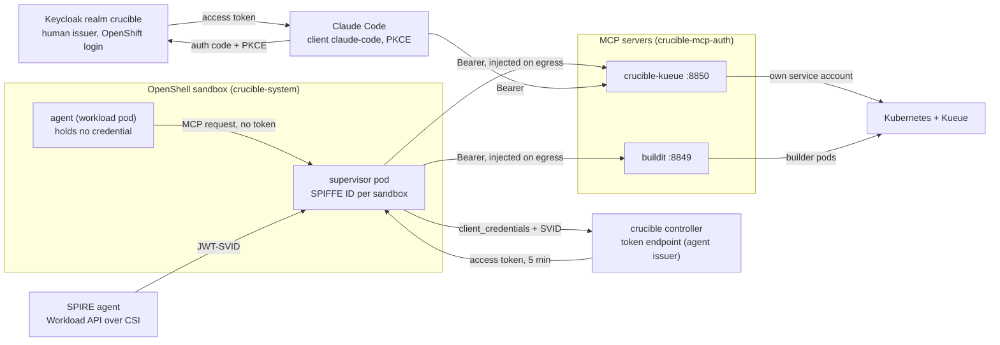
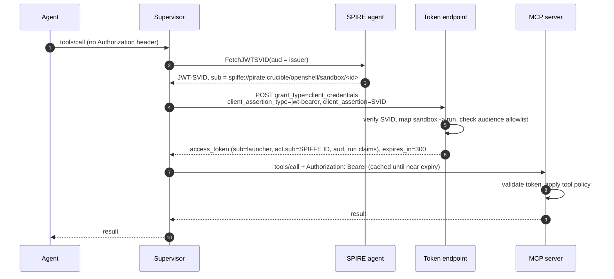
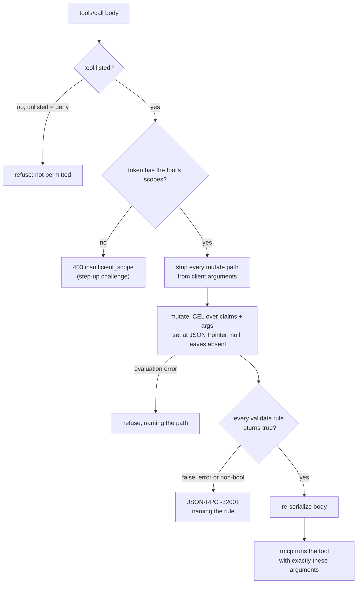
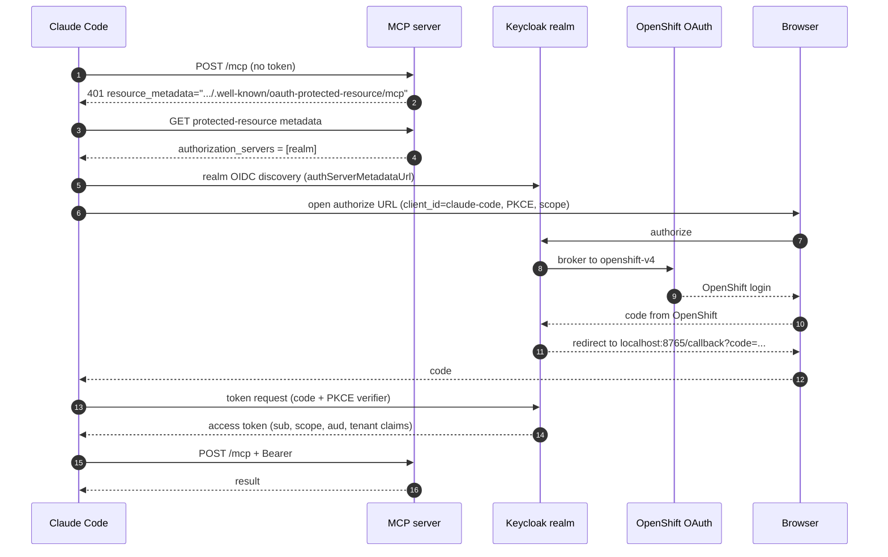
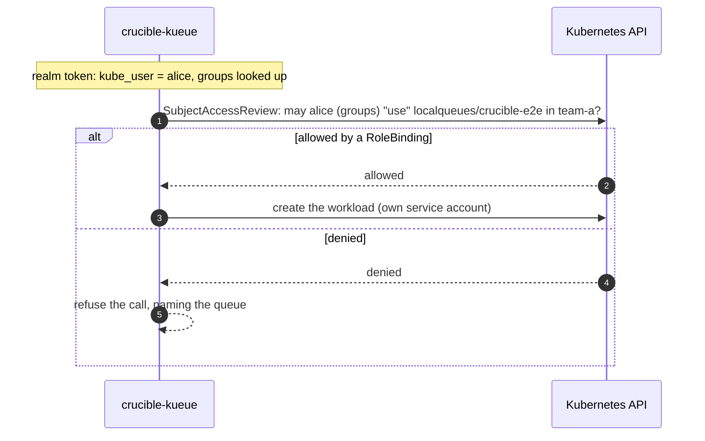

# crucible-mcp-auth

OAuth resource-server support for crucible's MCP servers. Sandboxed agents and people reach
crucible-kueue and buildit with short-lived access tokens that name both the human and the
sandbox. Each server validates them, publishes RFC 9728 metadata, and enforces a per-tool CEL
policy over the token's claims. Agents never hold a credential.

Status (2026-10-08):

- **Proven on pirate.** SPIRE issues each OpenShell supervisor a SPIFFE ID. Keycloak exchanges that
  JWT-SVID, sent exactly as OpenShell's provider `token_grant` sends it, for a 5-minute token with
  `sub` = the launcher and `act.sub` = the sandbox. crucible-kueue accepts it, refuses a
  policy-violating call by rule name, and stamps the launcher on the Job it creates.
- **Built.** This crate, hooked into crucible-kueue and buildit (vendored into this workspace).
- **Decided and built.** No per-run Keycloak clients and no dynamic client registration. Agent
  tokens come from a token endpoint in the crucible controller, proven on pirate with a real SVID;
  Keycloak stays for human logins.
- **Proposed.** Authorize queue access with Kubernetes RBAC through SubjectAccessReview.
- **Open.** Sandboxes do not fetch tokens until the gateway wiring lands, and the Claude Code login
  has not been run end to end by a person yet.

Operating the stack on pirate (manifests, realm setup, e2e commands) is in
[deploy/README.md](deploy/README.md).

## Goals

The design follows the MCP 2026-07-28 authorization model: every MCP server is an OAuth resource
server, and a token is good only for the server it names.

1. Servers publish RFC 9728 metadata, validate audience, answer 401/403 with the standard
   challenges, and never pass a client's token through to another service.
2. Agents never hold credentials. The OpenShell supervisor fetches tokens and injects the bearer
   only on egress to the bound endpoint; a failed fetch denies the request.
3. One token model for every MCP server, on any cluster that trusts the issuer.
4. A token says who launched the run (`sub`) and which sandbox presents it (`act.sub`), in RFC 8693
   form.
5. Servers validate tool arguments against claims and inject server-owned values the client cannot
   override.
6. People use the same servers through Claude Code, with a pre-registered public client and PKCE.
   Claude Code has no `client_credentials`, which is why people and agents take different routes to
   the same kind of token.

## Architecture

Two issuers mint the same shape of token: the crucible controller for agents, Keycloak for people.
Every MCP server trusts both and runs this crate.



| Component | Role | Where |
| --- | --- | --- |
| SPIRE (Zero Trust Workload Identity Manager) | Issues JWT-SVIDs to supervisor pods: `spiffe://pirate.crucible/openshell/sandbox/<sandbox-id>` | `zero-trust-workload-identity-manager` |
| OpenShell supervisor | Fetches the SVID, performs the token grant, injects the bearer on egress | per sandbox, `crucible-system` |
| Controller token endpoint | Agent issuer: verifies the SVID, maps sandbox to run, mints the token | crucible controller |
| Keycloak realm `crucible` | Human issuer; also the issuer in the proven spike | `rhbk` |
| `crucible-mcp-auth` | Token validation, RFC 9728 metadata, tool policy | library in each MCP server |
| crucible-kueue | Kueue workloads in the caller's namespace and queues | `crucible-system` |
| buildit | Image builds from the sandbox workspace | loop pod |

## Sandbox identity

A sandbox proves who it is with a SPIRE JWT-SVID that only its supervisor can fetch. The supervisor
trades it for an access token on the first MCP call and caches the token until shortly before it
expires.



**SPIFFE IDs.** A `ClusterSPIFFEID` selects supervisor pods in `crucible-system` by
`openshell.ai/boundary-role=supervisor` and builds the ID from the annotation
`openshell.ai/sandbox-id` (`.ai`, not upstream's `.io`). The CSI driver mounts the Workload API
socket; the sandbox SCC already allows `csi` volumes.

**The token request.** OpenShell's `token_grant` sends `client_credentials` with the SVID as a
`jwt-bearer` client assertion and no `client_id`. The SVID's audience defaults to the issuer URL
derived from the token endpoint; `jwt_svid_audience` overrides it when the endpoint is an in-cluster
Service. pirate pod networks cannot resolve `*.apps` hosts, so in-cluster URLs are required.

**What is proven: Keycloak.** Keycloak 26.6 `federated-jwt` accepts this request unchanged. The
assertion's `iss` selects an identity provider and its `sub` selects the client whose
`jwt.credential.sub` matches exactly. The assertion's `aud` must be exactly the realm issuer, and
because SVIDs carry no `jti` the provider sets `supportsClientAssertionReuse`. A tampered SVID gets
`invalid_client`.

**The controller token endpoint.** Exact subject matching means one Keycloak client per sandbox,
created and deleted by the controller. That is too much moving state, so the controller answers the
same request itself:

1. Verify the SVID against SPIRE's keys: one audience, the controller issuer; subject under the
   sandbox trust-domain path.
2. Map the sandbox ID to its run. The engine binds the ID, with the sandbox name and workdir, after
   `create_sandbox`, authenticated by its run pod's own token; a sandbox bound by another pod is
   refused, and so is one whose run pod is no longer running.
3. Mint an ES256 token for the requested audience, if allowlisted, with the run's claims. Expiry is
   5 minutes; keys are published at `/.well-known/jwks.json`.

Revocation is collecting the run: the endpoint stops minting and outstanding tokens expire within
5 minutes.

## Token shape

A token answers three questions: on whose behalf (`sub`), presented by whom (`act.sub`), and for
which server (`aud`). Servers read only claims, so agent and person tokens differ only in `act` and
the run claims.

| Claim | Agent token | Person token | Used for |
| --- | --- | --- | --- |
| `iss` | controller issuer (the realm in the spike) | Keycloak realm | which keys verify it |
| `sub` | the launcher, e.g. `weaton` | the person's realm user ID | `crucible.dev/launched-by`, policy |
| `act.sub` | `spiffe://pirate.crucible/openshell/sandbox/<id>` | absent | audit, `crucible.dev/actor` |
| `aud` | the MCP servers the run may call | the servers the requested scopes name | one must be this server |
| `scope` | `kueue.read kueue.submit buildit.read buildit.build` | what Claude Code requested | per-tool checks |
| `run_id` | run pod name | absent; the subject owns its workloads | ownership labels |
| `namespace`, `role`, `queues` | from the run's grant | admin-only user attributes today | crucible-kueue scope |
| `sandbox`, `workdir` | OpenShell sandbox name and workspace | absent | buildit's caller |
| `exp` | 5 minutes | realm default | |

**Scopes carry audiences.** `kueue.read` and `kueue.submit` each add crucible-kueue's URLs to
`aud`; the buildit scopes add buildit's. Requesting a scope is what binds a token to a server, so a
crucible-kueue token is rejected by buildit despite a valid signature.

**Canonical resource URLs** are the URLs clients use:
`http://crucible-kueue.crucible-system.svc.cluster.local:8850/mcp` for sandboxes,
`http://host.openshell.internal:8849/mcp` for buildit in the loop pod, and `localhost` URLs for local
development.

## Resource server

An axum layer in front of rmcp's Streamable HTTP service. rmcp 3.5 has no server-side auth, so
validation, challenges and metadata live here. Handlers get a typed `Principal` through the request
extensions rmcp already forwards.

```rust
let server = Arc::new(ResourceServer::new(ResourceServerConfig {
    issuer, jwks_uri, resources, required_scopes, scopes_supported, resource_name,
})?);
let mcp = Router::new()
    .fallback_service(streamable_http_service)
    .layer(from_fn_with_state(Arc::new(PolicyGuard { policy, server: Some(server.clone()) }), guard::enforce))
    .layer(from_fn_with_state(server.clone(), server::require_bearer));
let app = Router::new().nest_service("/mcp", mcp).merge(metadata::router(server));
```

Servers that also accept another credential (crucible-kueue's tenant tokens, buildit's tokens file)
write their own authentication middleware around `ResourceServer::authenticate` and `challenge`.

**Validation** (`jsonwebtoken` 11 on aws-lc):

- `iss` equals the configured issuer; `aud` names one of the server's canonical URLs.
- `exp`, `iss`, `aud`, `sub` required; `nbf` checked; 30 seconds of clock skew.
- Only RS, PS, ES and EdDSA. HS and `none` are refused before key lookup, so a public key can never
  be used as a shared secret.
- A key that declares `alg` refuses tokens signed with any other algorithm.
- Server-wide required scopes are checked after the signature.

**Key cache.** Keys are cached by `kid` for 10 minutes. An unknown `kid` refetches at most once per
30 seconds, so made-up kids cannot hammer the issuer. During an issuer outage cached keys keep
working and new ones fail closed.

**Challenges** (MCP 2026-07-28, RFC 6750):

| Case | Status | `WWW-Authenticate` |
| --- | --- | --- |
| no bearer token | 401 | `Bearer resource_metadata="...", scope="..."` |
| bad signature, issuer, audience or expiry | 401 | `Bearer error="invalid_token", error_description="...", resource_metadata="..."` |
| valid but missing a scope | 403 | `Bearer error="insufficient_scope", scope="<missing>"` |

**RFC 9728 metadata** is served at `/.well-known/oauth-protected-resource` and at the path-inserted
`/.well-known/oauth-protected-resource/mcp` that the challenge names. The resource is chosen from the
configured list by `Host` and never copied from it.

**Principal.** `subject` (`sub`), `actor_chain` (`act`, flattened, at most 8 deep), `client_id`
(`azp`), `namespace`, `scopes`, and every claim for policy rules. `presenter()` is the party holding
the token: the first actor, else the subject.

## Tool policy

A TOML file decides, per tool, which scopes a call needs, which argument paths the server owns, and
which CEL rules the arguments must pass. It runs before rmcp sees the call; anything other than a
`true` rule refuses it and names the rule.



On `tools/list`, mutate paths are removed from each tool's `inputSchema` (the property and its
`required` entry), for JSON and SSE responses alike.

The CEL engine is the `cel` crate 0.15, one workspace pin shared with the controller's webhook
transforms. JSON integers reach CEL as `int`, so `args.replicas <= 8` compares like with like. The
policy loads at startup; a rule that does not compile stops the server.

From crucible-kueue's shipped policy:

```toml
[tools.workload_plan]
scopes = ["kueue.submit"]

# Plan and submit inject the same value, so the plan hash still matches.
[[tools.workload_plan.mutate]]
path = "/manifest/metadata/annotations/crucible.dev~1actor"
value = "has(claims.act) ? claims.act.sub : null"

[[tools.workload_plan.validate]]
name = "queue-allowed"
rule = "!has(claims.queues) || size(claims.queues) == 0 || args.queue in claims.queues"
message = "the queue is not in this run's allowlist"
```

## Servers

Both servers accept a realm token or their older credential side by side, told apart by shape (a
compact JWT is never looked up as a static token), and log `auth=oidc` or the other source. Older
credentials get an equivalent `Principal` so one policy covers both.

| | crucible-kueue | buildit |
| --- | --- | --- |
| Older credential | tenant tokens (static file, controller-written records) | tokens file, one line per sandbox |
| Caller from a realm token | `namespace`, `role`, `queues`; `run_id`, else the subject | `sandbox`, optional `workdir`; refused without a sandbox |
| Launcher stamp | label `crucible.dev/launched-by` on workloads, server-owned | same label on builder pods |
| Shipped policy | [deploy/kueue-policy.toml](../crucible-kueue/deploy/kueue-policy.toml): read and submit scopes, queue allowlist, actor annotation, replica cap | [deploy/buildit-policy.toml](../buildit/deploy/buildit-policy.toml): read and build scopes, build and run timeout caps |
| Flags | `--issuer <issuer>=<jwks uri>` (repeatable) `--resource --tool-policy` | the same, plus the tokens file becomes optional |

A unit test in each server fails if a tool is missing from its shipped policy, so a new tool
cannot ship silently denied.

## People: Claude Code

People log in through OpenShift into the realm with the pre-registered public client
`claude-code` (auth code, PKCE S256, callback `http://localhost:8765/callback`).



```json
{
  "mcpServers": {
    "kueue": {
      "type": "http",
      "url": "http://localhost:8850/mcp",
      "oauth": {
        "clientId": "claude-code",
        "callbackPort": 8765,
        "scopes": "openid kueue.read kueue.submit",
        "authServerMetadataUrl": "https://keycloak.apps.openshift.nm.rdu4.corp.redhat.com/realms/crucible/.well-known/openid-configuration"
      }
    }
  }
}
```

Claude Code does not step up scopes on a 403 by itself, so request every scope up front. pirate's
ingress uses a self-signed CA: start Claude Code with `NODE_EXTRA_CA_CERTS` pointing at it, and add
an `/etc/hosts` entry for the Keycloak host because `*.apps` has no DNS.

A person's tenant scope comes from admin-only user attributes set with `deploy/realm-dev.sh grant`.
That is a stopgap; the next section replaces it with Kubernetes RBAC.

## Kubernetes authorization (proposed)

Queue access should follow Kubernetes RBAC, not a list kept in Keycloak. The server asks the API
server whether the caller may use a queue, then acts with its own service account.



```yaml
# Granting a person (or group) a queue is ordinary RBAC.
apiVersion: rbac.authorization.k8s.io/v1
kind: Role
metadata: {name: kueue-crucible-e2e, namespace: team-a}
rules:
  - apiGroups: [kueue.x-k8s.io]
    resources: [localqueues]
    resourceNames: [crucible-e2e]
    verbs: [use]
```

- The server's service account gains only `create subjectaccessreviews` and `list` on OpenShift
  `Group` objects, to pass the person's groups.
- Agent runs check their launcher the same way, intersected with the run's grant: a run can only use
  queues its human could use.
- The token needs a Kubernetes username the server can trust: a `kube_user` claim set only by the
  `openshift-v4` login, never from an attribute a user can edit.
- Quotas and admission webhooks still see the service account; crucible-kueue's manifest checks and
  Kueue quotas keep covering that.

## Alternatives considered

| Option | Why not |
| --- | --- |
| Dynamic client registration (RFC 7591) | OpenShell never registers; RFC 7591 cannot express "authenticated by an external issuer's subject"; still one client per sandbox, created by the untrusted side; deprecated in MCP 2026-07-28 |
| Per-run Keycloak clients from the controller | Exact-subject matching forces a client per sandbox; create, bind, delete and sweep is too much moving state |
| Kubernetes service-account tokens | Every supervisor shares one service account, so no per-sandbox identity; OpenShell's `token_grant` speaks only SPIFFE, so the agent pod would hold the token; no human in the token |
| Agents creating Jobs with their own kube access | Kueue has no per-user queue authorization beyond namespace RBAC; loses the plan/hash gate and manifest checks; large blast radius |
| Impersonating the person | `impersonate` lets a server bug become privilege escalation; groups must be resolved anyway |
| Passing the person's OpenShift token through | Forbidden by MCP 2026-07-28; OpenShift tokens are long-lived |

## Security notes

- **Pod creation in `crucible-system` is the trust root.** Pack tasks hold `edit` there and could
  create a pod with a forged `openshell.ai/sandbox-id` annotation and receive that SVID. The
  controller's sandbox-to-run check limits the damage; sandboxes should move to a namespace packs
  cannot write.
- **In-cluster Keycloak traffic is plain HTTP** (keys and token endpoint). Enable Keycloak TLS with
  a service-CA certificate.
- **Keycloak is a dependency** for human logins, and for agents until the controller endpoint lands.
  Tokens last 5 minutes.
- **Policy is fail-closed**: unlisted tools, evaluation errors and non-boolean results refuse, and a
  rule that does not compile stops the server.
- **Server-owned values** (launcher label, injected arguments) are stripped from client input, and a
  JWT never falls back to a static-token lookup.

## Testing

| Suite | What it proves |
| --- | --- |
| this crate, 47 unit tests | validation failures, algorithm confusion, key rotation and throttling, outage behavior, challenges, metadata, policy evaluation, mutation, stripping, schema hiding, SSE rewriting |
| crucible-kueue, 70 unit tests | claims to caller, person tokens, tenant principals, launched-by label, shipped policy coverage |
| buildit, 60 unit tests | realm and tokens-file callers, refusals, challenges, launched-by label, a policy refusal over HTTP |
| `crucible-kueue/tests/oidc_e2e.rs` (pirate) | spike SVID to controller token to crucible-kueue: rule refusal, actor annotation, launched-by label, refusal once the run is collected, tampered SVID and foreign audience refused, tenant tokens under the same policy |
| `buildit/tests/oidc_e2e.rs` (pirate) | the `buildit mcp` binary with a realm token: challenge, metadata, authenticated status, policy refusal |

The `testing` feature exposes real RSA keys, a loopback JWKS server and token minting for other
servers' tests; `e2e` adds the pirate helpers (spike pod, token exchange).

## Next steps

1. Deploy the controller token endpoint (`CONTROLLER_AGENT_*` env, signing-key Secret).
2. Gateway wiring: `provider_spiffe_workload_api_socket_path` in crucible's `gateway_toml()`,
   `providers_v2_enabled`, the `token_grant` provider for each MCP server, and the OIDC flags rendered
   into the server Deployments.
3. SubjectAccessReview queue authorization and the `kube_user` claim.
4. A person runs the Claude Code login end to end.
5. Keycloak TLS in-cluster; sandboxes out of `crucible-system`.
