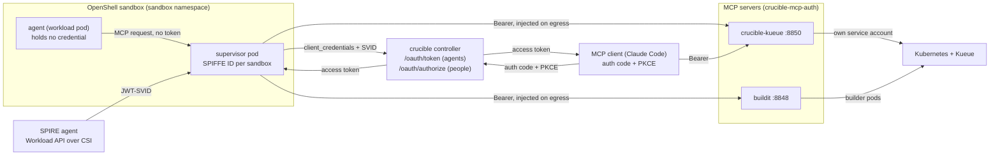
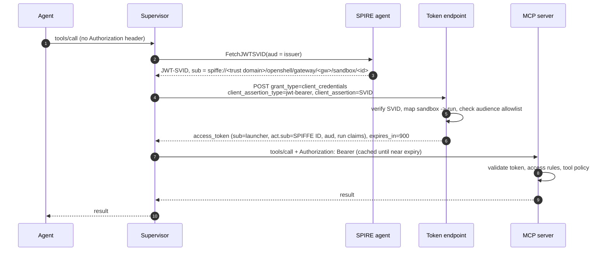
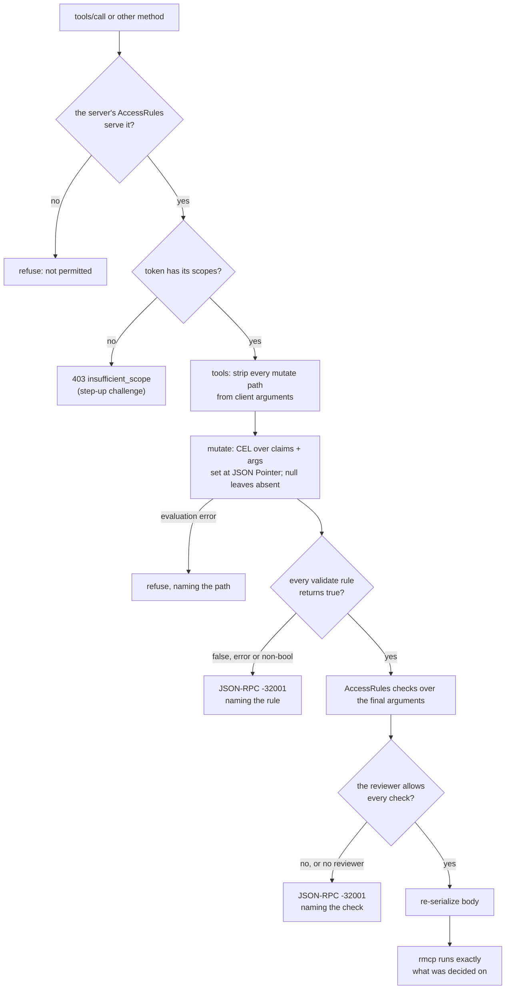
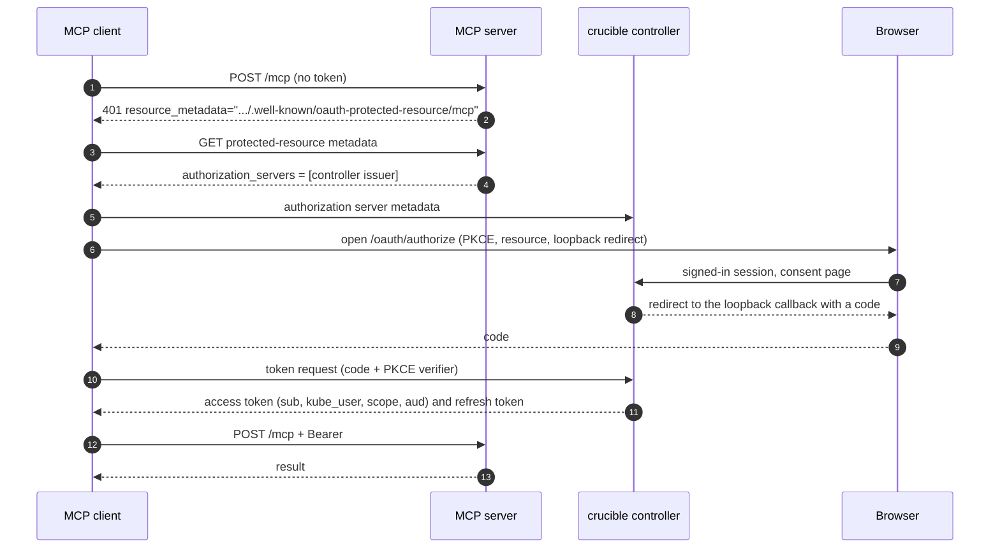
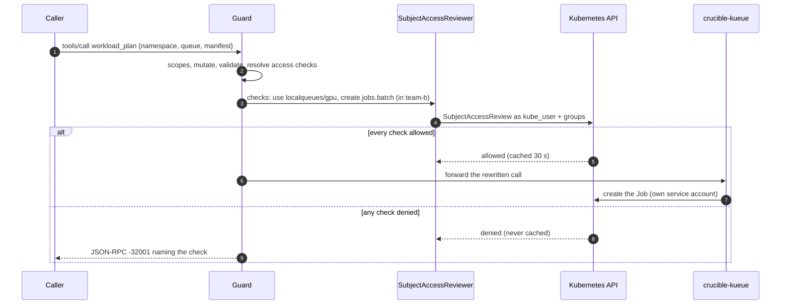

# crucible-mcp-auth

OAuth resource-server support for crucible's MCP servers. Sandboxed agents and people reach
crucible-kueue and buildit with short-lived access tokens that the crucible controller issues and
that name both the human and, for an agent, the sandbox. Each server validates them, publishes
RFC 9728 metadata, checks every call against the access rules it declares in code
(`access::AccessRules`: scopes, then SubjectAccessReviews as the caller's Kubernetes user), and
applies an optional CEL tool policy over arguments. Agents never hold a credential.

A deployment needs SPIRE (with an OIDC discovery provider) on each cluster whose sandboxes get
tokens, the controller's issuer (`CONTROLLER_AGENT_*`, and `CONTROLLER_PEOPLE_AUDIENCES` for
people), and each MCP server's flags. [docs/controller-deploy.md](../docs/controller-deploy.md)
and [docs/controller-auth.md](../docs/controller-auth.md) cover configuration; this file covers
the token model and what a server does with a token.

## Goals

The design follows the MCP 2026-07-28 authorization model: every MCP server is an OAuth resource
server, and a token is good only for the server it names.

1. Servers publish RFC 9728 metadata, validate audience, answer 401/403 with the standard
   challenges, and never pass a client's token through to another service.
2. Agents never hold credentials. The OpenShell supervisor fetches tokens and injects the bearer
   only on egress to the bound endpoint; a failed fetch denies the request.
3. One token model for every MCP server, on any cluster that trusts the issuer.
4. A token says who launched the run (`sub`) and which sandbox presents it (`act.sub`), in RFC 8693
   form.
5. Servers validate tool arguments against claims and inject server-owned values the client cannot
   override.
6. People use the same servers through Claude Code, with a pre-registered public client and PKCE.
   Claude Code has no `client_credentials`, which is why people and agents take different routes to
   the same kind of token.

## Architecture

The crucible controller is the issuer for both kinds of caller: a token endpoint that sandbox
supervisors reach with their JWT-SVIDs, and an authorization endpoint that people's MCP clients
reach with a browser sign-in. Every MCP server trusts it and runs this crate. A server deployed
outside crucible can trust any OIDC issuer for people instead (`--person-issuer`).



| Component | Role | Where |
| --- | --- | --- |
| SPIRE (Zero Trust Workload Identity Manager) | Issues JWT-SVIDs to supervisor pods: `spiffe://<trust domain>/openshell/gateway/<gateway-id>/sandbox/<sandbox-id>` | `zero-trust-workload-identity-manager` |
| OpenShell supervisor | Fetches the SVID, performs the token grant, injects the bearer on egress | per sandbox, the sandbox namespace |
| Controller issuer | Agents: verifies the SVID, maps sandbox to run, mints the token. People: signs them in, records consent, mints and refreshes their tokens | crucible controller |
| `crucible-mcp-auth` | Token validation, RFC 9728 metadata, access rules, tool policy | library in each MCP server |
| crucible-kueue | Kueue workloads wherever the caller's Kubernetes user may act | per cluster |
| buildit | Image builds from the sandbox workspace | each run's loop pod |

## Sandbox identity

A sandbox proves who it is with a SPIRE JWT-SVID that only its supervisor can fetch. The supervisor
trades it for an access token on the first MCP call and caches the token until shortly before it
expires.



**SPIFFE IDs.** A `ClusterSPIFFEID` selects supervisor pods in the profile's
`[cluster] sandbox_namespace` by `openshell.ai/boundary-role=supervisor` and builds the ID from two
values the run's OpenShell gateway sets on every supervisor it creates: the label
`openshell.ai/gateway-id` (the run pod's name) and the annotation `openshell.ai/sandbox-id` (`.ai`,
not upstream's `.io`). The controller issues a token only when the ID's gateway is the run that
bound the sandbox, so a sandbox id alone cannot be replayed from another run. Nothing renders the
`ClusterSPIFFEID`: applying it is an operator step, alongside installing SPIRE. Its `namespaceSelector` must name the sandbox
namespace and nothing else, since any pod it selects can claim a sandbox's identity:

```yaml
apiVersion: spire.spiffe.io/v1alpha1
kind: ClusterSPIFFEID
metadata:
  name: openshell-sandbox-supervisor
spec:
  spiffeIDTemplate: 'spiffe://{{ .TrustDomain }}/openshell/gateway/{{ index .PodMeta.Labels "openshell.ai/gateway-id" }}/sandbox/{{ index .PodMeta.Annotations "openshell.ai/sandbox-id" }}'
  namespaceSelector:
    matchLabels:
      kubernetes.io/metadata.name: <sandbox_namespace>
  podSelector:
    matchLabels:
      openshell.ai/boundary-role: supervisor
  jwtTtl: 5m
```

The CSI driver mounts the Workload API socket; the sandbox SCC already allows `csi` volumes.

**The token request.** OpenShell's `token_grant` sends `client_credentials` with the SVID as a
`jwt-bearer` client assertion and no `client_id`. The SVID's audience defaults to the issuer URL
derived from the token endpoint; `jwt_svid_audience` overrides it when the endpoint is an in-cluster
Service. Pod networks often cannot resolve the cluster's external Route hosts, so use in-cluster
Service URLs.

**The token endpoint.** The controller answers that request itself:

1. Verify the SVID against the issuing cluster's SPIRE keys (`CONTROLLER_AGENT_SPIRE`): one
   audience, the controller issuer; subject under that cluster's gateway prefix; at most 15 minutes
   of life.
2. Map the sandbox ID to its run. The engine binds the ID, with the sandbox name and workdir, after
   `create_sandbox`, authenticated by its run pod's own token; a sandbox bound by another pod is
   refused, so is one whose run pod is no longer running, and so is an SVID whose gateway is not
   the bound run's.
3. Mint an ES256 token for the requested audience, if `CONTROLLER_AGENT_AUDIENCES` lists it, with the
   run's claims and the scopes that audience grants. Tokens live 15 minutes by default (up to 30);
   keys are published at `/.well-known/jwks.json`.

Revocation is collecting the run: the endpoint stops minting and outstanding tokens expire.

## Token shape

A token answers three questions: on whose behalf (`sub`), presented by whom (`act.sub`), and for
which server (`aud`). Servers read only claims, so agent and person tokens differ only in `act` and
the run claims.

| Claim | Agent token | Person token | Used for |
| --- | --- | --- | --- |
| `iss` | controller issuer | controller issuer | which keys verify it |
| `sub` | the login the run was dispatched for | the person's login | `crucible.dev/launched-by`, policy |
| `act.sub` | `spiffe://<trust domain>/openshell/gateway/<gateway-id>/sandbox/<id>` | absent | audit, `crucible.dev/actor` |
| `aud` | the MCP servers the run may call | the servers the requested scopes name | one must be this server |
| `scope` | what `CONTROLLER_AGENT_AUDIENCES` grants the audience | what the client requested, within `CONTROLLER_PEOPLE_AUDIENCES` | per-tool checks |
| `run_id` | run pod name | absent; the subject owns its workloads | ownership labels |
| `kube_user` | the launcher's username on the run's cluster | the person's username on the server's cluster | who RBAC asks about; required by crucible-kueue |
| `namespace` | from the run's grant | absent | crucible-kueue's default namespace |
| `sandbox`, `workdir` | OpenShell sandbox name and workspace | absent | buildit's caller |
| `exp` | 15 minutes by default | 15 minutes by default | |

**One audience per token.** A token is minted for one server's URL, with that audience's scopes,
so a crucible-kueue token is rejected by buildit despite a valid signature.

**Canonical resource URLs** are the URLs clients use:
`http://crucible-kueue.crucible-system.svc.cluster.local:8850/mcp` for sandboxes,
`http://host.openshell.internal:8848/mcp` for buildit in the loop pod, and `localhost` URLs for local
development.

## Resource server

An axum layer in front of rmcp's Streamable HTTP service. rmcp 3.5 has no server-side auth, so
validation, challenges and metadata live here. Handlers get a typed `Principal` through the request
extensions rmcp already forwards.

```rust
let issuers = vec![TrustedIssuer::runs("<issuer>=<jwks uri>")?];
let server = Arc::new(ResourceServer::new(
    ResourceServerConfig { issuers, resources, required_scopes, scopes_supported, resource_name },
    &JwksTls::default(),
)?);
let guard = PolicyGuard { policy, server: Some(server.clone()), reviewer: None };
let mcp = Router::new()
    .fallback_service(streamable_http_service)
    .layer(from_fn_with_state(Arc::new(guard), guard::enforce))
    .layer(from_fn_with_state(server.clone(), server::require_bearer));
let app = Router::new().nest_service("/mcp", mcp).merge(metadata::router(server));
```

Servers write their own authentication middleware around `ResourceServer::authenticate` and
`challenge` when they turn a principal into their own caller type (crucible-kueue) or also accept
another credential (buildit's tokens file).

**Validation** (`jsonwebtoken` 11 on aws-lc):

- `iss` equals a configured issuer; `aud` names one of the server's canonical URLs. Each issuer
  is configured for runs or for people, and that, not the token's claims, decides which kind of
  caller a token is (`Principal::callers`).
- `exp`, `iss`, `aud`, `sub` required; `nbf` checked; 30 seconds of clock skew.
- Only RS, PS, ES and EdDSA. HS and `none` are refused before key lookup, so a public key can never
  be used as a shared secret.
- A key that declares `alg` refuses tokens signed with any other algorithm.
- Server-wide required scopes are checked after the signature.

**Key cache.** Keys are cached by `kid` for 10 minutes. Fetches, failed or not, happen at most once
per 30 seconds, so made-up kids or a failing issuer cannot turn requests into fetches. During an
issuer outage cached keys keep working and new ones fail closed. A key set over 256 KiB is refused.

**Key transport.** Whoever answers the JWKS fetch can mint accepted tokens, so `ResourceServer::new`
refuses a plain-http JWKS URI unless its host is loopback or `JwksTls::insecure_http` is set.
`JwksTls::ca_bundle` adds a PEM bundle of CAs (an in-cluster service CA) to the platform roots.

**Challenges** (MCP 2026-07-28, RFC 6750):

| Case | Status | `WWW-Authenticate` |
| --- | --- | --- |
| no bearer token | 401 | `Bearer resource_metadata="...", scope="..."` |
| bad signature, issuer, audience or expiry | 401 | `Bearer error="invalid_token", error_description="the access token is invalid or expired", resource_metadata="..."` |
| valid but missing a scope | 403 | `Bearer error="insufficient_scope", scope="<missing>"` |

**RFC 9728 metadata** is served at `/.well-known/oauth-protected-resource` and at the path-inserted
`/.well-known/oauth-protected-resource/mcp` that the challenge names. The resource is chosen from the
configured list by `Host` and never copied from it.

**Principal.** `subject` (`sub`), `actor_chain` (`act`, flattened, at most 8 deep), `client_id`
(`azp`), `namespace`, `scopes`, `callers` (from the issuer), and every claim for policy rules.
`presenter()` is the party holding the token: the first actor, else the subject.

Challenges and refusal bodies carry fixed descriptions; why a token failed goes only to the log.

## Access rules and the tool policy

Each server declares in code, by implementing `access::AccessRules`, every tool and method it
serves: the scopes a call needs and the Kubernetes access checks it needs for a given caller. A
call it does not describe is refused, so a new tool cannot ship unchecked. A TOML policy, optional,
adds CEL rules over a tool's arguments: `mutate` sets server-owned argument paths from the caller's
claims, `validate` refuses arguments outside a bound. The guard runs before rmcp sees the request:



`initialize`, `ping`, `server/discover`, notifications, client responses and `tools/list` always
pass. On `tools/list`, unconditional mutate paths are removed from each tool's `inputSchema` (the
property and its `required` entry), for JSON and SSE responses alike.

The CEL engine is the `cel` crate at the workspace's pin, the one the controller's webhook
transforms use. JSON integers reach CEL as `int`, so `args.replicas <= 8` compares like with like. The
policy loads at startup; a rule that does not compile, or a key the format does not know (such as
the old `scopes`, `authorize` or `unlisted`), stops the server.

From crucible-kueue's shipped policy:

```toml
[[tools.workload_scale.validate]]
name = "replica-cap"
rule = "args.replicas >= 0 && args.replicas <= 8"
message = "replicas must be between 0 and 8"
```

## Servers

crucible-kueue accepts access tokens only. buildit also accepts its older tokens file, told apart by
shape (a compact JWT is never looked up as a static token); a tokens-file caller gets an equivalent
`Principal` so one policy covers both.

| | crucible-kueue | buildit |
| --- | --- | --- |
| Other credential | none | tokens file, one line per sandbox |
| Caller from a token | `kube_user` (required), default `namespace`; `run_id`, else the subject | `sandbox`, optional `workdir`; refused without a sandbox |
| Launcher stamp | label `crucible.dev/launched-by` on workloads, server-owned | same label on builder pods |
| Actor stamp | annotation `crucible.dev/actor` (the token's presenter), set by the server | none |
| Tasks extension | `tasks/get` needs RBAC `get` on the workload, `tasks/cancel` `update` plus `kueue.submit` | `tasks/cancel` needs `buildit.build`; a reader's poll never publishes a run's files |
| Access rules | `crucible-kueue/src/access.rs`: read and submit scopes, a SubjectAccessReview for each tool but `whoami` and for both task methods | `BuilditRules`: read and build scopes, no Kubernetes checks |
| Shipped policy | [kueue-policy.toml](../crucible-kueue/deploy/kueue-policy.toml): replica cap | [deploy/buildit-policy.toml](../buildit/deploy/buildit-policy.toml): build and run timeout caps |
| Flags | `--run-issuer` and `--person-issuer <issuer>=<jwks uri>` (repeatable), `--resource`, `--tool-policy` (optional), `--kube-authz`, `--jwks-ca`, `--insecure-jwks-http` | `--run-issuer` only (no people), the rest the same; the tokens file becomes optional |

A unit test in each server fails if one of its tools has no scope in its access rules, so a new
tool cannot ship silently refused.

## People: MCP clients

People's MCP clients (Claude Code, pi) sign in at the controller: `/oauth/authorize` with PKCE S256
and a loopback redirect, a consent page in the controller's UI that names the server, the cluster
and the username the token will carry, then `/oauth/token` for the code and for refresh.
[docs/controller-auth.md](../docs/controller-auth.md) covers the flow, the routes and sign-out.



A server takes people's tokens from an issuer passed as `--person-issuer`; `crucible deploy render
--kueue` adds the controller there with `[kueue] people = true`. A person's token carries their
username on the server's cluster, by that cluster's identity rule, so crucible-kueue checks every
call by RBAC as that user and owns their workloads under their subject. A people issuer's token
that carries `run_id` is refused.

## Kubernetes authorization

Kubernetes RBAC decides what a caller may touch. The server's access rules (in code) turn a tool
call into SubjectAccessReviews; the server asks the API server, then acts with its own service
account.



For a caller carrying `kube_user` (people, and runs acting as their launcher), crucible-kueue's
access rules ask, for `workload_plan`: `use` on `kueue.x-k8s.io/localqueues/<queue>` and `create`
on the manifest's kind, in the call's `namespace` argument or else the token's `namespace` claim.

```yaml
# Granting a person or group a queue is ordinary RBAC; `use` is a verb only crucible-kueue asks about.
- apiGroups: [kueue.x-k8s.io]
  resources: [localqueues]
  resourceNames: [crucible-e2e]
  verbs: [use]
```

**Who is asked about.** `kube_user` names the Kubernetes user; a `system:` identity is refused, so
no token can stand in for a node or the cluster. Groups come from OpenShift `Group` objects (cached
a minute) or a `kube_groups` claim with `system:` groups dropped; `system:authenticated` is always
added. The controller resolves `kube_user` for people and runs alike from the cluster's identity
rule (an SSO claim, a link the cluster itself proved, or an administrator's hub override), so a
run can only do what its human could; a token without `kube_user` is refused.

**Which namespace.** Every crucible-kueue tool takes an optional `namespace`, defaulting to the
token's `namespace` claim; the access checks decide whether the caller may act there. Task ids carry
the namespace.

**One deployment.** A single crucible-kueue serves both kinds of caller:

| Caller | Token | Identity | Decided by |
| --- | --- | --- | --- |
| Sandboxed agent | controller-issued, `run_id` + `act.sub` + `kube_user` | the run's namespace by default | RBAC as the launcher |
| Person (MCP client) | controller-issued, `kube_user` | any namespace they name | RBAC as themselves |

People's tokens are accepted only when the server has a reviewer (`--kube-authz openshift|token`),
and a call that needs checks is refused without one, so a misconfiguration cannot let a person act
unchecked. Every tool but `whoami` is checked, and a unit test fails if a new tool goes unchecked.

**Embedding.** `crucible_kueue::router(client, Options { registry, oidc, policy, reviewer,
allowed_hosts })` builds the whole app, so a host such as the controller can mount it next to its
own routes with the same issuers and reviewer.

**Service account.** It gains `create` on `subjectaccessreviews` and `list` on
`groups.user.openshift.io`. Its workload verbs are still granted per namespace by RoleBinding; a
namespace people use needs that binding too. Quotas and admission webhooks still see the service
account, and crucible-kueue's manifest checks and Kueue quotas keep covering that.

## What this policy model enables

Every tool call now passes one enforcement point that knows who launched the run, which sandbox
is acting, what it is asking to do with which arguments, and what Kubernetes lets that person do.
That point sits outside agent code, so nothing an agent does can skip it. Policy is data: a TOML
file today, reviewable in a pull request, with rules that name themselves in every refusal.

**Wins available with what is built:**

- **Delegation that cannot exceed the human.** A run's reach is its grant intersected with its
  launcher's RBAC. Revoking someone's RoleBinding cuts off their running agents within 30 seconds
  (the allow cache).
- **Queues and namespaces as ordinary RBAC.** Platform teams grant GPU queues with RoleBindings and
  Groups they already manage. No second permission system lives in crucible.
- **Server-owned arguments.** Mutate rules inject facts the client cannot forge: who launched it,
  which sandbox acted, which namespace. Every workload carries provenance an admission policy or a
  cost report can key on.
- **Guardrails without code changes.** Replica caps, build timeouts, allowed kinds, and image or
  registry allowlists are CEL rules. They change by editing the policy and restarting, not by a
  server release.
- **One policy surface for every MCP server.** buildit, crucible-kueue and future servers share
  scopes, claims and rule semantics, so a rule written once ("runs never touch kube-system") holds
  everywhere it is listed.
- **Audit by construction.** Every decision logs the subject, the presenter, the tool and the rule
  that decided it; a refused call names the rule to the agent, which can correct itself.

**Next: decisions in Cedar.** The controller already authorizes with Cedar (`cedar-policy` 4.12):
`UserPrincipal`, `TeamPrincipal` and `RunPrincipal` over owned, shared resources. A tool call maps
onto the same model: principal = the run (with its launcher) or the person, action =
`Mcp::Action::"kueue:workload_submit"`, resource = the queue or workload, context = the arguments
and claims. Moving the CEL `validate` rules into a Cedar `Mcp::` namespace gives schema-checked
policies, forbid-overrides, and one language for controller and MCP decisions. Scopes, mutate and
SubjectAccessReview stay: Cedar decides what a run may do, RBAC decides whether its human may use
the queue at all. `cedar-policy-mcp-schema-generator` turns an MCP tool manifest into the Cedar
action schema.

**Later: rules over history with Dogwood.** [Dogwood](https://github.com/dogwood-policy/dogwood)
(AWS, Apache-2.0, released August 2026) embeds Cedar (every Cedar policy is a Dogwood policy) and
adds rules over a session's history: `formerly within`, `since`, `count` and `sum` over windows.
The session here is the run, which the token's `run_id` fixes, so a client cannot pick its own
session. Rules that become expressible:

| Rule | Needs |
| --- | --- |
| Submit only a plan this run made in the last 30 minutes (today a client can compute `plan_hash` and skip `workload_plan`) | plan responses |
| A run's GPU-hours stay under a budget across all its submissions | submit requests; completions from Kueue |
| Scaling past N replicas needs a human approval recorded in the last hour | controller approval events |
| No more than 20 builds per sandbox per hour | build requests |
| No resume after three stops of the same workload within 30 minutes | stop requests |
| No `run` in buildit within 15 minutes of reading a secret through the controller | controller events |
| Read a failed workload's logs before resubmitting it | logs requests, failure status |

Getting there takes three pieces: the guard capturing `tools/call` responses as well as requests
(JSON and SSE), an event store per run in the controller's Postgres shared by every MCP server, and
a decision trait next to `AccessReview` that a Cedar or Dogwood engine implements. History must be
fail-closed: a lost history makes `formerly` permits deny, but `count` and `sum` forbids would allow,
so a server without its run's history denies those rules until it is replayed. Dogwood's crate
(`dogwood-language` 1.0.0, Rust, on `cedar-policy` 4.11) calls itself a reference implementation,
and its in-memory engine replays the whole trace on every decision. Start with rules in log-only
mode behind a Postgres temporal engine, and enforce once the language stabilizes.

## Alternatives considered

| Option | Why not |
| --- | --- |
| Dynamic client registration (RFC 7591) | OpenShell never registers; RFC 7591 cannot express "authenticated by an external issuer's subject"; still one client per sandbox, created by the untrusted side; deprecated in MCP 2026-07-28 |
| Per-run clients in an external IdP (Keycloak `federated-jwt`) | Exact-subject matching forces a client per sandbox; create, bind, delete and sweep is too much moving state |
| Kubernetes service-account tokens | Every supervisor shares one service account, so no per-sandbox identity; OpenShell's `token_grant` speaks only SPIFFE, so the agent pod would hold the token; no human in the token |
| Agents creating Jobs with their own kube access | Kueue has no per-user queue authorization beyond namespace RBAC; loses the plan/hash gate and manifest checks; large blast radius |
| Impersonating the person | `impersonate` lets a server bug become privilege escalation; groups must be resolved anyway |
| Passing the person's OpenShift token through | Forbidden by MCP 2026-07-28; OpenShift tokens are long-lived |

## Security notes

- **Pod creation where sandboxes run is the trust root.** Whoever can create a pod there can set a
  forged `openshell.ai/sandbox-id` annotation and receive that sandbox's SVID. The controller's
  sandbox-to-run check does not help: the forged SVID names a sandbox the ledger binds to a real
  run, so the controller mints that run's token. The ClusterSPIFFEID must select only a dedicated
  sandbox namespace that nothing but the sandbox gateway can create pods in, and pack tasks must not
  hold `edit` there. The kueue workload namespace is rendered with Pod Security `restricted`.
- **JWKS over https.** Serve the issuer's key set over https with a certificate the server trusts
  (`--jwks-ca` adds a CA); plain http needs `--insecure-jwks-http` off loopback.
- **Fail-closed**: calls a server's access rules do not serve, checks that cannot be resolved or
  made, evaluation errors and non-boolean results refuse, and a policy rule that does not compile
  stops the server.
- **Server-owned values** (launcher label, injected arguments) are stripped from client input, and a
  JWT never falls back to a static-token lookup.

## Testing

| Suite | What it proves |
| --- | --- |
| this crate, unit tests | validation failures, algorithm confusion, key rotation and throttling, outage behavior, challenges, metadata, policy evaluation, mutation, stripping, schema hiding, SSE rewriting, access rules and review (allowed, denied, failed, no reviewer, checks over the final arguments), Kubernetes identity and SubjectAccessReview requests |
| crucible-kueue, unit tests | claims to identity, default and per-call namespaces, `kube_user` required, person tokens, JWT-only authentication, launched-by label, every tool but `whoami` reviewed for people, namespaced task ids |
| buildit, unit tests | token and tokens-file callers, refusals, challenges, launched-by label, a policy refusal over HTTP |
| `crucible-controller/tests/kueue_oidc_e2e.rs` (cluster) | a real SPIRE SVID to the controller's token to crucible-kueue: rule refusal, actor annotation, launched-by label, refusal once the run is collected, tampered SVID and foreign audience refused; a Deployment refused by Kubernetes RBAC for the launcher (`sar-e2e-rbac.yaml`), another namespace refused by RBAC |
| `buildit/tests/oidc_e2e.rs` (cluster) | the `buildit mcp` binary with an external OIDC issuer's token: challenge, metadata, authenticated status, policy refusal |
| `scripts/kueue-e2e.sh` (cluster) | the whole path in a cluster: a controller dispatches a pack whose agent builds an image with buildit and runs it through crucible-kueue, with tokens its supervisor obtained |

The `testing` feature exposes real RSA keys, a loopback JWKS server and token minting for other
servers' tests; `e2e` adds the cluster helpers (spike pod, token exchange), configured entirely from the
environment.
