# Agent and people MCP architecture

This document describes the MCP stack that lets agents and people act on Kubernetes clusters
through crucible. It covers these parts:

- the two MCP servers, `crucible-kueue` and `buildit`;
- the shared resource server library, `crucible-mcp-auth`;
- the controller as the OAuth issuer;
- the per-run gateway isolation that makes agent identities trustworthy.

The audience is engineers who maintain or extend this code, and reviewers of the branch that
adds it. The text follows ASD-STE100 Simplified Technical English. Code names appear exactly as
in the source, in backticks. Code references use `path:line` from the repository root.

Note: Every part of this stack is off unless you configure it. Section 9 lists what stays inert
when a value is absent.

## Glossary

Each term has one sense in this document.

| Term | Definition |
| --- | --- |
| access check | One SubjectAccessReview that a resource server asks the API server before it acts. The type is `AccessCheck` (`crucible-mcp-auth/src/access.rs`). |
| agent token | A token that the issuer gives to a supervisor for one sandbox of one run. |
| allowlist profile | The set of manifest fields that `crucible-kueue` accepts: `strict`, `tenant`, or a TOML file. |
| approval | The record that a person approved one MCP client for one resource. It is one row in `people_grants`, names its `client_id`, and owns a chain of refresh tokens. |
| assertion | The JWT-SVID that a supervisor sends to the token endpoint as `client_assertion`. |
| audience | The MCP resource URL that a token is for. The `aud` claim holds it. |
| authorization code | A single-use secret that the issuer gives to an MCP client after consent. It lives 60 seconds. |
| bind record | One row in `run_sandboxes`. It connects a sandbox id to the run and the loop pod that created the sandbox. |
| builder pod | A pod that `buildit` creates in the buildit namespace (`[buildit] namespace`) to build and run one image. |
| buildit | The vendored image build MCP server. It runs as a child process in each loop pod. |
| client ID | The OAuth `client_id` of an MCP client. It has one of three forms: a registered name, an `https://` metadata document URL, or a `dyn-` id that the issuer gave. The type is `ClientId` (`crucible-controller/src/agent_auth/people/clients.rs:24`). |
| client registry | The list of registered clients: the built-in `claude-code`, `pi` and `codex`, or the clients in `CONTROLLER_PEOPLE_CLIENTS_FILE`. |
| cluster token | A Kubernetes bearer token of a person, for example the output of `oc whoami -t`. |
| consent | The page and API call where a person approves or denies an MCP client. |
| controller | The `crucible-controller` process on the hub. It dispatches runs and is the issuer. |
| crucible-kueue | The MCP server that plans, submits and controls Kueue workloads on one cluster. |
| deploy profile | The TOML file that `CONTROLLER_DEPLOY_PROFILE` names. It describes clusters, namespaces and servers. |
| gateway | The OpenShell gateway process that creates sandboxes and supervisors for one run. |
| gateway id | The OpenShell id of one gateway. It is the loop pod name, hashed when longer than 63 characters. The label `openshell.ai/gateway-id` carries it. |
| hub | The cluster where the controller runs. Its dispatch name is `hub`. |
| identity rule | The rule in the deploy profile that tells how the controller learns `kube_user` on one cluster: `link` or `{ claim, prefix }`. |
| isolated profile | A deploy profile with `sandbox_driver = "kubernetes"` and a `sandbox_namespace`. Each run then gets a gateway pod of its own (`crucible/src/deploy/render/gateway.rs:55`). |
| issuer | The OAuth authorization server inside the controller. `CONTROLLER_AGENT_ISSUER` is its identifier. |
| issuer key | The ES256 private key that signs every token. |
| JWKS | A JSON Web Key Set: the public keys that verify signatures. |
| `kube_user` | The Kubernetes username that a token acts as. Every resource server that does access checks reviews this user. |
| launcher | The person that a run acts for. The login comes from `runs.dispatched_by`. |
| link | A record in `kube_identity_links` that a cluster's TokenReview proved: this person is this username on this cluster. |
| loop namespace | The namespace of loop pods (`[cluster] loop_namespace`). |
| loop pod | The pod that runs the engine for one run. The controller calls it the run pod. Pack code runs here. |
| MCP client | A program that a person uses to call MCP servers, for example Claude Code, pi or Codex. |
| metadata document client | A client whose `client_id` is the `https://` URL of its OAuth Client ID Metadata Document (CIMD), on a host in `CONTROLLER_PEOPLE_CIMD_HOSTS`. |
| override | A hub username that a platform administrator sets for a person. It wins over the identity rule on the hub only. |
| people token | A token that the issuer gives to an MCP client for one person. |
| plan hash | The SHA-256 of the normalized manifest. `workload_submit` requires it. |
| pod token | The per-run bearer (`CRUCIBLE_POD_TOKEN`) that a loop pod uses to talk to the controller. |
| push-only cluster | A spoke for which the hub holds a push token and no API client. |
| refresh token | A long-lived secret that an MCP client exchanges for a new token. Each use spends it. |
| registered client | A client in the client registry. The operator vouches for its name and its redirect URIs. |
| resource server | An MCP server that verifies tokens with `crucible-mcp-auth`. |
| run | One dispatch of a playbook launch or an issue. One loop pod executes it. |
| sandbox | An OpenShell sandbox: an isolated pod where the agent runs. |
| sandbox namespace | The namespace of sandboxes, supervisors and gateway pods (`[cluster] sandbox_namespace`). |
| scope | An OAuth permission name, for example `kueue.submit`. The `scope` claim holds a space-separated list. |
| self-registered client | A client that registered itself at `POST /oauth/register` (RFC 7591). It has a `dyn-` client ID and only loopback redirect URIs. Nobody vouches for its name. |
| SPIFFE ID | A URI that names a workload, for example `spiffe://<trust domain>/openshell/gateway/<gateway id>/sandbox/<sandbox id>`. |
| SPIRE | The SPIFFE runtime that gives JWT-SVIDs to workloads on one cluster. |
| spoke | A cluster other than the hub that the controller dispatches runs to. This document uses `spoke-a` and `spoke-b`. |
| supervisor | The OpenShell process in the pod of a sandbox. It controls egress and injects credentials. |
| token | An OAuth access token that the issuer signs. Other secrets are always named in full: refresh token, pod token, cluster token. |
| token grant | The OpenShell provider credential type that tells a supervisor to get a token from a token endpoint with its JWT-SVID. |
| tool policy | Optional CEL `validate` and `mutate` rules over tool arguments (`crucible-mcp-auth/src/policy.rs`). |
| turn pod | A short pod for a grounded-rank or scope turn. Under an isolated profile it also gets a gateway pod. |
| workload namespace | The namespace that `[kueue] workload_namespace` names. It is the default namespace of agent workloads. |

## 1. Overview

### 1.1 The problem

Agents in sandboxes must start cluster work: Jobs and RayJobs that train models, Deployments
that serve models, and image builds. A Kubernetes credential must not enter the sandbox. Pack code in the loop pod must
not choose who the agent is, or which namespace and queue it uses. People who use MCP clients
on their laptops need the same tools, with their own Kubernetes permissions.

### 1.2 The shape

The controller is the one OAuth issuer for agents and for people. A sandbox supervisor proves its
identity with a JWT-SVID from the SPIRE of its cluster. The controller finds the run that the
sandbox belongs to and signs a short token. The token names the launcher (`sub`), the sandbox
(`act.sub`), the run and the launcher's Kubernetes username (`kube_user`). A person gets a token
through the authorization code flow with PKCE, after upstream SSO and consent. The MCP client is
a public client: a registered client, a metadata document client, or a self-registered client.

The MCP servers verify each token against the issuer JWKS. Before each action, they ask the API
server a SubjectAccessReview as `kube_user`. So the person's own RBAC is the ceiling. Each run's
gateway runs in a pod of its own in the sandbox namespace. So pack code cannot create a
supervisor with the SPIFFE ID of another run.

### 1.3 Components and trust boundaries

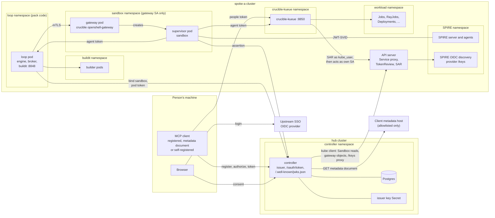

The diagram shows one spoke. The hub can also host runs; it then has the same namespaces. The
trust boundaries are the namespaces:

- The controller namespace holds the issuer key. The controller refuses to start when this
  namespace is also the loop, rig, sandbox, `crucible-kueue` or workload namespace
  (`crucible-controller/src/agent_auth/placement.rs:74`).
- The loop namespace runs pack code. The loop service account has no verbs in the sandbox
  namespace under an isolated profile.
- The sandbox namespace allows pod creation only to `crucible-openshell-gateway`. A SPIFFE ID
  there is as trustworthy as that rule.
- The `crucible-kueue` namespace holds the server service account. Workload verbs of that account
  apply only in the workload namespace.
- The person's machine holds only a token and a refresh token, never a cluster credential.
- A client metadata host is outside every boundary. The controller fetches a JSON document from
  it only when its host is in `CONTROLLER_PEOPLE_CIMD_HOSTS`. The document can name a client and
  its redirect URIs, and nothing more.

## 2. Trust model and identities

### 2.1 Principals

| Principal | Proves itself with | Shown in tokens as |
| --- | --- | --- |
| Person | An upstream SSO login to the controller. The browser session holds it. | `sub` (the login) and `kube_user` |
| Run | The pod token of its loop pod, at the bind endpoint only | `run_id` (the loop pod name) |
| Sandbox supervisor | A JWT-SVID from the SPIRE of its cluster | `act.sub` (the SPIFFE ID), `sandbox`, `workdir` |

A run acts for its launcher. The launcher is `runs.dispatched_by`, which must be `user:<login>`.
The controller stamps it when it creates the run row (`crucible-controller/src/runs/store.rs:334`).
The value is the person who last asked for this dispatch: an unpark, a redispatch, a scope, or a
paired GitHub approval. Without such a request, the value is the owner of the run. A run that
has no person behind it gets no token (`GrantError::NoLauncher`).

### 2.2 Token types and claims

All tokens are compact JWS, algorithm ES256, with `kid` in the header. The issuer signs both kinds
with the same key and the same `iss`.

| Claim | Agent token | People token | Content |
| --- | --- | --- | --- |
| `iss` | yes | yes | `CONTROLLER_AGENT_ISSUER`, an http(s) origin without a path |
| `sub` | launcher login | person login | On whose behalf the call is made |
| `aud` | yes | yes | One MCP resource URL, a string |
| `iat`, `nbf`, `exp` | yes | yes | Issue time, start, expiry (Unix seconds) |
| `jti` | yes | yes | 16 random bytes, hex |
| `act` | `{"sub": "<SPIFFE ID>"}` | absent | The presenter: the sandbox supervisor |
| `azp` | absent | the client ID | The OAuth client, for example `claude-code` |
| `scope` | yes | yes | Space-separated scopes |
| `run_id` | loop pod name | absent | The run. It is the pod name because a run id can be longer than a label value |
| `sandbox` | when known | absent | The sandbox name from its `Sandbox` resource |
| `workdir` | when bound | absent | The workspace path inside the sandbox |
| `kube_user` | when known | always | The Kubernetes username on the cluster of the audience |
| `kube_cluster` | the run's cluster | yes | The cluster the token acts on. A server started with `--cluster` refuses a token naming another, so a token for one cluster's URL does not work at the same URL on another |
| `namespace` | on a `[kueue]` cluster | absent | The default namespace for `crucible-kueue` |

The agent token is built in `crucible-controller/src/agent_auth/issuer.rs:820`. The people token is
built in `crucible-controller/src/agent_auth/people.rs:299`.

Note: Claims name identity only. There is no role and no queue list in a token. Each resource
server decides what the caller may do. `crucible-kueue` ignores `role` and `queues` claims if a
token carries them.

### 2.3 Issuer keys and JWKS

The issuer key is a PKCS#8 P-256 key. The `kid` is the RFC 7638 thumbprint of its public half, so
a new key gets a new `kid` with no configuration (`issuer.rs:152`). The JWKS at
`/.well-known/jwks.json` publishes the current key and, when configured, the previous key
(`issuer.rs:820`). The previous key verifies only. It signs nothing.

To rotate the issuer key, do these steps:

1. Move the current key file to `CONTROLLER_AGENT_PREVIOUS_SIGNING_KEY_FILE`.
2. Mount a new key at `CONTROLLER_AGENT_SIGNING_KEY_FILE`.
3. Restart every controller replica.
4. Wait for one token lifetime. The default is 900 seconds; people tokens can live up to 3600.
5. Remove the previous key variable and restart again.

Warning: All replicas must mount the same keys. A replica with another key signs tokens that the
other replicas do not publish.

Resource servers cache the JWKS for 600 seconds. A token with an unknown `kid` causes a refetch,
but not more than one fetch each 30 seconds (`crucible-mcp-auth/src/jwks.rs:152`). A failed fetch
keeps the cached keys. The client refuses a key set larger than 256 KiB and follows no
redirects.

### 2.4 Lifetimes

| Item | Lifetime | Where set |
| --- | --- | --- |
| Agent token | 900 to 1800 seconds, default 900 | `CONTROLLER_AGENT_TOKEN_TTL_SECS` |
| People token | 1 to 3600 seconds, default 900 | `CONTROLLER_PEOPLE_ACCESS_TTL_SECS` |
| Authorization code | 60 seconds, single use | `CODE_TTL_SECS` |
| Refresh token chain | dies 14 days after the last refresh, or 90 days after approval | `REFRESH_IDLE_SECS`, `REFRESH_ABSOLUTE_SECS` |
| Self-registered client | dies 30 days after its last use, with its approvals | `DcrPolicy::idle` |
| Registration rate window | 20 registrations for each source address in each hour | `DcrPolicy::per_source`, `DcrPolicy::window` |
| Metadata document cache | the `Cache-Control` `max-age` minus `Age`, 300 seconds without `max-age`, at most 3600 seconds | `CimdLimits` |
| JWT-SVID assertion | at most 900 seconds from `iat` to `exp` | `MAX_SVID_LIFETIME_SECS` |
| Cluster link flow | 10 minutes from start to callback | `FLOW_TTL` |
| Cluster OAuth token for a link | 300 seconds by default, then dropped after one review | `[cluster_link] access_token_max_age_secs` |
| Gateway certificates | run deadline in days, rounded up, plus 1 day; 30 days for a run without a deadline | `validity_days` |
| JWKS cache | 600 seconds, refetch at most each 30 seconds | `Jwks::from_source` |
| Allowed SAR decision cache | 30 seconds; denials are not cached | `ALLOW_TTL` |
| OpenShift group cache | 15 seconds, so a removed group stops allowing within 45 seconds together with the allow cache | `GROUPS_TTL` |

### 2.5 What each component verifies

The controller token endpoint verifies the assertion. Section 3 gives the full list.

Every resource server verifies a token through `ResourceServer::validate`
(`crucible-mcp-auth/src/server.rs:201`) and `Verifier::verify` (`crucible-mcp-auth/src/verify.rs:65`):

1. The header algorithm is asymmetric (RS, PS, ES or EdDSA). `HS*` and `none` never verify.
2. The header has a `kid`, and the JWKS of the issuer has that key.
3. The algorithm of the key, when the JWK declares one, is the header algorithm.
4. The signature is correct.
5. `iss` is exactly a trusted issuer string. There is no URL normalization.
6. `aud` names at least one configured resource URL.
7. `exp` and `nbf` hold, with 30 seconds of leeway.
8. `exp`, `iss`, `aud` and `sub` are present.
9. The token has every scope in `required_scopes` (`kueue.read` or `buildit.read`).

The configuration of each trusted issuer says whom its tokens stand for: runs or people
(`Callers`). When one issuer is trusted for both, a token with `act` is a run token and a token
without `act` is a people token. The token cannot choose its kind in any other way.

Then each server applies its own rules:

| Check | crucible-kueue | buildit |
| --- | --- | --- |
| Caller kind | Runs and people. People only with an access reviewer (`--kube-authz`) | Runs only |
| `kube_user` | Required for both kinds | Not read |
| `run_id` | Required for runs. A people token with `run_id` is refused | Must equal `--run-id` |
| `sandbox` | Not read | Required, a label value |
| `workdir` | Not read | Optional absolute normal path |
| Per-call scope | `kueue.read` or `kueue.submit` per tool (`crucible-kueue/src/access.rs:52`) | `buildit.read` or `buildit.build` per tool (`buildit/src/mcp.rs:1443`) |
| Access checks | SubjectAccessReview per call | None |
| Unlisted tool or method | Refused | Refused |

### 2.6 Why `kube_user` RBAC is the ceiling

`crucible-kueue` acts with its own service account. That account can create workloads in the
workload namespace. Before each call, the guard turns the call into access checks. For each
check it asks the API server a SubjectAccessReview as `kube_user`, with the groups of that user
(`crucible-mcp-auth/src/kube.rs:209`). The server does the call only when every review allows
it. So:

- A token can do at most what its `kube_user` can do with `kubectl`. The token scopes, the tool
  policy, the allowlist profile and the server account reach can only reduce that.
- An agent token acts as its launcher. A run cannot do more than the person who launched it.
- The issuer and the reviewer both refuse a `system:` username
  (`crucible-controller/src/identity/kube_identity.rs:27`, `crucible-mcp-auth/src/kube.rs:67`).
  So no token can act as a node, a service account or the cluster. Groups from a token claim
  also lose every `system:` entry.
- The server creates pods with its own identity. So the caller must be able to `get` each
  Secret and PersistentVolumeClaim that a manifest names (`crucible-kueue/src/access.rs:149`).
- A new RoleBinding applies on the next call, because denials are not cached. A removed
  permission can still allow calls for up to 30 seconds, because allowed decisions are cached.

The issuer never decides what a person may do. It decides only who the person is on each
cluster (section 5).

## 3. Agent token flow

### 3.1 From dispatch to the first MCP call

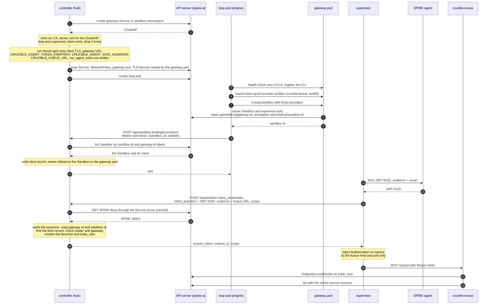

The steps are these:

1. Dispatch reserves the gateway. The Service comes first because its ClusterIP goes into the
   server certificate (`crucible-controller/src/runs/workpod/gateway.rs:184`).
2. The controller folds the loop pod client material and the agent server access into the run
   Secret before it renders the loop pod (`crucible-controller/src/runs/workpod/run.rs:809`,
   `crucible-controller/src/runs/workpod/kueue.rs:63`). A server is granted only where the
   issuer can mint its tokens: the run's cluster is in `CONTROLLER_AGENT_SPIRE`, and the server
   URL is a resource in `CONTROLLER_AGENT_AUDIENCES` (`kueue.rs:52`). The run records the servers
   that it got, with the scopes of the audience.
3. The gateway starts before the loop pod, so it boots while the loop pod schedules
   (`gateway.rs:256`).
4. The engine reads `CRUCIBLE_OPENSHELL_GATEWAY_URL` and talks to the remote gateway over mTLS
   (`crucible/src/openshell/gateway.rs:412`). It creates one token-grant provider for each server
   (`crucible/src/openshell/run.rs:398`). A provider holds no secret and gives the sandbox no
   placeholder (`crucible/src/openshell/provider.rs:368`).
5. After `CreateSandbox`, the engine binds the sandbox (`crucible/src/openshell/run.rs:469`). It
   binds only when the loop pod carries `CRUCIBLE_AGENT_TOKEN_ENDPOINT`. A failed bind does not
   fail the turn. The sandbox then gets no token.
6. The bind route trusts only the pod token of that run (`crucible-controller/src/agent_auth/bindings.rs:298`).
   It reads the sandbox name from the cluster, never from the request
   (`crucible-controller/src/agent_auth/directory.rs:60`).
7. The supervisor asks SPIRE for a JWT-SVID with the audience in `token_grant.jwt_svid_audience`.
   That value is the issuer identifier.
8. The token request has exactly the fields that OpenShell sends: `grant_type`,
   `client_assertion_type`, `client_assertion`, `audience`, `scope`. Any other field, for example
   `client_id` or `resource`, is refused (`crucible-controller/src/agent_auth/mod.rs:149`).
9. The supervisor injects the token as a bearer header only on egress to the host and port of the
   provider endpoint. The agent never sees the token.

### 3.2 What the token endpoint checks

`issue` (`crucible-controller/src/agent_auth/mod.rs:314`) does these checks in this order:

1. The issuer trusts at least one cluster SPIRE (`CONTROLLER_AGENT_SPIRE`).
2. The deploy profile is isolated and names a sandbox namespace
   (`crucible-controller/src/agent_auth/placement.rs:48`).
3. `grant_type` is `client_credentials`.
4. `client_assertion_type` is `urn:ietf:params:oauth:client-assertion-type:jwt-bearer`.
5. The assertion `iss` is the SVID issuer of exactly one configured cluster. That cluster's SPIRE
   keys verify the assertion (`crucible-controller/src/agent_auth/issuer.rs:701`).
6. The assertion `aud` is exactly one value, the issuer identifier.
7. The assertion has a numeric `iat`, not more than 30 seconds in the future.
8. `exp` minus `iat` is not more than 900 seconds.
9. `sub` is `<gateway prefix><gateway id>/sandbox/<sandbox id>` for the prefix of that cluster.
10. A bind record exists for the sandbox id, and its loop pod is in the `running` state.
11. The cluster of the run is the cluster whose SPIRE signed the assertion.
12. The requested `audience` is an entry of `CONTROLLER_AGENT_AUDIENCES` that serves the run's
    cluster: one bound to that cluster, or a bare one.
13. The gateway id in the SPIFFE ID is the gateway id of the bound loop pod.
14. The run has a launcher (`dispatched_by` is `user:<login>`).
15. Each requested scope is in the audience entry. A request with no scope gets all the scopes
    of the entry.
16. When a scope is a `kueue.*` scope, `kube_user` is known for the launcher on the run's cluster.
    For other audiences, the token omits an unknown `kube_user`, and the controller logs a warning.

The controller reads SPIRE keys through the API server Service proxy of each cluster, with the
same client it dispatches with (`crucible-controller/src/agent_auth/spire.rs:21`). The path is
`/api/v1/namespaces/<ns>/services/<scheme>:<service>:<port>/proxy/keys`
(`issuer.rs:189`). The scheme is `https` unless the entry starts with `http://`.

### 3.3 Refusals

Every refusal returns only the OAuth error code and a fixed description. The detail goes to the
controller log as `agent token refused` with `reason` and the `user_agent`.

| Case | Error | HTTP |
| --- | --- | --- |
| No `CONTROLLER_AGENT_SPIRE` (people-only issuer) | `unsupported_grant_type` | 400 |
| Profile not isolated, or no sandbox namespace | `unauthorized_client` | 400 |
| Malformed form, repeated field, unknown field | `invalid_request` | 400 |
| Wrong assertion type, unknown SPIRE `iss`, bad signature, wrong `aud`, no `iat`, future `iat` | `invalid_client` | 401 |
| Assertion lifetime over 900 seconds | `invalid_client` | 401 |
| SPIFFE ID not under the gateway prefix of its cluster | `invalid_client` | 401 |
| SPIRE keys could not be fetched | `server_error` | 500 |
| No `audience`, or an audience not in the allowlist | `invalid_target` | 400 |
| Sandbox never bound (unbound sandbox) | `invalid_grant` | 400 |
| Bound loop pod not in `running` | `invalid_grant` | 400 |
| SVID from the SPIRE of another cluster than the run (wrong cluster) | `invalid_grant` | 400 |
| SVID gateway id is not the gateway of the bound run (the bind record of another run) | `invalid_grant` | 400 |
| Run dispatched for no person | `invalid_grant` | 400 |
| Scope not listed for the audience | `invalid_scope` | 400 |
| `kueue.*` scope and no `kube_user` for the launcher | `invalid_grant` | 400 |

The bind route has its own refusals (`bindings.rs:320`):

| Case | HTTP |
| --- | --- |
| No pod token, or a token that does not verify | 401 |
| A pod token of another run | 403 |
| Unknown run, or a run with no work-pod row | 404 |
| Loop pod not in `running` | 409 |
| Profile names no sandbox namespace | 409 |
| No `Sandbox` with that id that this run's gateway created | 404 |
| The cluster could not be asked | 503 |
| Two `Sandbox` resources with that id, or one with no name | 409 |
| The sandbox id is bound to another loop pod, or its name is bound by another live pod on the same cluster | 409 |

Note: Pack code holds the gateway client certificate of its own run. It can create sandboxes for
its own run with the `driver_config` fields that the gateway accepts. Those sandboxes carry the
gateway id of its own run, so the issuer refuses them for any other run.

## 4. People token flow

### 4.1 MCP clients

People sign in with public OAuth clients. A public client has no secret, so PKCE `S256` is
required. Each code, approval and refresh token is bound to the client ID that it was issued to.
The people token names that client in `azp`.

#### 4.1.1 Client ID forms

`ClientId::parse` (`crucible-controller/src/agent_auth/people/clients.rs:133`) puts each
`client_id` in one of three forms. The form decides who vouches for the client.

| Form | Shape | Kind | Who vouches | Resolved by |
| --- | --- | --- | --- | --- |
| `Registered` | 1 to 64 of `A-Z a-z 0-9 . _ -`, not starting with `dyn-` (`clients.rs:98`) | `registered` | The operator | The client registry |
| `Metadata` | A canonical `https://` URL with a host name and a path, and no credentials, query or fragment (`clients.rs:64`) | `metadata` | The host that publishes the document | A fetch of the document (section 4.1.3) |
| `Dynamic` | `dyn-` and 16 to 64 base64url characters (`clients.rs:114`) | `dynamic` | Nobody | A row in `people_dynamic_clients` (section 4.1.4) |

`Clients` (`crucible-controller/src/agent_auth/people/registry.rs:27`) holds the registry, the
metadata document resolver and the registrations. It has two entry points:

- `resolve` (`registry.rs:66`) serves `/oauth/authorize`. It returns the client with its name and
  redirect rules. For a metadata document client, it fetches the document.
- `admits` (`registry.rs:87`) serves `/oauth/token`. It fetches nothing. It refuses a registered
  client that the registry no longer lists, a metadata document client whose host is no longer
  allowlisted, and a registration that is no longer live. The grant that the request redeems is
  already bound to its client ID.

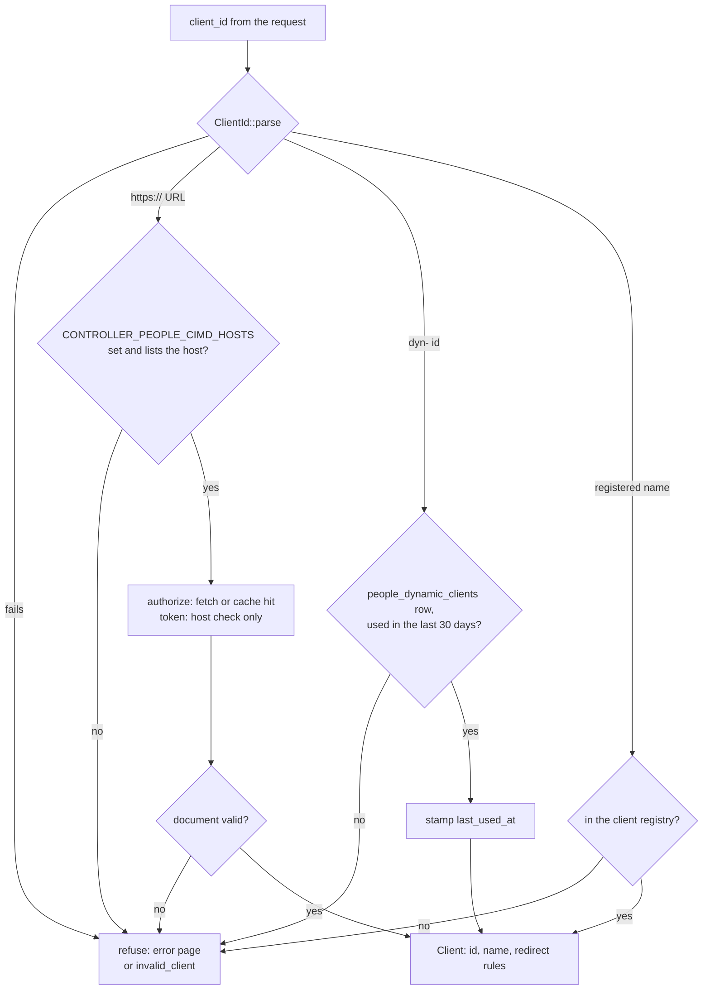

#### 4.1.2 The client registry

Without configuration, the registry has three clients (`clients.rs:448`):

| `client_id` | Name | Redirect URIs |
| --- | --- | --- |
| `claude-code` | Claude Code | `http://localhost:<any port>/callback` |
| `pi` | pi | `http://127.0.0.1:<any port>/callback` |
| `codex` | Codex | `http://127.0.0.1:<any port>/callback` and `http://127.0.0.1:<any port>/callback/<server id>` |

`CONTROLLER_PEOPLE_CLIENTS_FILE` names a TOML file of `[[clients]]` tables. Each table has
`client_id`, `name`, `redirect_uris` and an optional `resources` list. The file replaces the
built-in list, so list the built-in clients too if you want to keep them (`clients.rs:479`). The
controller does not start when the file is malformed, when it lists no client or one client
twice, or when a `resources` entry is not in `CONTROLLER_PEOPLE_AUDIENCES`
(`crucible-controller/src/agent_auth/people.rs:172`). Without `resources`, a client can get tokens
for every audience.

```toml
[[clients]]
client_id = "lab-cli"
name = "Lab CLI"
redirect_uris = ["http://127.0.0.1/oauth/done"]
resources = ["https://crucible-kueue.apps.spoke-a.example.com/mcp"]
```

When you remove a client, its next refresh gets `invalid_client`. When you remove a resource from
its `resources`, its next refresh for that resource revokes the approval.

Redirect matching follows RFC 8252 §7.3 (`RedirectRule`, `clients.rs:237`):

- A registered `http` URI on `localhost`, `127.0.0.1` or `[::1]` matches any explicit port on
  the same host, with the same path. It matches no query, no fragment and no credentials.
- `localhost`, `127.0.0.1` and `[::1]` are three different hosts. A client registered on
  `localhost` cannot use `127.0.0.1`.
- A registered path that ends in `/*` also matches one more segment of 1 to 64 base64url
  characters. Codex adds such a server id to the callback path. Only the registry can use `/*`.
- Any other registered URI must be `https`. It matches only character for character.
- The requested URI must already be in canonical form (`Client::redirect`, `clients.rs:348`).

#### 4.1.3 Client ID Metadata Documents

`CONTROLLER_PEOPLE_CIMD_HOSTS` is a comma-separated list of host names. When it is set, a
`client_id` that is an `https://` URL on one of those hosts is resolved as an OAuth Client ID
Metadata Document (draft-ietf-oauth-client-id-metadata-document). When it is unset, every URL
`client_id` is refused (`ClientError::MetadataOff`).

At `/oauth/authorize`, `Cimd::client` (`crucible-controller/src/agent_auth/people/cimd.rs:370`)
returns a cached document or fetches it, and only for a signed-in browser: a request naming a
metadata document without a session goes to `/auth/login` first, so nobody can make the controller
fetch without signing in. The fetch (`cimd.rs:390`) has these rules:

- The host must be on the allowlist (`cimd.rs:362`).
- The resolver gives only public addresses. It drops loopback, private, link-local and other
  RFC 6890 special-use addresses (`cimd.rs:127`, `cimd.rs:170`). With `HTTPS_PROXY` set, the proxy
  resolves the names, so this check moves to the proxy.
- The client uses only https and follows no redirects (`cimd.rs:338`).
- The answer must be `200`, JSON, at most 5 KiB, and arrive within 5 seconds.

The document must describe a public client of its own URL (`client_of`, `cimd.rs:200`):

- `client_id` is the URL exactly.
- `client_name` is 1 to 100 printable characters.
- `redirect_uris` has at least one entry. The entries follow the registry rules, but `/*` is not
  accepted.
- `token_endpoint_auth_method` is `none`. There is no `client_secret` and no
  `client_secret_expires_at`.
- `grant_types` and `response_types`, when present, include `authorization_code` and `code`.

A valid document is cached for its `Cache-Control` `max-age` minus `Age`. Without `max-age` it is
cached for 300 seconds. The limit is 3600 seconds (`freshness`, `cimd.rs:266`). A document with
`no-store` or `no-cache` is not cached. A refused document is not cached.

The consent page and Settings show the `client_name` of the document with the host of the URL, so
a document cannot look like a registered client. Codex publishes
`https://chatgpt.com/oauth/codex/client.json`. pi publishes `https://pi.dev/oauth/client.json`.

#### 4.1.4 Self-registered clients

pi 1.x, Codex and Claude Code without a client id register a client before they sign in
(RFC 7591). The controller accepts these registrations at `POST /oauth/register`
(`crucible-controller/src/agent_auth/people/dynamic.rs:422`). Registration is on by default when
`CONTROLLER_PEOPLE_AUDIENCES` is set. `CONTROLLER_PEOPLE_DCR=false` turns it off.

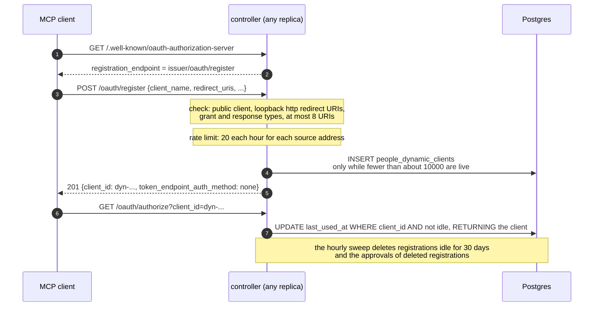

`check` (`dynamic.rs:194`) accepts only native public clients:

- `token_endpoint_auth_method` is absent or `none`. The controller issues no secret, no
  registration access token and no management endpoint.
- `grant_types` includes `authorization_code` and stays within `authorization_code` and
  `refresh_token`. `response_types` is `code`.
- `redirect_uris` has 1 to 8 entries, each at most 512 characters. Each entry is `http` on
  `localhost`, `127.0.0.1` or `[::1]`, with no query, fragment or credentials.
- The controller removes control characters and repeated white space from `client_name` and
  keeps at most 100 characters. An empty name becomes `Unnamed client`.

The client ID is `dyn-` and 24 random bytes in base64url. The consent page and Settings show the
name as "<name> (self-registered)".

`Dcr::register` (`dynamic.rs:287`) applies two limits:

- Each source address can register 20 times in each hour. The limit is in memory, for each
  replica. Past it, the answer is `429` with `temporarily_unavailable`.
- About 10000 registrations used in the last 30 days can exist. Past it, the answer is `503`
  with `temporarily_unavailable`. The count and the insert are one statement but not serialized
  across replicas, so concurrent registrations can go slightly over: the cap is soft.

The source address is the TCP peer. When the peer is in `CONTROLLER_PEOPLE_TRUSTED_PROXIES`, as
the cluster router is, the source is the last `X-Forwarded-For` hop (`source`, `dynamic.rs:428`).
Any other peer, an in-cluster caller included, is its own source and cannot pick a bucket.

`Dcr::client` (`dynamic.rs:345`) reads a registration and stamps `last_used_at` in one
statement. A registration that is not used for 30 days stops working. The hourly sweep deletes
it and the approvals issued to it (`Dcr::sweep`, `dynamic.rs:375`).

| Registration refusal | Error | HTTP |
| --- | --- | --- |
| A redirect URI that is not loopback `http`, or no URI, or more than 8 | `invalid_redirect_uri` | 400 |
| A body that is not JSON, a secret auth method, or other grant or response types | `invalid_client_metadata` | 400 |
| Rate limit of the source address | `temporarily_unavailable` | 429 |
| 10000 live registrations | `temporarily_unavailable` | 503 |
| People tokens or registration off | `invalid_request` | 404 |

#### 4.1.5 Clients on consent and in Settings

The consent API (`crucible-controller/src/identity/api/consent.rs:63`) returns these client
fields:

| Field | Content |
| --- | --- |
| `client_id` | The client ID |
| `client_name` | The registry name, the `client_name` of the document, or the name that the client registered |
| `client_host` | The host of the metadata document URL; `null` for other kinds |
| `client_kind` | `registered`, `metadata` or `dynamic` |
| `redirect_origin` | The `host:port` that the code goes to |

`GET /api/me/mcp-sign-ins` returns the same `client_id`, `client_name`, `client_host` and
`client_kind` for each live approval. The approval stores the name that the person saw on the
consent page.

### 4.2 Discovery, authorization and code exchange

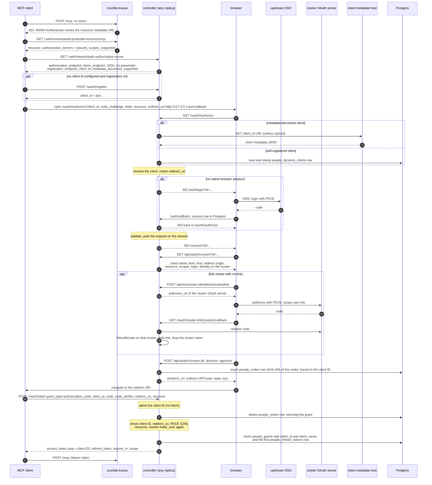

The steps are these:

1. `crucible-kueue` answers a request without a token with 401 and a challenge that names its
   RFC 9728 metadata. The metadata lists the trusted issuers as `authorization_servers`
   (`crucible-mcp-auth/src/metadata.rs:42`).
2. The MCP client reads the RFC 8414 metadata of the controller
   (`crucible-controller/src/agent_auth/issuer.rs:831`, `crucible-controller/src/agent_auth/mod.rs:445`).
   People support adds `authorization_endpoint`, the `authorization_code` and `refresh_token`
   grants, the `code` response type, `S256`, the `none` client authentication, and
   `authorization_response_iss_parameter_supported`. Two fields depend on the client
   configuration:
   - `registration_endpoint` is `<issuer>/oauth/register` while registration is on. It is absent
     with `CONTROLLER_PEOPLE_DCR=false`.
   - `client_id_metadata_document_supported` is `true` while `CONTROLLER_PEOPLE_CIMD_HOSTS` is
     set. It is absent otherwise.
3. `/oauth/authorize` (`crucible-controller/src/agent_auth/people.rs:554`) resolves the client
   (section 4.1) and matches `redirect_uri` against its redirect rules. `state` is required, at
   most 1024 characters. The method must be `S256`. `resource` must be one of
   `CONTROLLER_PEOPLE_AUDIENCES`, and a registered client with `resources` must list it
   (`validate`, `people.rs:373`).
4. An unknown client, a refused metadata document, an expired registration or a bad redirect gives
   an error page. The controller never redirects to a URI that the client did not register. When
   the client and the redirect are correct, the controller sends every other error to the
   redirect URI with `error`, `state` and `iss`.
5. Without a native session, the controller sends the browser to `/auth/login`. After the
   login, the browser returns to `/oauth/authorize`.
   A session whose group refresh failed counts as no session.
6. The request waits on the session under a random id. The consent page shows it only to the
   same browser and the same person. The page names the client and shows the `host:port` that
   the code goes to (section 4.1.5).
7. The approval resolves `kube_user` for the cluster of the audience. An unlinked `link` cluster
   answers 409. The controller parks the request on the session again, so the page can link
   and try again.
8. The code is 32 random bytes, base64url. Postgres stores only its SHA-256. The stored grant
   names the client ID and the client name.
9. The token endpoint admits the client ID without a fetch (`registry.rs:87`). It deletes the
   code in the same statement that reads it, so a code works once on any replica
   (`crucible-controller/src/agent_auth/people/grants.rs:157`). A code issued to another client
   ID is `invalid_grant` (`redeem_code`, `people.rs:722`). The code is spent all the same.

Note: Claude Code does not step up after a 403. So a person always gets every scope that the
audience lists. Requested scopes outside that list are refused; the OIDC scopes `openid`,
`profile`, `email` and `offline_access` are ignored.

### 4.3 Refresh with rotation and reuse detection

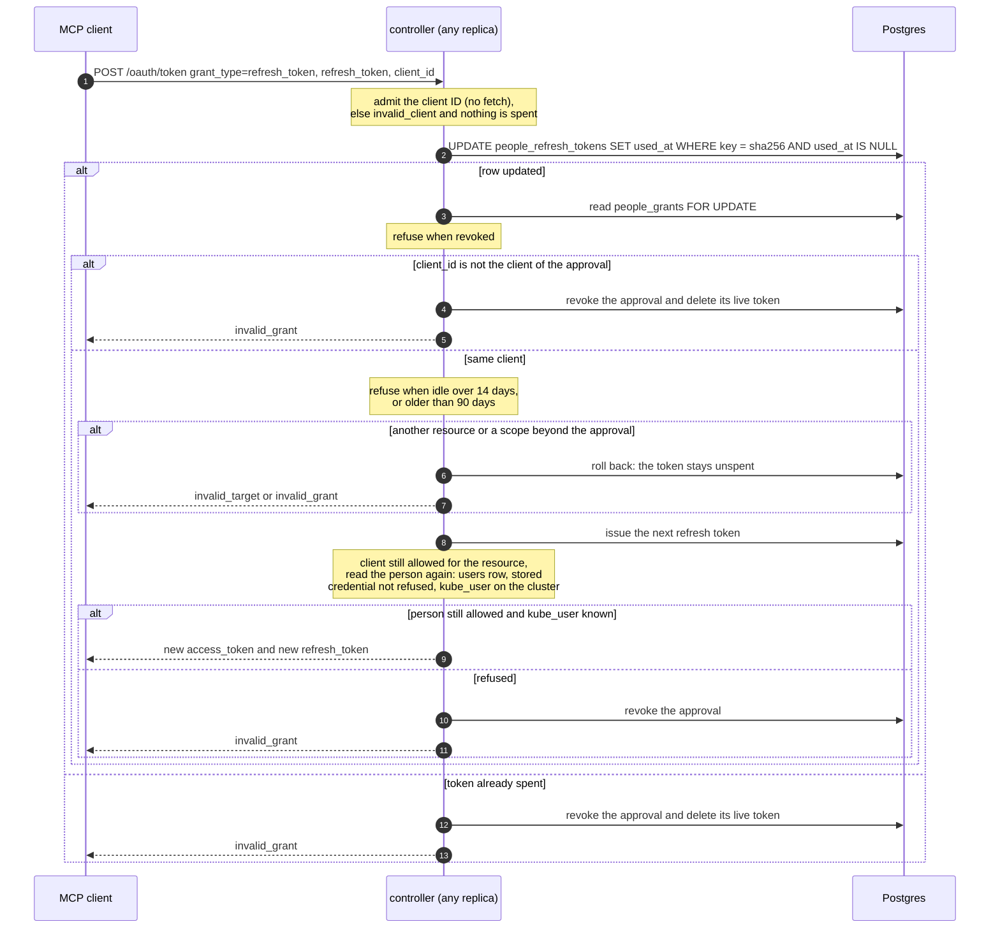

The rotation is one conditional `UPDATE`, so two replicas cannot both spend one refresh token
(`grants.rs:223`). A spent token stays in the table until its approval goes. When a client
presents it again, the controller revokes the whole approval (RFC 9700 §4.14.2). A live token
that another client ID presents also revokes the approval (`grants.rs:279`). A refresh that
asks for another `resource` or a wider scope is refused inside the same transaction, before
anything commits (`refresh_fits`, `people.rs:765`; `grants.rs:309`), so the token it presented stays
live and the client can refresh with it again.

A refresh also checks the client again. A registered client that the registry no longer lists
gets `invalid_client`. A registered client whose `resources` no longer lists the resource of the
approval loses the approval.

Every refresh reads the person again (`crucible-controller/src/identity/people_directory.rs:35`):

- A deleted `users` row revokes the approval.
- A stored offline credential that the upstream SSO refused (`user_credentials.last_error`)
  revokes the approval.
- An unlinked cluster username revokes the approval. A new link appears in the next token.

Warning: A client that retries a refresh after a lost response presents a spent token. The
controller treats that as reuse and revokes the approval. The person must approve the client
again.

A background task deletes expired codes and dead approvals each hour
(`grants.rs:425`). With registration on, the same task deletes registrations idle for 30 days and
the approvals of deleted registrations. It starts only when people tokens are configured.

### 4.4 Several replicas

Any replica can do any step of the flow:

- Browser sessions, the parked authorization request and a started cluster link live in the
  Postgres session store.
- Codes, approvals and refresh tokens live in `people_codes`, `people_grants` and
  `people_refresh_tokens`. Each method is one statement or one transaction.
- Every replica signs with the same issuer key and publishes the same JWKS.

Leader election (`CONTROLLER_LEASE_NAME`) applies only to the daemon. The API, the token endpoint
and the bind route answer on every replica.

### 4.5 Settings and revocation

`GET /api/me/mcp-sign-ins` lists the live approvals of the caller, with the client of each
(`crucible-controller/src/identity/api/mcp_sign_ins.rs:57`). Settings groups them by client.

- `DELETE /api/me/mcp-sign-ins?client_id=<client ID>` revokes the approvals of one client and
  deletes its unused codes (`grants.rs:330`). A `client_id` that does not parse gets 400.
- `DELETE /api/me/mcp-sign-ins` revokes all approvals of the caller and deletes their unused codes.

An API key cannot revoke approvals (`mcp_sign_ins.rs:113`).

## 5. Per-cluster identity

### 5.1 Identity rules

The deploy profile gives each cluster one identity rule. The hub rule is `[cluster] identity`.
A spoke rule is `[clusters.<name>] identity`. A cluster without a rule is `link`
(`forge/src/fleet.rs:61`).

| Rule | TOML | The username is |
| --- | --- | --- |
| `link` | `identity = "link"` | What the cluster's TokenReview said for a cluster token that the person gave |
| claim | `identity = { claim = "login" }` | The SSO login of the person |
| claim | `identity = { claim = "email" }` | The email that the SSO login recorded |
| claim with prefix | `identity = { claim = "login", prefix = "sso:" }` | The prefix, then the claim, as the API server's `--oidc-username-prefix` makes it |

Use a claim rule only when the cluster API server trusts the same SSO for the same people. Use
`link` in all other cases.

### 5.2 Links

A person proves a link in one of two ways:

- Paste a cluster token: `PUT /api/me/cluster-identities/{cluster}` with `{"cluster_token": "..."}`.
  The controller sends a TokenReview to that cluster (`crucible-controller/src/identity/kube_links.rs:108`).
- Use the OAuth server of an OpenShift cluster: `POST /api/me/cluster-identities/{cluster}/link`.
  The controller is a confidential `OAuthClient` there. It redeems the code with PKCE for a
  `user:info` token and sends that token to a TokenReview
  (`crucible-controller/src/identity/cluster_link.rs:204`, `cluster_link.rs:237`).

Either way the controller stores only the username, the source (`token-review` or
`openshift-oauth`) and the time. It never stores or logs the cluster token. A token that another
cluster minted does not authenticate, so it cannot link this cluster. A link to a `system:`
username is refused.

The OAuth link is offered for a cluster only when all of these are true:

- `[cluster_link] openshift` lists the cluster.
- The controller has a client for the cluster.
- A file with the cluster's name exists in `CONTROLLER_CLUSTER_LINK_SECRETS`.

The callback is `GET /oauth/cluster-link/{cluster}/callback`. It checks the state in constant
time, the cluster, the person and the 10-minute limit. It then lands on
`/settings?linked=<cluster>` or `?link_error=<code>`. The code is a fixed word, so a crafted URL
cannot put text on the page.

### 5.3 The hub override

A platform administrator can set the hub username of a person:
`PUT /api/users/{login}/kube-user` with `{"kube_user": "<name>"}`, or `null` to clear it. An
administrator cannot set their own. The event log records it on `user:<login>`. The override
applies on the hub only, and it wins over the hub rule and any hub link
(`crucible-controller/src/identity/cluster_identity.rs:66`).

### 5.4 Resolution

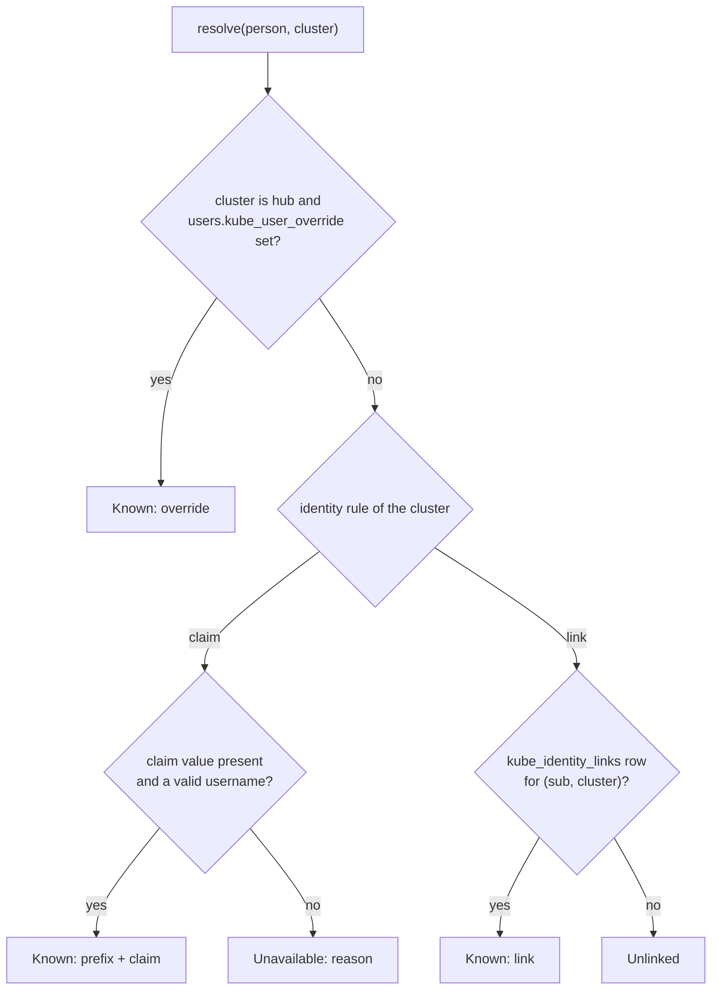

The same function decides `kube_user` for every consumer:

| Consumer | Person | Cluster | When |
| --- | --- | --- | --- |
| People token | The person who approves | The cluster of the audience in `CONTROLLER_PEOPLE_AUDIENCES` | At code exchange and at each refresh |
| Agent token | The launcher, found by login in `users` | The cluster of the run | At each token request (`cluster_identity.rs:101`) |
| Agent tools record | The person in `runs.dispatched_by` | The cluster of each `crucible-kueue` tool | After the launch commits the run row (`crucible-controller/src/runs/agent_tools.rs:283`) |
| Settings and consent pages | The caller | Each cluster of the profile | On each read |

A launcher that never logged in has no `users` row, so its `kube_user` is unavailable. Because the
agent token resolves at each request, a new link applies to the next token of a run that is
already live.

Note: The links, the override and the settings panels are served only when the controller mints
agent tokens, people tokens are configured, or the profile has `[cluster_link]`
(`crucible-controller/src/api/mod.rs:672`, `crucible-controller/src/api/state.rs:306`). So an
agent-only deployment on a `link` cluster serves the paste link route. A person can link a
username there, and the runs of that person then get it.

## 6. Per-run gateway isolation

### 6.1 Why each run has its own gateway

A SPIFFE ID of a sandbox is only as trustworthy as the pods that can carry it. SPIRE derives the
ID from pod metadata. If pack code can create a pod in the sandbox namespace, it can claim the
SPIFFE ID of any sandbox. When the gateway runs inside the loop pod, the loop service account
needs pod rights in the sandbox namespace. Pack code runs as that account.

So under an isolated profile, the controller starts each run's gateway in a pod of its own, as
`crucible-openshell-gateway`. That account is the only identity with sandbox rights in the
sandbox namespace. The gateway stamps its gateway id on every supervisor and `Sandbox` that it
creates, from its own configuration. `driver_config` cannot set labels or annotations. The
ClusterSPIFFEID puts the gateway id in the SPIFFE ID:

```yaml
spiffeIDTemplate: 'spiffe://{{ .TrustDomain }}/openshell/gateway/{{ index .PodMeta.Labels "openshell.ai/gateway-id" }}/sandbox/{{ index .PodMeta.Annotations "openshell.ai/sandbox-id" }}'
```

The token endpoint then refuses an SVID whose gateway id is not the bound run's gateway id.

### 6.2 Lifecycle

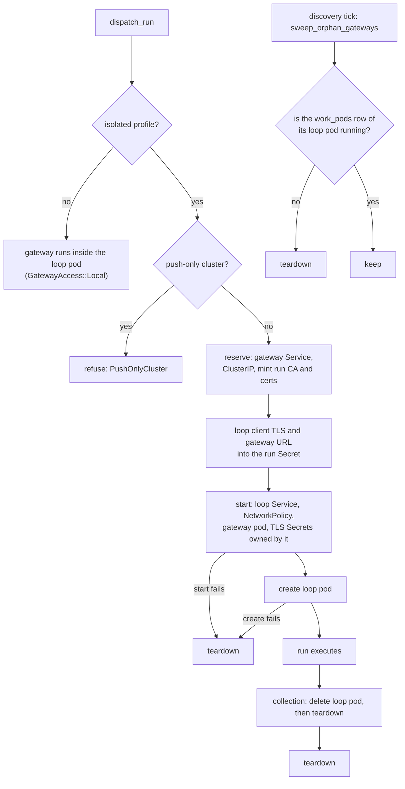

The phases are these:

- `reserve` creates the gateway Service and mints the TLS material for its ClusterIP
  (`crucible-controller/src/runs/workpod/gateway.rs:184`).
- `start` creates the loop Service, the NetworkPolicy and the gateway pod (`gateway.rs:256`).
  It then creates the two TLS Secrets with an owner reference to the gateway pod.
- `teardown` deletes objects in this order (`gateway.rs:337`):
  1. the `Sandbox` resources and supervisor pods with the gateway id label;
  2. the loop Service in the loop namespace;
  3. the gateway's own objects.

  The gateway's own objects go last. A `teardown` that fails halfway leaves the label that the
  sweep finds.
- `sweep_orphan_gateways` runs on the daemon discovery tick (`gateway.rs:398`). It finds the
  gateway objects in each sandbox namespace by `crucible.dev/role=openshell-gateway`. It removes
  each gateway whose loop pod row is absent or not `running`. The daemon registers it only
  under an isolated profile.

A failed launch removes its gateway at once (`crucible-controller/src/runs/workpod/run.rs:1015`).
Collection removes it after it deletes the loop pod (`run.rs:1116`). Each failure logs a warning
and leaves the rest to the sweep.

Turn pods (grounded rank, scope) get a gateway the same way, with certificates valid for the turn
deadline (`crucible-controller/src/runs/workpod/spec.rs:409`). Their loop Service opens only the
OTLP collector port. Turn sandboxes are never bound, so they get no agent tokens.

### 6.3 Objects

| Namespace | Object | Name | Created by | Removed by |
| --- | --- | --- | --- | --- |
| loop | loop pod | `<run pod>` | controller | collection |
| loop | run Secret | from `secret_name(<run pod>)` | controller | owner reference to the loop pod |
| loop | loop Service | `<run pod>` (hashed if long) | controller `start` | `teardown` |
| buildit | builder pods | per build | `buildit` | `buildit clean`; the pod deadline stops them |
| sandbox | gateway Service | `<run pod>-gw` (hashed if long) | controller `reserve` | `teardown` |
| sandbox | gateway NetworkPolicy | `<run pod>-gw` | controller `start` | `teardown` |
| sandbox | gateway pod | `<run pod>-gw` | controller `start` | `teardown` |
| sandbox | server TLS Secret | `<run pod>-gw-tls` | controller `start` | owner reference to the gateway pod, and `teardown` |
| sandbox | supervisor client TLS Secret | `<run pod>-gw-client` | controller `start` | owner reference to the gateway pod, and `teardown` |
| sandbox | `Sandbox` resources | per sandbox | gateway | owner reference to the gateway pod after bind, and `teardown` |
| sandbox | supervisor pods | per sandbox | gateway | `teardown` |

The gateway objects carry `crucible.dev/gateway-for=<run pod>` and
`crucible.dev/role=openshell-gateway`. What the gateway creates carries
`openshell.ai/gateway-id=<gateway id>` (`crucible/src/deploy/render/gateway.rs:78`).

The run Secret holds the loop pod client material under `openshell-gateway-ca.crt`,
`openshell-gateway-tls.crt` and `openshell-gateway-tls.key`. The engine reads them as files in
`/etc/crucible/gateway-tls`. The loop pod env gets `CRUCIBLE_OPENSHELL_GATEWAY_URL`
(`https://<gateway ClusterIP>:17670`) and `CRUCIBLE_OPENSHELL_GATEWAY_TLS_DIR`.

The gateway pod runs the loop image with the command `crucible openshell-gateway`
(`crucible/src/deploy/render/gateway.rs:224`, `crucible/src/openshell/gateway.rs:886`). It gets
the driver env of the loop pod (`CRUCIBLE_SANDBOX_*`, the supervisor and runtime images, the OTLP
endpoints), and these per-run values:

| Env | Value |
| --- | --- |
| `CRUCIBLE_GATEWAY_GRPC_ENDPOINT` | The URL that supervisors dial back |
| `CRUCIBLE_GATEWAY_HOST_IP` | The loop Service ClusterIP: `host.openshell.internal` inside sandboxes |
| `CRUCIBLE_GATEWAY_CLIENT_TLS_SECRET` | The Secret the driver mounts into supervisors |
| `CRUCIBLE_GATEWAY_SERVER_TLS_DIR` | Where the server TLS Secret is mounted |
| `CRUCIBLE_GATEWAY_ID` | The gateway id |

The gateway keeps its state in memory (`--db-url sqlite::memory:`). Under the kubernetes driver,
the gateway accepts any client with a certificate from the run CA as an authorized user
(`crucible/src/openshell/gateway.rs:507`). The run CA is the boundary.

### 6.4 The per-run CA

`GatewayTls::mint` (`crucible-controller/src/runs/workpod/gateway.rs:90`) uses `rcgen` to make:

- a CA, constrained to path length 0, with `keyCertSign` and `cRLSign`;
- a server certificate with the gateway Service ClusterIP as its only IP SAN, `serverAuth`;
- a loop client certificate, `clientAuth`;
- a supervisor client certificate, `clientAuth`.

All four start one day before the mint date. They end after the run deadline in whole days plus
one day, or after 30 days for a run with no deadline. The controller drops the CA key after the
mint. No other run trusts this CA, so a certificate of one run cannot call the gateway of another.

### 6.5 Network policy

The gateway NetworkPolicy (`crucible/src/deploy/render/gateway.rs:362`) selects the gateway pod.
It admits ingress on port 17670 only from:

- the loop pod of this run (`crucible/run=<run>` in the loop namespace), and
- supervisor pods with `openshell.ai/component=supervisor` and this gateway id.

The loop Service exposes the ports that the rendered loop NetworkPolicy lists for sandbox
traffic. These are the broker, the OTLP collector, `buildit` on 8848 with `[buildit]`, and the
`[mcp]` servers of the pack. Under an isolated profile, the loop render omits port 17670
(`crucible/src/deploy/render/kube.rs:1342`).

### 6.6 RBAC for each identity

| Identity | Namespace | Rights | Source |
| --- | --- | --- | --- |
| `crucible-openshell-gateway` | sandbox | `sandboxes`, `sandboxes/status`: create, delete, get, list, patch, update, watch; `events`: get, list, watch; `pods`: create, delete, get, list, patch, watch; `services`, `networkpolicies`: create, get; `persistentvolumeclaims`: get; `secrets`: create, delete | loop render `sandbox_rbac` (`kube.rs:1473`) |
| `crucible-openshell-gateway` | cluster | `tokenreviews`: create; `nodes`: get, list, watch; `runtimeclasses`, `priorityclasses`, `namespaces`: get | same |
| sandbox service account (`[cluster] sandbox_service_account`, default `crucible-sandbox` under isolated gateways) | sandbox | none. Sandbox and supervisor pods mount no token; the account needs only what admits them (an OpenShift SCC). The render creates it | loop render `sandbox_rbac` |
| controller identity (`[cluster] sandbox_readers`) | sandbox | `sandboxes`: get, list, patch, delete; `pods`: get, list, create, delete; `pods/finalizers`: update; `services`, `secrets`, `networkpolicies`: list, create, delete | loop render `sandbox_reader_rbac` (`kube.rs:1658`) |
| controller identity | loop | `services`: list, create, delete; plus the dispatch rights in `docs/controller-deploy.md` | same, and the operator |
| controller identity | SPIRE | `services/proxy`: get | the operator |
| controller identity | cluster | `tokenreviews`: create (`system:auth-delegator`), for links | the operator |
| loop service account | sandbox | none under an isolated profile | loop render |
| loop service account | buildit | `pods`: create, delete, get, list, watch; `pods/exec`: create, get; `pods/log`: get. The Role and RoleBinding are `<service account>-buildit`, for `buildit` builder pods. None in the loop namespace | loop render `buildit_rbac` with `[buildit]` (`kube.rs:1707`) |

Note: `pods/finalizers` update is necessary on OpenShift. The TLS Secrets have an owner reference
with `blockOwnerDeletion` to the gateway pod, and the OpenShift owner-reference admission checks
that right.

Note: The loop render grants the builder pod rights only when the profile has `[buildit]`, and
only in `[buildit] namespace`. The render does not depend on `sandbox_driver`.

Warning: The loop service account is shared by every run. Rights to create pods or exec into pods
in the loop namespace would let one run's pack code reach another run's loop pod and run Secret:
its gateway client certificate, pod token, push authfile and kubeconfig. It could also label a pod
`crucible/run=<other run>` to pass that run's gateway NetworkPolicy. That is why builder pods live
in a namespace of their own, which profile load refuses to share with the loop, rig, sandbox or
crucible-kueue namespaces. The rights in the buildit namespace still let runs see each other's
builder pods there, including a push's authfile while `buildit` streams it into the builder pod.
The clean end state is `buildit` under a service account of its own.

With `[cluster] aws_sandbox_role_arn`, the gateway pod gets its own projected token for the
`sts.amazonaws.com` audience. The trust policy of that role must allow
`system:serviceaccount:<sandbox namespace>:crucible-openshell-gateway`.

### 6.7 Push-only clusters and directly reachable clusters

The controller creates gateway objects, reads `Sandbox` resources and reads SPIRE keys through
its own API client for the cluster. A push-only cluster sends snapshots to the hub, and the hub
has no client for it. So under an isolated profile, dispatch to a push-only cluster fails with
`PushOnlyCluster` (`crucible-controller/src/runs/workpod/run.rs:557`, `run.rs:707`).

A cluster is push-only when the hub has a push token for it and no client for it. A cluster
has a client when it is the hub, a personal target, or has a kubeconfig in
`CONTROLLER_CLUSTERS_DIR`. A cluster with both a push token and a kubeconfig dispatches
normally.

Note: The token path depends on the per-cluster client. When the hub cannot reach a spoke, the
sandboxes of that spoke get no tokens until the spoke is reachable again.

### 6.8 When `sandbox_namespace` is unset

| Area | Isolated profile | `sandbox_namespace` unset |
| --- | --- | --- |
| Gateway | A pod of its own per run and per turn | Inside the loop pod |
| Sandboxes and supervisors | Sandbox namespace | Loop namespace |
| Sandbox RBAC | `crucible-openshell-gateway` | The loop service account |
| Loop NetworkPolicy | No gateway port | Admits sandbox pods on 17670 |
| Agent tokens with `CONTROLLER_AGENT_SPIRE` set | Issued | The controller does not start (`PlacementError`) |
| Token endpoint without `CONTROLLER_AGENT_SPIRE` | `unsupported_grant_type` | `unsupported_grant_type` |
| Bind route | Served | 409: the profile names no sandbox namespace |
| Gateway sweep | Registered | Not registered |
| Push-only dispatch | Refused | Allowed |
| People tokens | Allowed | Allowed (they vouch for no sandbox) |

Profile load also refuses a sandbox namespace that is the loop namespace, the rig namespace, the
`crucible-kueue` namespace or the workload namespace (`crucible/src/deploy/profile.rs:859`).

## 7. crucible-kueue internals

### 7.1 Request pipeline

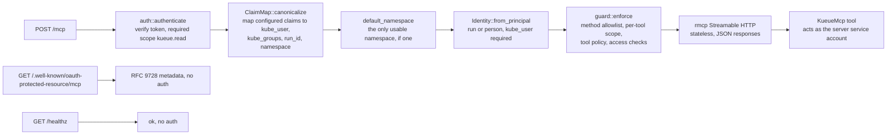

The app is built in `crucible-kueue/src/lib.rs:62`:

1. `auth::authenticate` verifies the bearer token and checks `kueue.read`
   (`crucible-kueue/src/auth.rs:117`). A token that fails verification gets a 401 with the RFC
   9728 challenge. A token without `kueue.read` gets a 403 step-up challenge.
2. `ClaimMap::canonicalize` copies the configured claims into the canonical names, and removes a
   canonical claim that the configured claim does not supply (`crucible-kueue/src/config.rs:289`).
   A token cannot set `kube_user` itself unless `kube_user` is the configured user claim.
3. A token without `namespace` gets the one namespace the caller can use, when there is exactly
   one (`auth.rs:36`).
4. `Identity::from_principal` refuses a people token with `run_id`, a people token on a server
   with no reviewer, and any token without `kube_user` (`auth.rs:68`). The refusal is a 403. A
   run's identity is its
   `run_id`; a person's is its `sub`. A value that is not a label value gets a hash suffix.
5. The guard decides the request (`crucible-mcp-auth/src/guard.rs:45`). `initialize`, `ping`,
   `server/discover`, `notifications/*` and responses to the server pass. `tools/list` passes and
   has injected parameters removed from each `inputSchema`. Every other method must be listed
   in `KueueRules`. JSON-RPC batches are refused.
6. For a listed call, the guard checks the scope. For a tool, it then applies the tool policy.
   It then sends each access check to the reviewer (`guard.rs:141`). The request goes on as the guard parsed and
   rewrote it.
7. A refused tool call returns a tool result with `isError` and the text
   `{"status": "refused", "error", "retryable"}`, so the model can read the reason. Only an
   access review that did not complete (the API server or the group lookup failed) is
   `retryable`; a caller the reviewer cannot check (an empty or `system:` `kube_user`, malformed
   `kube_groups`) is refused for good (`ReviewError`, `crucible-mcp-auth/src/access.rs`). An absent
   scope returns a 403 step-up challenge. A refused method returns JSON-RPC error `-32001`.

### 7.2 Tools

| Tool or method | Scope | Access check as `kube_user` |
| --- | --- | --- |
| `whoami` | `kueue.read` | none |
| `queues_list` | `kueue.read` | `list` `localqueues` |
| `queue_describe`, `hardware_describe` | `kueue.read` | `get` the LocalQueue |
| `workload_status`, `tasks/get` | `kueue.read` | `get` the workload |
| `workload_list` | `kueue.read` | `list` Kueue `workloads` |
| `workload_logs` | `kueue.read` | `get` `pods/log` |
| `workload_plan`, `workload_submit` | `kueue.submit` | `use` (or `get`) the LocalQueue, `create` the kind, `get` each Secret and PVC the manifest names |
| `workload_scale` | `kueue.submit` | `update` the `scale` subresource |
| `workload_stop`, `workload_resume`, `tasks/cancel` | `kueue.submit` | `update` the workload |
| `workload_delete` | `kueue.submit` | `delete` the workload |

The namespace of each check is the call's `namespace` argument, else the token's `namespace`
claim. Every tool takes an optional `namespace`.

Note: A unit test fails if a tool has no scope in `KueueRules`. A new tool cannot ship
unchecked.

### 7.3 Plan, then submit

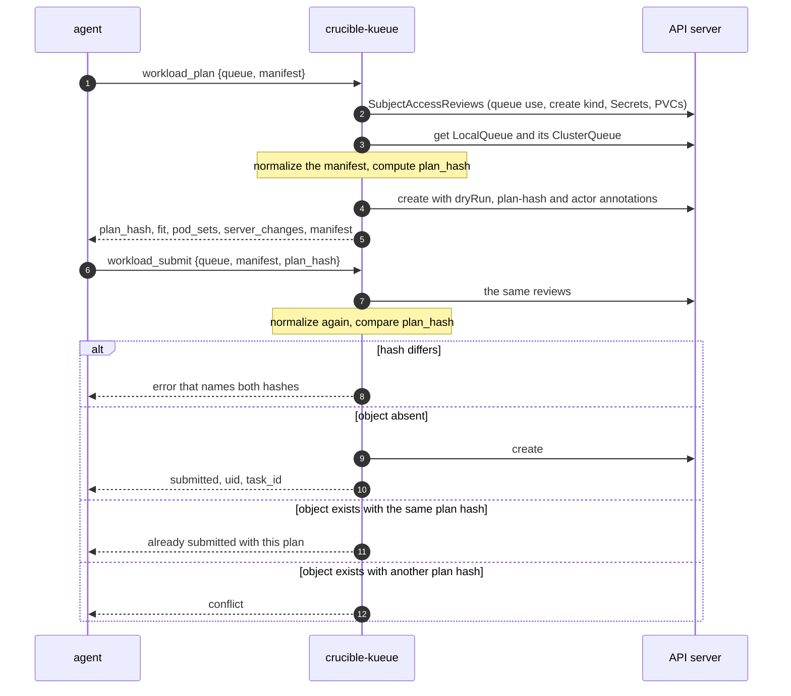

`workload_plan` normalizes the manifest, runs a server-side dry run, and estimates the fit
against the ClusterQueue quota as `fits_now`, `waits_for_quota` or `never_fits`
(`crucible-kueue/src/server.rs:1604`). It returns `plan_hash`, `finished_retention_seconds`,
`server_changes`, the admission mode, the pod sets, the total requests and the normalized
manifest.

`workload_submit` normalizes the same input again and compares the hash
(`server.rs:1658`). The hash is the SHA-256 of the normalized object as key-sorted JSON
(`crucible-kueue/src/manifest.rs:504`). It depends only on content, so the agent must send the
same queue and the same manifest. An identical resubmit is a no-op. A name that holds another
plan is a conflict.

After the hash, the server stamps two annotations: `<domain>/plan-hash`, and for a run,
`<domain>/actor` with the SPIFFE ID of the presenter (`server.rs:288`).

### 7.4 Manifest allowlist and profiles

The allowlist is data (`crucible-kueue/src/profile.rs`). Anything not on the list is refused.

| List | `strict` | `tenant` adds |
| --- | --- | --- |
| Pod fields | `containers`, `initContainers`, `restartPolicy`, `terminationGracePeriodSeconds`, `activeDeadlineSeconds`, `dnsPolicy`, `dnsConfig`, `nodeSelector`, `affinity`, `topologySpreadConstraints`, `securityContext`, `volumes`, `imagePullSecrets`, `hostname`, `subdomain`, `setHostnameAsFQDN`, `enableServiceLinks`, `shareProcessNamespace`, `hostAliases`, `readinessGates`, `automountServiceAccountToken` | `tolerations`, `priorityClassName`, `resourceClaims` |
| Container `resources` | `requests`, `limits` | `claims` |
| Volume sources | `emptyDir`, `configMap`, `downwardAPI`, `ephemeral`, `projected` | `secret`, `persistentVolumeClaim` |
| Projected sources | `configMap`, `downwardAPI` | `secret` |
| `env[].valueFrom` | `fieldRef`, `resourceFieldRef`, `configMapKeyRef` | `secretKeyRef` |
| `envFrom[]` | `configMapRef`, `prefix` | `secretRef` |
| Reserved label domains | `kueue.x-k8s.io`, `openshell.ai`, `spiffe.io`, and the server label domain | only the server label domain |
| Allowed reserved labels | none | `kueue.x-k8s.io/priority-class` |
| Allowed reserved annotations | none | `kueue.x-k8s.io/podset-required-topology`, `kueue.x-k8s.io/podset-preferred-topology` |

A TOML file starts from `base = "strict"` or `base = "tenant"` and has optional `[add]` and
`[remove]` tables with the same list names. The tool policy can make any rule stricter.

The pod field list has no `serviceAccountName`, `hostNetwork`, `hostPID`, `hostIPC`, `nodeName`,
`schedulerName` or `runtimeClassName`. So a manifest cannot pick another identity, the host, or a
way past Kueue. The object-level `spec` of each kind is also on a list, so fields such as
`managedBy` never reach the cluster.

### 7.5 Normalization

`normalize` (`crucible-kueue/src/manifest.rs:303`) does these steps:

1. Find the kind from `apiVersion` and `kind`. Seven kinds are known: Job, RayJob,
   LeaderWorkerSet, Deployment, StatefulSet, JobSet, PyTorchJob.
2. Remove `status`, `uid`, `resourceVersion`, `creationTimestamp` and `managedFields`. Refuse
   `generateName`, `ownerReferences` and `finalizers`.
3. Require `metadata.name` as a DNS-1123 label.
4. Set `metadata.namespace` to the caller namespace. Refuse another value.
5. Refuse reserved labels and annotations that the profile does not allow (`manifest.rs:822`).
6. Set the object labels: `kueue.x-k8s.io/queue-name`, `<domain>/managed-by=crucible-kueue`,
   `<domain>/run-id`, `<domain>/owner-kind` (`run` or `person`), `<domain>/launched-by`. A
   manifest value that conflicts is refused.
7. With `--suspend` (default true), create Jobs and JobSets with `spec.suspend: true`, and
   PyTorchJobs with `spec.runPolicy.suspend: true`, for Kueue to start on admission.
8. For batch kinds, add `activeDeadlineSeconds` (default 86400) and `ttlSecondsAfterFinished`
   (default 3600) where the manifest sets none (`manifest.rs:228`). A JobSet gets the deadline on
   each replicated Job; a PyTorchJob gets both on `runPolicy`; a RayJob gets the TTL only with
   `shutdownAfterJobFinishes: true`.
9. Check the object-level fields of the kind. A RayJob may not enable the in-tree autoscaler, and
   its head service must be `ClusterIP`. Volume claim templates may set only access modes,
   resources and volume mode.
10. In each pod template: check reserved metadata, set `<domain>/workload` and `<domain>/run-id`,
    check the pod spec (`manifest.rs:1142`), and set `automountServiceAccountToken: false`. A
    manifest with `true` is refused.
11. Check each container. Refuse privilege, privilege escalation, root and added capabilities.
    Accept `procMount` only as `Default`, and seccomp and AppArmor only as `RuntimeDefault`. Refuse
    a probe or hook with a `host`.
12. Add pull secrets (section 7.6).
13. For a Deployment or StatefulSet, pin `spec.selector.matchLabels` to the workload and run-id
    labels, so its controller adopts only pods of this object (`manifest.rs:1122`).

`server_changes` in the plan lists what step 12 added.

### 7.6 Pull secrets

`--pull-secret name` or `--pull-secret name=registry` declares a pull secret of the served
namespaces. A pod template may name only declared pull secrets. When a container image is on a
declared registry (a host, or a host/path prefix), the server adds that secret to the pod itself
(`crucible-kueue/src/manifest.rs:433`). An image on another registry must be public.

Warning: The server does not create the pull secret. It must exist in the workload namespace with
that name, or the pods cannot pull. `crucible deploy render --kueue` does not copy it.

### 7.7 Access checks and namespaces

The reviewer (`crucible-mcp-auth/src/kube.rs`) builds a SubjectAccessReview with:

- `user`: the canonical `kube_user`, never a `system:` user;
- `groups`: OpenShift `Group` objects that list the user (`--kube-authz openshift`), or the
  `kube_groups` claim without `system:` entries (`--kube-authz token`), plus
  `system:authenticated` and `system:authenticated:oauth`;
- the resource attributes of the access check.

The server serves the namespaces in `--namespace`, else every namespace that holds a LocalQueue.
A caller can use a served namespace when its RBAC lets it list LocalQueues there
(`crucible-kueue/src/namespaces.rs:97-115`). The answer is cached 30 seconds per identity
(subject, `kube_user` and `kube_groups`), so a RoleBinding granted or removed shows in the usable
list within 30 seconds; the per-call access checks are not cached. Every tool call and both task methods resolve the
namespace they act in (the call's `namespace` argument, the token's `namespace` claim, or the task
id's namespace) and refuse one the server does not serve with `not_found` and the list of usable
namespaces, before anything reaches the API server (`served_caller`,
`crucible-kueue/src/server.rs:661`). A server with no `--namespace` that cannot list LocalQueues
cluster-wide serves nothing. It never passes on the API server message about the server's own
account.

### 7.8 Status rollup and the wait

Kueue can track one object as several Workloads. A Deployment gets one Workload for each pod.
`rollup` (`crucible-kueue/src/status.rs:138`) gives each Workload a phase: `NoWorkload`,
`Pending`, `QuotaReserved`, `Admitted`, `Evicted`, `Stopped`, `Finished`. The headline is the
phase furthest from the run state, with counts for each phase. So `pending` with
`admitted > 0` means partly admitted.

`workload_status` reports the phase and the reason. While the workload waits, it also reports
the queue position and a new fit estimate. It then reports pod counts, up to five problem pods
with exit messages, recent events and a `next_action`. `detail: "full"` adds all conditions,
the object status and every pod.

With `until` (`admitted`, `running`, `ready` or `finished`) the server waits for up to
`timeout_seconds`, at most 50, and polls each 2 seconds (`crucible-kueue/src/server.rs:1228`).
The wait ends with one of these:

| `ended` | Cause |
| --- | --- |
| `reached` | The workload is at `until` or past it |
| `settled` | The workload is `Finished` or `Stopped` and cannot reach `until` alone |
| `stuck` | A pod has a problem of the highest severity |
| `timeout` | The time is over |

### 7.9 MCP tasks

The server enables the MCP tasks extension for batch kinds (Job, RayJob, JobSet, PyTorchJob). A
client that declares the extension gets a task from `workload_submit`. The task id is
`<namespace>/<Kind>/<name>/<uid>` (`crucible-kueue/src/task.rs:16`), so a new object with the same
name is a different task. Clients without the extension get a synchronous reply that still
carries `task_id`.

The server keeps no task state. `tasks/get` reads the cluster each time. A task completes when
Kueue marks the Workload finished. It failed unless the reason is `Succeeded`. `tasks/cancel` sets
the `<domain>/task-cancelled` annotation and deactivates the Workload (`server.rs:2175`).

Serving kinds are never tasks. `workload_status` reports their `readiness` instead.

### 7.10 Ownership modes

| Mode | Stop, resume, scale, delete |
| --- | --- |
| `managed` (default) | Only objects with `<domain>/managed-by=crucible-kueue`, the caller's `<domain>/run-id` and the caller's kind in `<domain>/owner-kind`, so a person whose subject reads like a run id owns nothing of that run |
| `rbac` | Any object of a served kind that the access checks allow |

`workload_list` takes `filter`: `mine` (default, this run), `managed` (all objects of this
server), or `all` (every Kueue-queued workload of a served kind). Stop and resume deactivate the
Kueue Workload for Job, RayJob, LeaderWorkerSet, JobSet and PyTorchJob. For a Deployment or
StatefulSet they scale to zero and keep the replica count in `<domain>/stopped-replicas`.

### 7.11 Kueue version and kinds

At startup the server reads `/apis/kueue.x-k8s.io` and uses `v1beta2`, else `v1beta1`. It does not
start when the cluster serves neither (`crucible-kueue/src/kueue.rs:49`). It also lists which of
the seven kinds the cluster installs (`crucible-kueue/src/kinds.rs:11`). `whoami` and the server
instructions report them.

### 7.12 Generic configuration

The server does not need crucible. These flags make it a general Kueue MCP server for a cluster
with a stock OIDC provider:

| Flag | Default | Use |
| --- | --- | --- |
| `--label-domain` | `crucible.dev` | The domain of every stamped label and annotation |
| `--user-claim` | `kube_user` | The claim that names the Kubernetes user |
| `--user-prefix` | empty | The prefix of the user, as `--oidc-username-prefix` on the API server |
| `--groups-claim` | `kube_groups` | The groups claim, with `--kube-authz token` |
| `--run-id-claim` | `run_id` | The run claim of run tokens; empty for none, which is refused with `--run-issuer` |
| `--namespace-claim` | `namespace` | The default namespace claim |
| `--queue-verb` | `use` | `use`, or `get` where roles do not grant Kueue's custom verb |
| `--ownership` | `managed` | `managed` or `rbac` |
| `--allowlist-profile` | `strict` | `strict`, `tenant`, or a TOML file |

## 8. buildit per run

### 8.1 Where it runs

`buildit` runs as a child process of the engine in each loop pod of a `[buildit]` cluster. The
engine starts it when the loop pod has `CRUCIBLE_BUILDIT_RUN_ISSUER`
(`crucible/src/openshell/buildit.rs:158`). It listens on port 8848. Sandboxes reach it at
`http://host.openshell.internal:8848/mcp`, which is the loop Service. The supervisor injects a
token for that audience on egress to that host and port only.

The engine starts it with these arguments (`buildit.rs:127`):

| Argument | Value |
| --- | --- |
| `--run-issuer` | `<issuer>=<jwks uri>` from `CRUCIBLE_BUILDIT_RUN_ISSUER` |
| `--resource` | `http://host.openshell.internal:8848/mcp` |
| `--allowed-host` | `host.openshell.internal` |
| `--tool-policy` | the shipped `buildit/deploy/buildit-policy.toml` |
| `--run-id` | the loop pod name |
| `--namespace` | `[buildit] namespace`, from `CRUCIBLE_BUILDIT_NAMESPACE` |
| `--insecure-jwks-http` | when the JWKS URI is plain http |
| `--push-repo`, `--push-authfile` | when both `CRUCIBLE_BUILDIT_PUSH_REPO` and the loop pod push authfile exist |

### 8.2 Who may call it

`realm_caller` (`buildit/src/mcp.rs:832`) accepts a token only when all of these are true:

- The trusted issuer is a run issuer. People tokens are refused.
- `run_id` is this server's `--run-id`. A token of another run is refused.
- `sandbox` is a label value. It names the sandbox to read from.
- `workdir`, when present, is an absolute normal path.
- `sub` is a label value. It becomes `crucible.dev/launched-by` on builder pods.

The scopes are `buildit.read` for `status`, `logs` and `tasks/get`, and `buildit.build` for
`build`, `run`, `push`, `clean` and `tasks/cancel`. `buildit` does no access checks: it builds in
its own namespace for the run's own sandboxes.

### 8.3 How it reads the sandbox

For `build`, `buildit` downloads the build context with
`openshell sandbox download <sandbox> <workdir>/<context> <dest>` through the run's gateway
(`buildit/src/sandbox.rs:101`). The context path must be relative, without `..`. It may not
contain `.git`, `.mcp.json`, `.claude`, `.buildit`, `.kube` or `.jira`. `sanitize` then deletes
those names, special files, and symlinks that resolve outside the context (`sandbox.rs:207`). `run`
writes requested output paths back to `<workdir>/.buildit/<build id>/` in the sandbox with
`openshell sandbox upload`.

### 8.4 Builder pods

Each build gets one builder pod in the buildit namespace (`buildit/src/mcp.rs:971`). The pod has
the labels `buildit.dev/managed-by=mcp`, `buildit.dev/sandbox`, `buildit.dev/build-id` and
`crucible.dev/launched-by`. It runs `buildah` with `automountServiceAccountToken: false`,
`enableServiceLinks: false` and an `activeDeadlineSeconds` of `--pod-deadline` (default 7200).
`--max-builds` (default 4) limits live builder pods per sandbox. The shipped policy caps a build at
3600 seconds and a run at 1800 seconds; without a value they are 1800 and 600.

Warning: A build's `RUN` steps and `buildit run` execute the agent's code in the builder pod, with
no OpenShell sandbox around it. The loop render's NetworkPolicy `buildit-builders` in the buildit
namespace admits no ingress to builder pods, and egress only to DNS (UDP and TCP 53 and 5353) and to
`[buildit] egress`, by default TCP 443 anywhere, for the registries a build pulls from and pushes to.
A NetworkPolicy matches IP networks, not host names: to keep `RUN` steps away from in-cluster
services, list the registries' networks, or add the cluster's pod and service networks as `except`.

### 8.5 The push path

`push` publishes a build that succeeded to one repository only: `--push-repo`, for example
`registry.example.com/team/smoke`. The tag is `<sandbox>-<build id>`. The repository must be
`<registry>/<path>` with no tag, digest or scheme (`buildit/src/mcp.rs:457`).

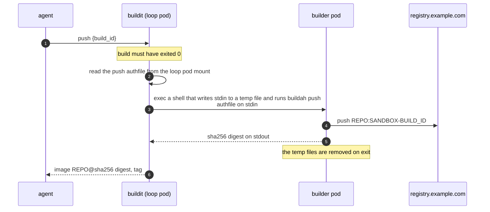

The authfile is the loop pod's `[secrets] push_authfile` Secret, mounted in the loop pod only
(`FORGE_AUTHFILE`). `buildit` reads it on each push and streams it to the builder pod over exec
stdin (`buildit/src/mcp.rs:479`, `mcp.rs:1089`). The builder pod never mounts it, and the sandbox
never sees it. Without a push repository or without the authfile, `push` is refused.

## 9. Configuration reference and feature flags

### 9.1 Controller environment

| Variable | Default | What it does |
| --- | --- | --- |
| `CONTROLLER_AGENT_ISSUER` | unset | The issuer identifier, an http(s) origin with no path. Unset disables the issuer, agent tokens, people tokens and the agent tools. Cluster links depend only on `[cluster_link]`. |
| `CONTROLLER_AGENT_SIGNING_KEY` | unset | The issuer key as inline PEM. |
| `CONTROLLER_AGENT_SIGNING_KEY_FILE` | unset | The issuer key file. Necessary when the issuer is set and the inline key is not. |
| `CONTROLLER_AGENT_PREVIOUS_SIGNING_KEY_FILE` | unset | The previous issuer key. The JWKS publishes it; it signs nothing. |
| `CONTROLLER_AGENT_TOKEN_TTL_SECS` | `900` | Agent token lifetime, 900 to 1800. |
| `CONTROLLER_AGENT_TOKEN_ENDPOINT` | `<issuer>/oauth/token` | Where supervisors reach the token endpoint, for a spoke that reaches the controller through a route. |
| `CONTROLLER_AGENT_SPIRE` | unset | Comma-separated `<cluster>=<svid issuer> <gateway prefix> [http://]<namespace>/<service>:<port>`. Each cluster and each SVID issuer once. A run gets agent tools only on a cluster listed here. Unset: the issuer serves people only, mints no agent tokens, grants no agent tools and stamps no dispatchers. |
| `CONTROLLER_AGENT_AUDIENCES` | unset | Comma-separated `[<cluster>:]<resource url>=<scope> <scope>`. Necessary with `CONTROLLER_AGENT_SPIRE`. A URL with no `=` grants no scopes. With `<cluster>:` the entry serves runs on that cluster only, and the same URL may appear once per cluster; without it the entry serves every cluster. A run gets a server only when the server URL is a resource here: the `crucible-kueue` Service URL `http://crucible-kueue.<namespace>.svc.<cluster domain>:8850/mcp`, or `http://host.openshell.internal:8848/mcp` for `buildit`. The run records the scopes of that entry. |
| `CONTROLLER_PEOPLE_AUDIENCES` | unset | Comma-separated `<cluster>:<resource url>=<scope> <scope>`. Enables people tokens. Each resource once. |
| `CONTROLLER_PEOPLE_ACCESS_TTL_SECS` | `900` | People token lifetime, 1 to 3600. |
| `CONTROLLER_PEOPLE_CLIENTS_FILE` | unset | A TOML file of `[[clients]]` with `client_id`, `name`, `redirect_uris` and optional `resources`. It replaces the built-in `claude-code`, `pi` and `codex`. Unset: the built-in clients (section 4.1.2). |
| `CONTROLLER_PEOPLE_CIMD_HOSTS` | unset | Comma-separated host names that may publish Client ID Metadata Documents. Unset: every URL `client_id` is refused (section 4.1.3). The controller needs outbound HTTPS to these hosts. It honours `HTTPS_PROXY`. |
| `CONTROLLER_PEOPLE_DCR` | on | `false`, `0`, `off` or `no` turns off `POST /oauth/register` and removes `registration_endpoint` from the metadata. `true`, `1`, `on`, `yes` or empty keeps it on (section 4.1.4). |
| `CONTROLLER_PEOPLE_TRUSTED_PROXIES` | unset | Comma-separated networks or addresses whose `X-Forwarded-For` names a registration's source. Unset: the TCP peer is the source (section 4.1.4). |
| `CONTROLLER_DEPLOY_PROFILE` | unset | The deploy profile. The issuer does not start without it. |
| `POD_NAMESPACE` | the service account namespace file | The controller namespace, for the issuer key placement check. |
| `CONTROLLER_AUTH_MODE` | per `docs/controller-auth.md` | People authorization needs `native`: `/oauth/authorize` reads a native session only. |
| `CONTROLLER_CLUSTER_LINK_SECRETS` | unset | A directory with one OAuth client secret file per cluster. Necessary when the profile has `[cluster_link]`. |
| `CONTROLLER_GITHUB_LOGINS` | unset | `<github login>=<crucible login>` pairs. A GitHub review approval sets the dispatcher only for a listed pair. |
| `CONTROLLER_PUSH_TOKENS`, `CONTROLLER_CLUSTERS_DIR` | unset | Together they decide which clusters are push-only (section 6.7). |

The issuer refuses to start when any of these is true:

- Any other `CONTROLLER_AGENT_*` or `CONTROLLER_PEOPLE_*` variable is set, but
  `CONTROLLER_AGENT_ISSUER` is not.
- `CONTROLLER_AGENT_ISSUER` is set, but neither `CONTROLLER_AGENT_SPIRE` nor
  `CONTROLLER_PEOPLE_AUDIENCES` is set.
- `CONTROLLER_AGENT_SPIRE` is set and the profile is not isolated.
- `CONTROLLER_PEOPLE_CLIENTS_FILE` cannot be read, is not a valid `[[clients]]` list, or names a
  `resources` entry that is not in `CONTROLLER_PEOPLE_AUDIENCES`.
- `CONTROLLER_PEOPLE_CIMD_HOSTS` is set and lists no host, or an entry that is not a host name.
- `CONTROLLER_PEOPLE_DCR` is not one of the values above.
- `CONTROLLER_PEOPLE_TRUSTED_PROXIES` has an entry that is not an IP network or address.
- The controller namespace is unknown, or is a loop, rig, sandbox, `crucible-kueue` or workload
  namespace.
- A value does not parse.

The three client variables apply only when `CONTROLLER_PEOPLE_AUDIENCES` is set. Without people
tokens, the controller does not read them.

### 9.2 Deploy profile keys

| Key | Default | What it does |
| --- | --- | --- |
| `[cluster] sandbox_driver` | per profile | `kubernetes` is one half of an isolated profile. |
| `[cluster] sandbox_namespace` | unset | The other half. Unset: sandboxes live in the loop namespace and no agent tokens are issued. |
| `[cluster] sandbox_service_account` | `crucible-sandbox` with a sandbox namespace, else the loop's | The account sandbox pods run as. Under isolated gateways it is never the loop's account, which does not exist in the sandbox namespace. |
| `[cluster] sandbox_readers` | `[]` | `namespace/name` service accounts that get the controller rights in section 6.6. |
| `[cluster] sandbox_spiffe_socket` | unset | The SPIFFE Workload API socket path that supervisors get through `csi.spiffe.io`. Unset: no socket, so no JWT-SVIDs. |
| `[cluster] identity` | `"link"` | The hub identity rule. |
| `[clusters.<name>] identity` | `"link"` | A spoke identity rule. |
| `[cluster] aws_sandbox_role_arn` | unset | The AWS role that the gateway pod assumes for sandboxes. |
| `[kueue] image` | required | The `crucible-kueue` image. |
| `[kueue] clusters` or `cluster` | `["hub"]` | The clusters where the server runs. Runs on these clusters get `crucible-kueue` access. |
| `[kueue] namespace` | required | The server namespace. |
| `[kueue] workload_namespace` | required | The `namespace` claim, and the only namespace where the server account has workload verbs. |
| `[kueue] run_issuer` | required | Must equal `CONTROLLER_AGENT_ISSUER`. |
| `[kueue] run_jwks_uri` | `<run_issuer>/.well-known/jwks.json` | For a server that cannot reach the issuer address. |
| `[kueue] kube_authz` | required | `openshift` or `token`: where groups come from. |
| `[kueue] cluster_domain` | `cluster.local` | The cluster DNS domain of the Service name. |
| `[kueue] pull_secrets` | `[]` | `name` or `name=registry` entries for `--pull-secret`. |
| `[kueue] people` | `false` | `true` renders `--person-issuer` with the same issuer as `run_issuer`, so the server also accepts people tokens. Set it when `CONTROLLER_PEOPLE_AUDIENCES` names this server. |
| `[buildit] clusters` or `cluster` | `["hub"]` | The clusters whose runs get `buildit`. |
| `[buildit] namespace` | required | Where builder pods run. Profile load refuses the loop, rig, sandbox, crucible-kueue and workload namespaces. |
| `[buildit] run_issuer` | required | Must equal `CONTROLLER_AGENT_ISSUER`. |
| `[buildit] egress` | TCP 443 to `0.0.0.0/0` and `::/0` | `[{ cidr, ports = [443], except = [] }, ...]`: where builder pods may connect besides DNS (section 8.4). |
| `[buildit] run_jwks_uri` | `<run_issuer>/.well-known/jwks.json` | For a loop pod that cannot reach the issuer address. |
| `[buildit] push_repo` | unset | The one repository for `push`. Unset: `push` is refused. |
| `[secrets] push_authfile` | unset | The Secret that holds the push authfile, mounted in the loop pod. |
| `[cluster_link] external_url` | required | The controller URL as browsers reach it. https, or http to loopback. |
| `[cluster_link] client_id` | `crucible-controller` | The `OAuthClient` name. |
| `[cluster_link] openshift` | required | The `link` clusters that link through their OAuth server. |
| `[cluster_link] access_token_max_age_secs` | `300` | The lifetime of the `user:info` token. |

### 9.3 Loop pod and gateway pod environment

The controller sets these. Do not set them by hand.

| Variable | Set when | Read by |
| --- | --- | --- |
| `CRUCIBLE_AGENT_TOKEN_ENDPOINT` | The run gets `crucible-kueue` or `buildit` (see the next rows) | engine: token-grant providers, and the bind decision |
| `CRUCIBLE_AGENT_SVID_AUDIENCE` | same | engine: `token_grant.jwt_svid_audience` |
| `CRUCIBLE_KUEUE_URL` | The run is on a `[kueue]` cluster that is in `CONTROLLER_AGENT_SPIRE`, and the server URL is in `CONTROLLER_AGENT_AUDIENCES` | engine: provider endpoint, `.mcp.json` server `kueue` |
| `CRUCIBLE_BUILDIT_RUN_ISSUER` | The run is on a `[buildit]` cluster that is in `CONTROLLER_AGENT_SPIRE`, and `http://host.openshell.internal:8848/mcp` is in `CONTROLLER_AGENT_AUDIENCES` | engine: starts `buildit` |
| `CRUCIBLE_BUILDIT_NAMESPACE` | The run gets `buildit` | engine: `buildit --namespace`; required with `CRUCIBLE_BUILDIT_RUN_ISSUER` |
| `CRUCIBLE_BUILDIT_PUSH_REPO` | The run gets `buildit` and `[buildit] push_repo` is set | engine: `buildit --push-repo` |
| `CRUCIBLE_OPENSHELL_GATEWAY_URL` | Isolated profile | engine: remote gateway |
| `CRUCIBLE_OPENSHELL_GATEWAY_TLS_DIR` | Isolated profile | engine: client material |
| `CRUCIBLE_GATEWAY_*` | Isolated profile, gateway pod only | `crucible openshell-gateway` |

The engine refuses a partial set: `CRUCIBLE_KUEUE_URL` without the token endpoint and audience
fails the turn, and so does `CRUCIBLE_BUILDIT_RUN_ISSUER` without them.

### 9.4 crucible-kueue flags

Each flag also has a `CRUCIBLE_KUEUE_*` environment variable (`crucible-kueue/src/bin/crucible-kueue.rs:16`).

| Flag | Default | What it does |
| --- | --- | --- |
| `--bind` | `0.0.0.0:8850` | Listen address. |
| `--context` | unset | A kubeconfig context; unset uses in-cluster config. |
| `--allowed-host` | loopback only | Extra `Host` values, for example the Service DNS name. |
| `--run-issuer` | at least one of the two issuer flags | `<issuer>=<jwks uri>` of run tokens. |
| `--person-issuer` | unset | `<issuer>=<jwks uri>` of people tokens. Needs `--resource` and `--kube-authz`. |
| `--resource` | required | The canonical MCP URLs; `aud` must name one. |
| `--cluster` | unset | The cluster this server acts on. A token's `kube_cluster` must name it. Unset: any cluster. Set it on each cluster when several serve the same URL. |
| `--jwks-ca` | unset | Extra CA bundle for JWKS hosts. |
| `--insecure-jwks-http` | false | Allows plain-http JWKS off loopback. |
| `--tool-policy` | unset | The CEL tool policy file. |
| `--kube-authz` | unset | `openshift` or `token`. Unset: every access check is refused, and people tokens are refused. |
| `--namespace` | discover | The served namespaces. |
| `--pull-secret` | none | Declared pull secrets. |
| `--default-active-deadline` | `86400` | Seconds, or `none`. |
| `--default-ttl-after-finished` | `3600` | Seconds, or `none`. |
| `--suspend` | `true` | Create batch kinds suspended. |
| `--accelerator-resource`, `--accelerator-product-label` | NVIDIA, AMD, Habana, TPU names | What `hardware_describe` counts. |
| other generic flags | section 7.12 | |

`crucible deploy render --kueue` renders the server with `--run-issuer`, `--resource`,
`--allowed-host`, `--kube-authz`, `--namespace <workload namespace>` and the pull secrets
(`crucible/src/deploy/kueue.rs:123`). With `[kueue] people = true`, it also renders
`--person-issuer` with the same issuer and JWKS URI as `--run-issuer` (`kueue.rs:141`).

Note: People tokens and agent tokens have the same `iss`. A server that trusts the issuer as both
kinds treats a token with `act` as a run and a token without `act` as a person.

### 9.5 buildit flags

| Flag | Default | What it does |
| --- | --- | --- |
| `--bind` (`MCP_BIND`) | `0.0.0.0:8849` | The engine sets `0.0.0.0:8848`. |
| `--run-issuer`, `--resource`, `--jwks-ca`, `--insecure-jwks-http` | | As for `crucible-kueue`. |
| `--tool-policy` | unset | The engine sets the shipped policy. |
| `--run-id` | unset | The only run whose tokens are accepted. Unset accepts any run. |
| `--namespace` | the client namespace | Where builder pods go. |
| `--push-repo` (`MCP_PUSH_REPO`) | unset | Needs `--push-authfile`. |
| `--push-authfile` (`MCP_PUSH_AUTHFILE`) | unset | Needs `--push-repo`. |
| `--pod-deadline` | `7200` | Builder pod `activeDeadlineSeconds`. |
| `--max-builds` | `4` | Live builder pods per sandbox. |

`buildit` also accepts an older tokens file. `buildit` never reads a compact JWT as a tokens-file
token.

### 9.6 What stays inert

With no agent or people configuration, the controller does none of the work in this document. A
test boots the controller with a deploy profile and no agent configuration and checks this
(`crucible-controller/src/lib.rs`).

| Area | Inert when | Detail |
| --- | --- | --- |
| `/oauth/token`, `/.well-known/jwks.json`, `/.well-known/oauth-authorization-server` | `CONTROLLER_AGENT_ISSUER` unset | Not routed (`crucible-controller/src/lib.rs:304`) |
| `/api/sandbox-bindings/runs/{run_id}` | same | Not routed |
| `/oauth/authorize` | `CONTROLLER_PEOPLE_AUDIENCES` unset | Not routed (`crucible-controller/src/lib.rs:138`) |
| `/oauth/register` | issuer unset | Not routed. With the issuer set and people tokens or registration off, it answers 404 `invalid_request` |
| Metadata document fetches | `CONTROLLER_PEOPLE_CIMD_HOSTS` unset | No outbound request; every URL `client_id` is refused |
| Identity routes: cluster identities, link, callback, consent, MCP sign-ins, hub override | no agent tokens, no people tokens and no `[cluster_link]` | Not routed, not in the OpenAPI document (`crucible-controller/src/api/mod.rs:672`) |
| `/api/agent-tools`, `/api/prefs/notices` | no agent tokens: issuer or `CONTROLLER_AGENT_SPIRE` unset (`crucible-controller/src/config.rs:858`) | Not routed |
| Gateway sweep | profile not isolated | Not registered |
| Grants sweep, registration sweep | no people tokens; the registration sweep also when registration is off | Not started |
| Loop pod env and token-grant providers | no agent tokens, or the run gets no server (section 9.3) | Not set, so the engine creates none and binds nothing |
| `issues.dispatch_requested_by`, `runs.dispatched_by` | no agent tokens | Not written |
| `run_agent_tools` | no agent tokens, or the run gets no server | Not written, and not read for run pages |
| `run_sandboxes` | no bind requests | Not written |
| `people_dynamic_clients` | no people tokens, or registration off | Not written |
| UI: defaults banner, run tools panel, consent page, settings panels | `/api/whoami` reports `features.agent_tools` and `features.identities` false | Not rendered and not fetched |

## 10. Data model

### 10.1 Tables and relations

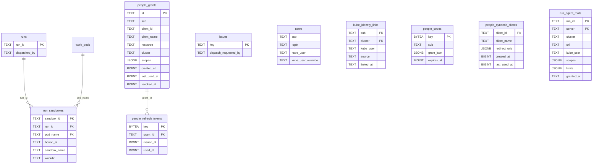

Only the foreign keys in the diagram exist. `kube_identity_links`, `people_*` and
`run_agent_tools` reference nothing outside themselves. `run_agent_tools` is written before the
run row exists, so it has no foreign key. `people_grants.client_id` has no foreign key to
`people_dynamic_clients`: most client IDs are registered names or URLs. The registration sweep
deletes the approvals of a `dyn-` client ID that has no row.

### 10.2 Migrations

| Migration | Change | Written by | Read by |
| --- | --- | --- | --- |
| `0059_run_sandboxes` | Table `run_sandboxes`: `sandbox_id` (PK), `run_id` (FK `runs`, cascade), `pod_name` (FK `work_pods`, cascade), `bound_at`; index on `pod_name` | `bindings::bind` from the bind route (`crucible-controller/src/agent_auth/bindings.rs:150`) | `bindings::resolve` at the token endpoint (`bindings.rs:239`) |
| `0060_user_kube_user` | Columns `users.kube_user` and `users.kube_user_override` | `kube_user_override`: `PUT /api/users/{login}/kube-user`. `kube_user`: nothing now | `kube_identity::override_for_sub` on the hub (`crucible-controller/src/identity/kube_identity.rs:64`). `kube_user` is read by nothing |
| `0061_run_sandbox_names` | Columns `run_sandboxes.sandbox_name`, `run_sandboxes.workdir`; a unique index on the name | the bind route | the token endpoint, for the `sandbox` and `workdir` claims |
| `0062_dispatch_principal` | Columns `issues.dispatch_requested_by`, `runs.dispatched_by` | `issues::store::request_dispatch` (unpark, redispatch, bump, scope, paired approval); `runs::store::stamp_dispatcher` at run creation, which also clears the request | `bindings::resolve` (the launcher) |
| `0063_run_sandbox_names_not_global` | Drops the unique name index | | The bind transaction checks a name only against live bindings on the same cluster |
| `0064_kube_identity_links` | Table `kube_identity_links` (`sub`, `cluster`) PK, `kube_user`, `source`, `linked_at` | `kube_links::link` (paste and OAuth link), `kube_links::unlink` | `cluster_identity::resolve` for people tokens, agent tokens, agent tools, settings and consent |
| `0065_people_grants` | Tables `people_codes`, `people_grants`, `people_refresh_tokens`, with indexes on `sub` and `grant_id` | `PgGrantStore` (`crucible-controller/src/agent_auth/people/grants.rs`) | `PgGrantStore` |
| `0066_run_agent_tools` | Table `run_agent_tools`, PK (`run_id`, `server`) | `agent_tools::grant` at dispatch (`crucible-controller/src/runs/agent_tools.rs:263`); `agent_tools::attribute` sets `kube_user` after the run row is committed (`agent_tools.rs:283`) | the run DTO and the issue DTO, for the run tools panel |
| `0067_people_grant_clients` | Columns `people_grants.client_id` and `people_grants.client_name`, `NOT NULL`. Rows from before get `claude-code` and `Claude Code`. Index on (`sub`, `client_id`) | `PgGrantStore::issue_refresh` | `rotate_refresh` (the client check), `live` (Settings), `revoke_client` |
| `0068_people_dynamic_clients` | Table `people_dynamic_clients`: `client_id` (PK), `client_name`, `redirect_uris`, `created_at`, `last_used_at`; index on `last_used_at` | `Dcr::register`; `Dcr::client` stamps `last_used_at` (`crucible-controller/src/agent_auth/people/dynamic.rs:287`, `dynamic.rs:345`) | `Dcr::client` at authorize and token; `Dcr::sweep` deletes idle rows |

Secrets in `people_codes` and `people_refresh_tokens` are stored only as SHA-256. A spent refresh
token stays in its row with `used_at` until its approval goes, so a reuse is recognized.

Note: `users.kube_user` is no longer written or read. An earlier design learned it passively from
cluster tokens. The hub username now lives in `kube_identity_links` like any other cluster, plus
the override.

## 11. Operations

### 11.1 Deploy order

Do these steps in this order. The issuer must not issue agent tokens before gateway isolation is
in place.

1. Build the images from the same commit: the loop image, the controller image and the
   `crucible-kueue` image (`Containerfile.kueue`). The loop image must contain
   `crucible openshell-gateway`, `openshell-gateway` and `buildit`.
2. On each cluster that hosts runs, install SPIRE with the OIDC discovery provider. Add a
   ClusterSPIFFEID for supervisor pods in the sandbox namespace, with `jwtTtl: 5m` and the
   template in section 6.1.
3. In the deploy profile, set `sandbox_driver = "kubernetes"`, `sandbox_namespace`,
   `sandbox_readers` and `sandbox_spiffe_socket`.
4. Render the loop RBAC with `crucible deploy render --manifest <render.toml> --profile <profile>`.
   Apply the ServiceAccount, Roles and bindings on each cluster.
5. Grant the controller identity `get` on `services/proxy` in the SPIRE namespace of each cluster.
6. With `[buildit]`, create `[buildit] namespace`, and make sure that step 4 applied the Role and
   RoleBinding `<service account>-buildit` there (section 6.6). Builder pods run as that
   namespace's `default` service account; on OpenShift bind it to an SCC that admits them.
7. Render `crucible-kueue` with `crucible deploy render --kueue`. Apply it on each cluster in
   `[kueue] clusters`. Copy the declared pull secrets into the workload namespace. Create the
   LocalQueues.
8. Grant people their queues with ordinary RBAC (section 11.2).
9. Create the issuer key Secret in the controller namespace. Mount it in each replica.
10. Set the controller environment (section 9.1). Put each server URL that runs get in
    `CONTROLLER_AGENT_AUDIENCES`, and each cluster that hosts runs in `CONTROLLER_AGENT_SPIRE`.
    Make sure that loop pods reach the controller at `[cluster] ingest_url`. Restart the
    controller.
11. For people tokens: set `CONTROLLER_AUTH_MODE=native` and `CONTROLLER_PEOPLE_AUDIENCES`. Set
    `[kueue] people = true`, render `crucible-kueue` again, and expose it on a Route. To change
    the clients, set `CONTROLLER_PEOPLE_CLIENTS_FILE`, `CONTROLLER_PEOPLE_CIMD_HOSTS` or
    `CONTROLLER_PEOPLE_DCR` (section 4.1).
12. For OAuth links: render `crucible deploy render --cluster-link <cluster>` and apply it on that
    cluster with a new secret. Put the same secret in the `CONTROLLER_CLUSTER_LINK_SECRETS`
    directory under the cluster name.

To make the issuer key, use this command:

```sh
openssl ecparam -genkey -noout -name prime256v1 | openssl pkcs8 -topk8 -nocrypt -out agent-signing.pem
```

### 11.2 RBAC per spoke

Section 6.6 lists the gateway, controller and loop rights. `crucible deploy render --kueue` gives
the server account:

- cluster-wide: `clusterqueues` and `resourceflavors` get and list; `nodes` get and list;
  `subjectaccessreviews` create; with `openshift`, `groups.user.openshift.io` list
  (`crucible/src/deploy/kueue.rs:262`);
- in the workload namespace only (`kueue.rs:295`):
  - `localqueues`: get, list;
  - Kueue `workloads`: get, list, patch;
  - `localqueues/pendingworkloads`: get, list;
  - the seven kinds: create, get, list, patch, delete;
  - `pods`, `pods/log`, `events`: get, list.

The workload namespace has the label `pod-security.kubernetes.io/enforce: restricted` and
`kueue.openshift.io/managed: "true"`.

Each person, or the launcher of each run, needs RBAC for what they do. A minimum Role for one
queue is this:

```yaml
apiVersion: rbac.authorization.k8s.io/v1
kind: Role
metadata:
  name: team-queue-user
  namespace: team-workloads
rules:
  - apiGroups: [kueue.x-k8s.io]
    resources: [localqueues]
    verbs: [list]
  - apiGroups: [kueue.x-k8s.io]
    resources: [localqueues]
    resourceNames: [team-queue]
    verbs: [get, use]
  - apiGroups: [kueue.x-k8s.io]
    resources: [workloads]
    verbs: [get, list]
  - apiGroups: [batch]
    resources: [jobs]
    verbs: [create, get, update, delete]
  - apiGroups: [""]
    resources: [pods, pods/log]
    verbs: [get, list]
```

Note: `use` is a verb that only `crucible-kueue` asks about. Where a cluster cannot grant it, run
the server with `--queue-verb get`.

### 11.3 SPIRE requirements

- The supervisor JWT-SVID must carry `iat`, and `exp` minus `iat` must be at most 900 seconds. The
  upstream SPIRE chart issues 1-hour JWT-SVIDs by default. Set `jwtTtl: 5m` on the supervisors'
  ClusterSPIFFEID.
- The `aud` of the SVID must be exactly the issuer identifier.
- The SPIFFE ID must be `<gateway prefix><gateway id>/sandbox/<sandbox id>`. Scope the
  ClusterSPIFFEID to the sandbox namespace.
- The discovery provider must serve `/keys`. The controller reads it through the API server
  Service proxy. Name the Service in `CONTROLLER_AGENT_SPIRE` as `<namespace>/<service>:<port>`,
  with `http://` first when the Service serves plain http.
- `CONTROLLER_AGENT_SPIRE` names the SVID `iss` of each cluster exactly. Each cluster needs its own
  SVID issuer. The controller refuses one issuer for two clusters.

### 11.4 Rollback

To disable the feature with no data change, do these steps:

1. Unset `CONTROLLER_AGENT_ISSUER`, `CONTROLLER_PEOPLE_AUDIENCES` and `CONTROLLER_AGENT_SPIRE`.
2. Restart the controller. The routes, tasks, env and writes in section 9.6 stop.
3. Remove `[kueue]` and `[buildit]` from the profile if new runs must not get the servers.
4. Delete the gateway objects that remain in the sandbox namespace by label
   `crucible.dev/role=openshell-gateway`, if the sweep no longer runs.

To roll the controller image back to a build without migrations 0059 to 0068, also revert the
schema. The migrator does not ignore applied migrations that it does not know
(`crucible-controller/src/lib.rs:417`), so an older controller does not start on the new schema.
To roll back only to a build with 0066 and without 0067 and 0068, run the second script.

Warning: This SQL deletes the bind records, links, approvals, client registrations and agent
tools records. Back up the database first. Stop every controller replica before you run it.

```sql
BEGIN;
DROP TABLE people_dynamic_clients;
DROP TABLE run_agent_tools;
DROP TABLE people_refresh_tokens;
DROP TABLE people_grants;
DROP TABLE people_codes;
DROP TABLE kube_identity_links;
ALTER TABLE runs DROP COLUMN dispatched_by;
ALTER TABLE issues DROP COLUMN dispatch_requested_by;
DROP TABLE run_sandboxes;
ALTER TABLE users DROP COLUMN kube_user_override;
ALTER TABLE users DROP COLUMN kube_user;
DELETE FROM _sqlx_migrations WHERE version BETWEEN 59 AND 68;
COMMIT;
```

The second script keeps the approvals of `claude-code` only. An older controller knows no other
client.

```sql
BEGIN;
DROP TABLE people_dynamic_clients;
DELETE FROM people_grants WHERE client_id <> 'claude-code';
DROP INDEX people_grants_sub_client;
ALTER TABLE people_grants DROP COLUMN client_name;
ALTER TABLE people_grants DROP COLUMN client_id;
DELETE FROM people_codes;
DELETE FROM _sqlx_migrations WHERE version IN (67, 68);
COMMIT;
```

### 11.5 Logs to search

| Component | Message | What it tells you |
| --- | --- | --- |
| controller | `issuing agent access tokens` | The issuer started; lists the SPIRE clusters and audiences |
| controller | `issuing access tokens to people` | People tokens are on |
| controller | `agent token issued` | Fields `sandbox`, `spiffe_id`, `run_id`, `sub`, `kube_user`, `aud`, `scope` |
| controller | `agent token refused` | Field `reason` gives the cause the client does not see |
| controller | `agent token minted without kube_user` | A non-kueue audience for a launcher with no username |
| controller | `sandbox bound` | A bind record was written |
| controller | `sandbox bind refused`, `sandbox bind could not reach the cluster` | A bind was refused, or the cluster did not answer |
| controller | `the bound sandbox could not be owned by its gateway pod` | The owner reference failed; `teardown` still deletes by label |
| controller | `authorization request refused` | Field `reason`, or `error` and `reason` when the error went to the redirect URI |
| controller | `authorization code issued` | Fields `login`, `client_id`, `resource` |
| controller | `person token issued` | Field `grant` is `authorization_code` or `refresh_token`; field `client_id` |
| controller | `person token refused` | Field `reason` |
| controller | `refresh token reused; approval revoked` | Reuse detection fired |
| controller | `refresh token presented by another client; approval revoked` | Fields `issued` and `presented` name the two client IDs |
| controller | `dynamic client registered`, `client registration refused` | A registration at `/oauth/register`, with `client_id` and `source`, or the `reason` |
| controller | `client metadata document fetched` | A fetch of a metadata document, with `client_id` and `ttl_secs` |
| controller | `idle client registrations swept` | The sweep deleted registrations idle for 30 days |
| controller | `mcp clients signed out` | A sign-out from Settings; `client_id` is absent for a sign-out of every client |
| controller | `kubernetes username linked` | A link was written |
| controller | `a failed launch left its gateway`, `deleting the run's gateway failed` | The sweep removes the rest |
| controller | `gateway sweep: removed an orphaned gateway` | The sweep found a gateway with no live run |
| engine | `sandbox bind failed (its agent token requests will be refused)` | The sandbox gets no tokens |
| crucible-kueue | `token refused`, `caller authenticated` | Authentication result, with `sub`, `presenter`, `run`, `namespace` |
| crucible-kueue | `token identifies no caller this server serves` | No `kube_user`, a person without a reviewer, or `run_id` in a people token |
| crucible-kueue | `request refused` | A guard refusal, with the rule |
| crucible-kueue | `subject access review` (debug) | Each review with user, verb, resource and decision |
| crucible-kueue | `workload submitted` | A create succeeded |
| buildit | `caller authenticated`, `token refused`, `pushed` | Authentication and push results |

### 11.6 Common failures

| Symptom | Cause | Fix |
| --- | --- | --- |
| The gateway pod exits at once; its log names an unknown subcommand or an absent `openshell-gateway` | The loop image predates this feature and lacks `crucible openshell-gateway` | Build the loop image from the same commit as the controller |
| `agent token refused` with `reason` about the assertion lifetime | SPIRE issues 1-hour JWT-SVIDs | Set `jwtTtl: 5m` on the supervisors' ClusterSPIFFEID |
| Dispatch fails with `PushOnlyCluster` | The hub has a push token and no client for the cluster | Put a kubeconfig for the cluster in `CONTROLLER_CLUSTERS_DIR`, or use a profile that is not isolated for it |
| The Job is admitted but its pods are in `ImagePullBackOff` | The declared pull secret does not exist in the workload namespace | Copy the Secret into the workload namespace with the name in `[kueue] pull_secrets` |
| The agent turn fails at the first model call | The launch named no `--model`, and the endpoint does not serve the provider's `default_model` | Launch with `--provider <name> --model <model>`, or fix the provider's default model |
| On OpenShift the loop pod fails to stage the gateway client material | The loop pod runs with an arbitrary UID and `HOME=/` | Bind the loop service account to the SCC that gives the loop pod a writable home |
| Every token request is `invalid_grant` with `reason` "bound to no run" | The loop pod never bound its sandboxes: no `ingest_url` in the profile, or no route to the controller | Set `[cluster] ingest_url` to an address loop pods reach; on a spoke expose `/api/sandbox-bindings` and `/oauth/token` |
| `invalid_grant` with a reason about `kube_user` | The launcher has no username on the run's cluster | Link it in Settings, set a claim rule, or set the hub override |
| The first isolated run parks with a 403 on the server TLS Secret | The controller identity lacks `pods/finalizers` update in the sandbox namespace | Re-render and apply the loop RBAC |
| `server_error` with `SPIRE keys unavailable` | No `services/proxy` get in the SPIRE namespace, or a wrong Service in `CONTROLLER_AGENT_SPIRE` | Grant the right; check the namespace, name, port and scheme |
| A people token gets 403 from `crucible-kueue` | The server trusts the issuer only as `--run-issuer` | Add the same issuer as `--person-issuer` |
| A refresh suddenly returns `invalid_grant` | Reuse detection after a retried refresh, an unlinked username, or a refresh token presented as another client | Approve the client again; check the controller log for the reason |
| A refresh returns `invalid_client` | The client registry no longer lists the client, the metadata host is no longer allowlisted, or the registration was idle for 30 days | Register the client again, or sign in under a registered client |
| The authorize page says that the redirect URI is not registered for `claude-code` | pi signs in with `claude-code` and a `127.0.0.1` callback. `claude-code` registers only `localhost` | Add the server to pi again without OAuth options, or with `--oauth-client-id pi` |
| Codex stops with "Dynamic client registration not supported" | `CONTROLLER_PEOPLE_DCR=false`, and Codex has no client id | Pass `--oauth-client-id codex`, or turn registration on |
| The authorize page refuses an `https://` client ID | `CONTROLLER_PEOPLE_CIMD_HOSTS` is unset or does not list the host, or the document failed a check | Add the host to `CONTROLLER_PEOPLE_CIMD_HOSTS`; check the page for the reason |
| `POST /oauth/register` returns 429 for many people | Every registration counts against the router address: `CONTROLLER_PEOPLE_TRUSTED_PROXIES` does not cover the router, or the router does not append `X-Forwarded-For` | Set `CONTROLLER_PEOPLE_TRUSTED_PROXIES` to the network the router connects from, and make the router append `X-Forwarded-For` |

## 12. Tests

### 12.1 Unit tests

- `crucible-mcp-auth` tests use real ES256 keys and a JWKS server on loopback
  (`crucible-mcp-auth/src/testing/mod.rs`). They cover algorithms, `kid` and issuer checks,
  audience, leeway, scope challenges, the guard decisions and the CEL policy.
- `crucible-kueue` tests cover the manifest allowlist, normalization, plan hashes, pull secrets,
  the claim map, access checks for each tool, and task ids. `crucible-kueue/tests/task_auth.rs`
  drives the HTTP app in process.
- `buildit` tests cover token callers, push targets, context paths and sanitization.
- The people client tests cover the client ID forms, the redirect rules of each built-in
  client, the registry file (`crucible-controller/src/agent_auth/people/clients.rs`), and the
  registration checks, name cleanup, source address and rate limiter (`people/dynamic.rs`).
- The metadata document tests serve documents on loopback. They cover the allowlist, the
  document checks, the timeout, the cache lifetime, and names that resolve to special-use
  addresses (`people/cimd.rs`).
- The engine tests cover the token-grant profiles, the partial-env refusals and the bind
  decision.
- The render tests cover the gateway objects and the network policies. They also prove that the
  loop service account has no verbs in the sandbox namespace under an isolated profile.
- The UI has unit tests for each view (`crucible-controller/ui/src/pages/*View.test.ts`) and
  Playwright tests for consent and settings (`crucible-controller/ui/e2e/consent.spec.ts`,
  `settings.spec.ts`).

### 12.2 Postgres tests

The controller tests that touch the ledger are `#[sqlx::test]` tests. They need a live Postgres at
`DATABASE_URL`; each test gets a fresh database. `just dev-pg` starts one on port 55432. These
tests cover these areas:

- the token endpoint against real bind records, and the bind route;
- the people grants: single-use codes, rotation, reuse, idle and absolute expiry, and a code or
  refresh token from one replica that another replica redeems;
- the client binding: a refresh as another client revokes the approval, and a sign-out of one
  client keeps the other clients;
- registrations: the issued id, the rate limit and cap, and the idle expiry that deletes the
  approvals;
- cluster links, consent, the hub override, dispatcher stamps and the agent tools record.

### 12.3 Cluster tests

These tests are `#[ignore]` and need a cluster. Their headers list the environment they read.

| Test | What it proves |
| --- | --- |
| `crucible-controller/tests/kueue_oidc_e2e.rs` | A real JWT-SVID becomes an agent token at the controller, and the token drives `crucible-kueue` with RBAC as `kube_user` |
| `crucible-controller/tests/kueue_gateway_e2e.rs` | The controller starts a real gateway pod; a supervisor it creates gets a gateway-keyed SPIFFE ID; the token works; `teardown` removes everything. Prepare with `just gateway-e2e-setup` |
| `crucible-kueue/tests/cluster_e2e.rs` | The server against a real Kueue |
| `buildit/tests/oidc_e2e.rs` | `buildit` with real tokens |

### 12.4 The full e2e harness

`just kueue-e2e` runs `scripts/kueue-e2e.sh`. A controller from this checkout runs in the
cluster with its own Postgres. It dispatches `e2e/kueue/pack` with an isolated gateway and a
`crucible-kueue` server of its own. The agent writes a program that prints a nonce, builds and
pushes it with `buildit`, and runs it as a Job through `crucible-kueue`. The script then checks:

- the controller issued `buildit` and `crucible-kueue` tokens to a SPIFFE ID under this cluster's
  gateway prefix, for the launcher's `kube_user` and this run;
- the Job carries the run, launcher and queue labels, and uses only the e2e pull secret;
- the Job runs an image pushed by digest, succeeded, and printed the nonce;
- the agent's `whoami` named the same run and `kube_user`;
- no kueue token appeared in the loop pod env, its Secrets or any log.

The harness runs beside a live deployment on the same cluster:

- It uses its own namespaces, which carry the label `crucible.dev/e2e=kueue`.
- It renames each cluster-scoped object with the suffix `-kueue-e2e` and labels it.
- Its ClusterSPIFFEID selects only its own sandbox namespace.
- It refuses to start when one of its namespaces exists without the label.
- Teardown deletes only by the label. `KEEP=1` keeps everything.

Note: A launch with a cluster token records no `users` row. The harness inserts the launcher's
`users` row and a hub `kube_identity_links` row, as a login and a link would.

## 13. Multitenancy later

The stack is single-tenant today in these places:

| Point | Today | Extension point |
| --- | --- | --- |
| Token claims | `sub`, `kube_user`, run and sandbox; no team | Add a `team` claim from crucible teams at mint time (`issuer.rs:782`, `people.rs:299`). The tool policy already sees every claim, so CEL rules can use it at once |
| Workload namespace | One `[kueue] workload_namespace` for all runs on a cluster | Choose the `namespace` claim per team in `issuer::default_namespace`. The server already serves several namespaces with `--namespace`, and RBAC decides each one |
| Push repository | One `[buildit] push_repo` | A per-team repository chosen at dispatch and carried in `CRUCIBLE_BUILDIT_PUSH_REPO` |
| SPIFFE ID | `.../openshell/gateway/<gateway id>/sandbox/<sandbox id>` | A team segment from a label that the controller puts on the gateway pod. `CONTROLLER_AGENT_SPIRE` allows one gateway prefix per cluster, so the issuer must then parse the team after the prefix, or accept several prefixes |
| Identity rules | One rule per cluster | Rules per group, so that one cluster can trust SSO usernames for some teams and links for others |
| People clients | One client registry for the deployment, optional metadata documents, and self-registration. A client without `resources` can get every audience | Registry entries or `resources` per team |
| Audience scopes | One scope list per audience | Scopes per team, still bounded by RBAC as `kube_user` |
| Ownership | `managed` labels per run | `rbac` mode already lets a team control its own objects through RBAC |

The ceiling stays the same in each case: a token can do at most what its `kube_user` can do.
