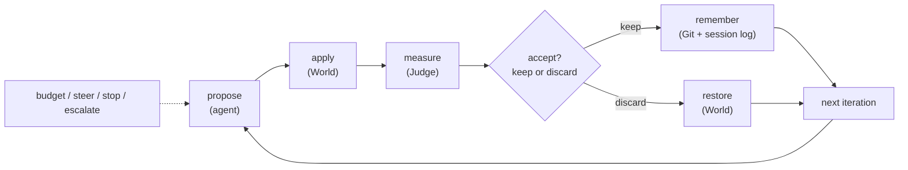

# The autoresearch loop, in one read

Autoresearch is the scored lane of Crucible. It is a **keep/discard loop with a goal and a
gate**, in which an agent improves a codebase against a frozen objective. The loop does not
depend on a domain. A *domain* is a problem packaged for the loop. For a graph that runs one
time and ships, see [Your first playbook](./playbooks.md).

This page describes the system in general concepts. Then it shows how the
`examples/counter` domain maps to those concepts. [ADR 0001](./adr/0001-adaptive-harness.md)
gives the reason that the judge is frozen.

> **Scope.** The core is the engine, the `World`/`Judge` boundary, `CommandWorld` and
> `CommandJudge`, and the `crucible.toml` manifest. A **composite** manifest
> ([ADR 0009](./adr/0009-composite-domains.md)) runs the engine across more than one
> component. Around the loop there are: provisioning and issue-tracker grounding through an
> MCP broker ([ADR 0002](./adr/0002-mediated-provisioning-mcp.md)), a profiler over MCP
> ([ADR 0006](./adr/0006-profiling-over-mcp.md)), build and deploy in the engine
> ([ADR 0005](./adr/0005-engine-side-builds.md)) with rendered deployment manifests
> ([ADR 0012](./adr/0012-rendered-deployments.md)), and publish-on-keep with a draft PR for
> each fork. Authorized review comments on the PR steer the run again.

## Summary

The loop is an optimization loop with these properties:

- The **proposal** step is an LLM agent.
- The **objective** is a frozen, expensive black-box evaluation.
- The **world** is state that the engine can change and restore.
- The loop has **durable memory** and **human-in-the-loop control**.

## The loop



- **propose**: the agent edits the world toward the goal. A backend supplies the proposal
  policy: `local` (the harness on the host), `openshell` (sandboxed), or `command`.
  `[agent].backend` selects it.
- **apply**: makes the candidate live. For a code repository, the edits are the apply step.
- **measure**: the frozen Judge scores the candidate.
- **accept?**: keeps the candidate if it is strictly better. Otherwise, restores the last
  good state.
- **remember**: kept states are Git commits. Each step is an NDJSON event.

By default, the loop has one candidate in each iteration. A **wide round**
([ADR 0010](./adr/0010-candidate-portfolios-and-search.md)) can first run `N` independent
propose turns in parallel, each biased to a different `[search].approaches` entry. The same
Judge ranks them, and the winner is the start point of the loop. With `--wide 0` (the
default), there is no wide round. The wide round is a step before the loop and does not
change the engine.

## The contract

Crucible defines a small contract. A repository implements it in any language. A domain is
**a manifest and some executables**. It is not Rust code. Each command runs in the workspace
with the environment of the domain:

| Command | Required | Contract |
| --- | --- | --- |
| `measure` | yes | The last stdout line is `{ "valid": bool, "score": number, "solved"?: bool, "note"?, "detail"? }`. A nonzero exit status makes the result invalid. **This is the judge.** It gets `CRUCIBLE_BASELINE_*` and `CRUCIBLE_BEST_SCORE` in its environment. |
| `apply` | no | Applies the candidate. Omit it for code repositories, where the agent edits files. Deploy domains build, push, and set the image. |
| `snapshot` | no | Prints an opaque token for the current state. Default: a Git commit ref. |
| `restore <token>` | no | Rolls back to a token. Default: `git reset --hard` and `clean`. |
| `setup` | no | Prepares the workspace. Default: Git clone and checkout. |

The accept policy is the same for all domains. The engine keeps a candidate if it is `valid`
and its `score` is better than the best score in the `direction`. The run is solved only if
`measure` reports it. A domain does not supply code for the keep logic.

### Carrying pipeline artifacts across a discard

A discard resets the workspace and removes untracked files. Any files that an iteration
generated for its candidate (code traces, a generated port tree) are gone in the next turn,
and the agent must generate them again. `[workspace] carry_forward` names paths, relative to
the workspace, that the discard keeps:

```toml
[workspace]
carry_forward = ["codegen-out/"]
```

The engine writes each entry to `.git/info/exclude`, and the clean step of the discard keeps
it. Carried content does not go into a candidate diff, a snapshot commit, or a tree hash. If a
turn only generates the carried content again, the engine sees no candidate change.

Limits:

- A path that the repository **tracks** is not protected. Git excludes apply only to
  untracked files, and `git reset --hard` in the discard reverts tracked content. Carry only
  pipeline output that the repository does not track.
- A path can be absent when the run starts. The exclude applies when the path appears.
- Nested paths (`target/codegen-out`) work. The clean step goes into the parent directory and
  does not delete it. Entries must be plain relative paths, without `.`, `..`, or a leading
  `/`.
- Wide-tournament rounds run in new worktrees without the carried directories, so the
  setting does not apply to them.
- Composite manifests reject the key. Carry-forward for each component is not supported.

If you omit the key, each iteration starts from a clean workspace. Use this default for a
campaign whose method needs a clean start.

### Declared artifacts: carried AND published

`[[workspace.artifact]]` is `carry_forward` with publishing. Use it for generated output
that a reviewer must see, but that must not be in the candidate diff:

```toml
[[workspace.artifact]]
path   = "codegen-out/runtime"   # carried, same rules as carry_forward
embed  = "summary.txt"           # newest match → PR body (collapsed, 16 KiB cap) + record
upload = "summary.pptx"          # newest match → record only (binaries a PR can't inline)
title  = "Runtime investigation" # PR-body section heading (default: the path)
```

The newest match is used. If versioned pipeline directories (`V1 … V7`) each have a summary
with the same name, the summary of the final iteration is published. The record destination
accepts `s3://bucket[/prefix]` or `file:///abs/path`. The file form writes the same layout to
a mounted PVC, for clusters that cannot reach S3. If two or more iterations have a
measurement, the PR body also shows the score of each iteration as a mermaid `xychart-beta`
chart.

### Languages

The contract is JSON and exit codes, so you can write each command in any language:

- **Small glue commands** (apply, operations, steer, stop): we recommend **nushell**. These
  commands run kubectl or Prometheus, parse the output, and compute a value. Nushell works
  with structured data (`... | from json | ...` in, a record `| to json` out). Nushell is
  not a POSIX shell, so pin `nu` in the sandbox image.
- **A large `measure`** with real math (percentiles, replay): use a compiled binary (Rust or
  Go).
- Bash, Python, and other languages are also valid. Only the JSON and exit status format is
  fixed.

`measure_cmd` is any executable that prints one JSON object on stdout
(`{"valid": bool, "score": number, "note": string}`). A plain POSIX shell script satisfies
the full contract:

```sh
#!/bin/sh
p99=$(make bench | jq .p99_ms)
printf '{"valid": true, "score": %s, "note": "p99 %sms"}\n' "$p99" "$p99"
```

The engine reads only the JSON verdict, so all languages work the same way.

## What the engine supplies

| Concept | What it does | Where |
| --- | --- | --- |
| **Engine** | The loop, budget, keep/discard, baseline. | `crucible/src/runloop/driver.rs` (`run_loop`) |
| **World** | State that the engine can change and restore. Opaque `Snapshot`. | `crucible::World` → `GitWorld` / `CommandWorld` |
| **Judge** | The frozen objective: measure and decide. | `crucible::Judge` → `CommandJudge` |
| **Agent** | Proposal policy and transport (local or sandbox). | `agent::AgentSource` |
| **Reporters** | Console, NDJSON, and session-log output. | `report::reporter::Reporter`, `report::console`, `report::stream` |
| **Session log** | Versioned NDJSON event stream. It is the source of truth. | `crucible/src/report/session.rs` |
| **Memory** | Kept Git commits and `RESULTS.md`. | `crucible-vcs/src/vcs.rs`, `write_results` |
| **Run controls** | Steer, stop or park, resume, escalate. | `STEER.md` / `state/control.json` / `--resume` / `ESCALATION.json` |
| **Distress** | The agent pages the operator. `severity=error` suspends the run and keeps the pod. | `crucible-broker::distress`, `crucible/src/control/distress.rs` |
| **Durable run state** | `[cluster] state_pvc` mounts a claim over the `state/` directory of the domain. A replacement pod resumes the run (loop or playbook) and does not start it again. A named (shared) claim uses a `state/<run>` subPath for each run and needs RWX. A `[cluster.state_pvc]` table creates a dedicated `<run>-state` claim, mounted at its root. | `deploy/profile.rs`, `deploy/render/kube.rs` |
| **Provisioning** | MCP broker. The agent sends requests, and the host keeps the credentials (GPU capture, issue-tracker grounding, draft PRs). | `crucible-broker` (ADR-0002) |
| **Profiler** | Profiling over MCP: pprof for a Go service, GPU traces for a model server. | `crucible-broker::profile` (ADR-0006) |
| **Build and deploy** | Build in the engine. `crucible deploy render` writes digest-pinned loop and deployment manifests. | `forge`, `crucible/src/deploy/` (ADR-0005 / 0012) |
| **Publish** | Publish-on-keep to S3 and a draft PR for each fork. Authorized review comments steer the run again. | `crucible/src/runloop/publish.rs`, `crucible-broker::draft_pr` |
| **Search (wide round)** | Optional N parallel propose turns before the deep loop. The same Judge ranks them ([ADR 0010](./adr/0010-candidate-portfolios-and-search.md)). | `crucible/src/runloop/graph.rs` (`wide_template`) |
| **Self-test** | Before a run uses the Judge, `crucible check` proves that the Judge can tell a known-good configuration from a known-bad one. | `[judge.selftest]`, `crucible/src/cli/selftest.rs` |
| **Setup** | `crucible init` creates a manifest and a measure script in an existing repository. `crucible check` validates it without an agent turn. `crucible scope` reads a goal and freezes a `SCOPE.md` (ADR-0014 S0). | `crucible/src/cli/init.rs`, `crucible/src/cli/check.rs`, `crucible-contract/src/scope.rs` |
| **Preflight** | Runs the rung ladder of the domain against the unmodified tree before iteration 1. A failure stops the run. The optional baseline rung sets `segment.baseline_score`. | `[preflight]`, `crucible/src/runloop/preflight.rs` |

The control plane (`crucible-controller`) is optional. It finds candidate issues, scopes
them into packs, launches runs, and shows run records as leaderboards. The controller links
the engine. The engine binary does not link the controller, and everything on this page
works without a controller.

Trust boundary (ADR-0001): the engine gives the agent a `World` but not a `Judge`. The
objective is frozen, and the agent cannot reach it, so the agent cannot change the test that
grades it. The same boundary applies to provisioning. The agent can only send requests to the
broker over MCP. The privileges (GPU and Kueue, capture RBAC, the forge token, the
issue-tracker credential) stay on the host and do not go into the sandbox of the agent.

<div class="cru-callout">
  <p><strong>Two ways to build a candidate. Neither runs in the agent.</strong> If a candidate is a source build (the Dockerfile of a compiled service), <code>forge</code> runs <strong>buildah</strong>. If a candidate is the base image with one or two edited files (an interpreted-source overlay, for example one Python file), <code>forge::oci::derive_layer</code> adds one tar+gzip layer to the base and pushes an immutable, digest-pinned image. It needs <strong>no container runtime</strong> (<code>oci-client</code>, <code>sha2</code>, <code>tar</code>, <code>flate2</code>). If the registries are the same, base layers move by a server-side blob <em>mount</em>. If not, they move by a low-memory pull and push stream. The deployment then uses <code>set image</code> with a digest, so a snapshot or restore is only a ref. <code>forge-derive-layer</code> is the CLI that validates the round trip on a cluster.</p>
</div>

## `[preflight]`: prove the environment before spending an iteration

A rung that grades a candidate can fail for reasons that are not related to the candidate:
a missing dev header, a pip install that hides the built wheel, a cache directory that is not
writable. If the run finds these problems in iteration 1, it loses a full agent turn.
`[preflight]` runs the same ladder against the *unmodified* tree first, with no agent cost:

```toml
[preflight]
commands = [
  "python3 tools/gate.py --only-rung 1 --mode {mode}",
  "python3 tools/gate.py --only-rung 2 --digest {digest} --limit 1",
]
baseline = "python3 tools/gate.py --only-rung 3 --digest {digest}"
```

- Each command runs with `sh -c` in the workspace. Its last non-empty stdout line must be a
  JSON object. The rung passes if the command exits with status 0 and `pass` is absent or
  true. The recognized keys are `digest`, `score`, `tiebreak`, `note`, and `logs`.
- `{mode}` runs the command once for each build mode in
  `[measure.build].mutable_kwargs.mode`, in declared order. A `{mode}` command without that
  list is a manifest load error. Without this rule, a preflight could pass in derive mode
  while full mode is broken.
- `{digest}` inserts the most recent `digest` that an earlier rung emitted, so the build rung
  gives its artifact to the correctness rung. If no rung produced a digest yet, the command
  fails.
- Any failure is an **environment verdict**. The run does not start. It logs the failed
  command, its note, and the end of its stderr as a `preflight-failed` row. The run uses no
  iteration.
- `baseline` is optional. Its `score` and `tiebreak` become `segment.baseline_score`. A
  `skip_baseline` (codegen) domain then decides iteration 1 against a real number, not
  against the worst-score sentinel of the direction. Without `baseline`, the sentinel is
  used.

## The three extension points

- **New domain:** usually a manifest that points `CommandWorld` and `CommandJudge` at a
  repository, and a `measure` command. *No Rust.* Write a custom `World` or `Judge` only for
  in-process measurement or a world that is not files.
- **Composite domain:** combine N existing component domains into one run. It has a top-level
  `[composite]` table that references the component domain directories (used without
  change), a `CompositeWorld` (a tuple of Git overlays, one for each component, and the live
  deployment), and one combined gate over the full stack. The engine does not change. It runs
  a *list* of workspaces ([ADR 0009](./adr/0009-composite-domains.md)).
- **New frontend:** implement `Reporter`.
- **New agent transport:** add an `AgentSource`.

## The canonical example: the counter, mapped to the contract

`examples/counter/` is the full system, with each large part replaced by the smallest part
that satisfies the contract. Each of its five small files has a **contract role**:

| File | Lang | Contract role |
| --- | --- | --- |
| `crucible.toml` | toml | **manifest** (`[repo] path = "."`, `direction = "higher"`, no `[world]` → GitWorld) |
| `measure.nu` | nu | **measure** (score = the integer in `value.txt`; `solved` at ≥ 5) |
| `bump.nu` | nu | **propose** with the `command` backend (deterministic: `value.txt += 1`, no LLM, no cost) |
| `setup_cmd` (inline in the manifest) | sh | **setup** (seed a fresh git workspace with only the runtime files) |
| `method.md` | md | **method prompt** (used only if you set `backend = "local"`) |

There is no `[world]` block, so GitWorld supplies the restore: kept iterations are commits,
and discards use `git reset --hard`. The backend is `command`, so the whole loop runs in
milliseconds and costs nothing. It is still a real end-to-end run (manifest → setup →
propose → measure → keep/discard → Git history).

A production domain fills the same roles with larger parts. A serving-stack domain has *two*
reversible parts: the code tree **and** a live deployment. It adds `snapshot_cmd` and
`restore_cmd` that capture the image and configuration together with the Git state. Its
`measure` is a compiled benchmark binary. Its propose backend is `local` or `openshell`. Its
glue commands (apply pipelines, deployment inspection, steer and stop) are on PATH as
**bare names**, so the contract names are the same for every implementation. A normal
repository needs none of this. It needs one `measure` command and the Git default.

## Add a new domain

1. `crucible init` creates a starter `crucible.toml` and a measure script in the repository.
   You can also write the manifest by hand:
   ```toml
   [repo]      url|path, ref
   [workspace] setup_cmd          # optional; default: git clone + checkout
               carry_forward      # optional; untracked derived paths a discard keeps
               [[workspace.artifact]] path, embed?, title?   # carried + published to PR/S3
   [agent]     model, method_prompt, goal_file|goal, toolbox_dir, env
   [judge]     measure_cmd, direction = "lower"|"higher"
   [world]     apply_cmd?, snapshot_cmd?, restore_cmd?   # omitted → git
   ```
2. Write a `measure` command (any language) that prints `{valid, score, solved?}`.
3. `crucible check --manifest crucible.toml` validates the manifest without an agent turn.
   It checks that every referenced file resolves, and it runs `measure_cmd` one time to check
   the output format.
4. Run `crucible --manifest crucible.toml`. The engine supplies the loop, the budget, all
   frontends, steer, stop, and resume, the session log, and escalation.

Any other repository can run this way with **no new Rust**.

## The task lane: no `[judge]`

Some work has no objective to score, for example "consolidate the open dependabot PRs" or
"fix flaky tests every night". If you omit `[judge]`, the run is a **task**. The loop runs as
usual (sandbox, broker, session log, publish, resume), with the built-in `TaskJudge`, which
keeps everything. There is no baseline measure and no score. The engine keeps and snapshots
every completed turn. The run exits with status 0 when no iterations remain
([ADR-0026](./adr/0026-no-judge-task-lane.md)).

```toml
[repo]
url = "https://github.com/you/repo"
[agent]
backend = "openshell"
goal = "Consolidate the open dependabot PRs into one branch; run the tests."
[publish]
pr_repo = "you/repo-fork"   # the deliverable: kept commits as one draft PR
```

On the wire, the run has the normal format, with `gate: "task"` as the discriminator: an
iteration-0 `baseline-skipped` row, then `keep` rows with `score: null`, and
`Summary.best_score` null. `crucible check` does not probe the measure. It requires a goal
and prints a "task mode" notice. Notes:

- Exit status 0 means that the run completed. It does not mean that the task succeeded.
  Examine the rows or the PR.
- `solved` does not occur. Only the iteration limit ends the run (`--no-early-stop` has no
  effect).
- The trust boundary does not change. The agent has no credentials. The output is a draft
  PR. Privileged write actions (merge, close issues) stay in broker tools.
- Composites still need `[judge]`. `[search]`, `[workflow]`, and `[preflight]` also need it,
  and a task manifest rejects them at load. The scope pipeline rejects proposed packs without
  a judge, and a scored judge cannot use `objective = "task"`.

`examples/task/` is the runnable reference (deterministic `command` backend, no LLM).
[Tasks: the no-judge lane](./task-lane.md) is the full guide.

## Distress: the agent can page you

The broker has a `distress` tool. The agent uses it to report that a run cannot succeed. The
required severity sets the result:

| severity | Slack | Run |
| --- | --- | --- |
| `info` | posted | continues. The note goes on the next decided row in `RESULTS.md`. |
| `warn` | posted | continues. The note goes to the same place. |
| `error` | posted | **suspends**. The current turn finishes and the engine decides it. Then the loop parks. The pod stays alive and keeps its state. |

Use `error` for a run that cannot succeed without an operator: the same environment failure
in many iterations, a missing capability, or a goal that is not possible as written. Do not
use it for a task that is difficult but possible. The tool replies `{"status":"suspending"}`,
and the agent finishes its turn. The suspend occurs at the start of the next iteration, after
the engine records that turn, so no data is lost. More `error` calls during the suspend have
no effect. If the engine cannot write the marker (a full or read-only volume), the tool
returns an error, not `suspending`, and posts nothing. The run is not suspended, so the agent
and the page must not report that it is.

The suspend is a pending approval. The loop opens the same `approval_wait` bracket that
provisioning uses, so suspended wall-clock time goes to `parked_total` and does not count
toward `--max-time`. The distressed iteration still counts, because its turn ran. The
suspended time counts against no limit. `--max-park` limits the wait.

The signal is one file on the forge-storage volume of the loop pod:
`/var/lib/forge/distress`. To resume the run, delete the file:

```sh
oc exec <pod> -n <ns> -- rm /var/lib/forge/distress   # resume in place
```

If the fix must be in place at pod start (image pins, the pack, resources), replace the pod.
The marker is on an emptyDir, so the new pod starts without it. A resume that finds the open
distress bracket does not park again. Info and warn notes go to
`/var/lib/forge/distress-notes.jsonl`, and the engine adds them to the next row.

The render sets these variables on the loop pod. The broker inherits them, so the page can
name the run: `CRUCIBLE_RUN_NAME`, `CRUCIBLE_ITERATIONS`, `CRUCIBLE_LOOP_IMAGE`, and the
downward-API `CRUCIBLE_POD_NAME` and `CRUCIBLE_POD_NAMESPACE`. A pod that the controller
dispatches also has `CRUCIBLE_RUN_DISPLAY_NAME`, the two-word name of the run
(`benevolent-monkey`). The page and report cards show this name instead of the run id. Links
still use the id. Slack supports only webhooks. Set `SLACK_WEBHOOK_URL` to an incoming
webhook through the `[[secret_env]]` of the profile. Set `DATADOG_BASE_URL` if your Datadog
site is not `app.datadoghq.com`. Without a webhook, the suspend still occurs. The engine sends
the page one time and does not retry.

## `crucible flow`: explain a finished run

`crucible flow --session state/session.jsonl --out flow.html` converts a finished run into a
small flow-model IR and renders it. The `--out` extension selects the format: `.json` (the
IR), `.dot`, `.mmd`, or `.html`. The HTML format is a self-contained page with a header, a
swimlane of iterations (agent turn and check ladder in each column, scores against the
baseline), detail for each iteration, and the draft-PR footer. The optional
`--spans <dd-export.json>` (Datadog APM) adds real wall-clock time: columns in proportion to
time, check durations, and the tool-call timeline of the agent.

## Concept to code

- loop, budget, keep/discard: `crucible/src/runloop/driver.rs`, `crucible/src/runloop/graph.rs`
- the contract traits: `crucible/src/crucible.rs`
- World and Judge implementations: `crucible/src/command_world.rs` (`GitWorld`, `CommandWorld`, `CompositeWorld`), `crucible/src/command_judge.rs` (`CommandJudge`)
- composite domains: `crucible/src/manifest/mod.rs` (`CompositeManifest`), `crucible/src/cli/scored.rs` (`run_composite`)
- broker (provisioning, issue tracker, profiler, draft PR): `crucible-broker/`
- distress (suspend from the agent, and the Slack page): `crucible-broker/src/distress.rs`, `crucible/src/control/distress.rs`
- build and rendered deploy in the engine: `forge/` (build, native-OCI derive, kube-rs), `crucible/src/deploy/`
- agent transport: `crucible/src/agent/`
- frontends: `crucible/src/report/{console,stream}.rs`
- session log wire format: `crucible/src/report/session.rs`
- the example domain: `examples/counter/` (manifest, `measure.nu`, `bump.nu`)
