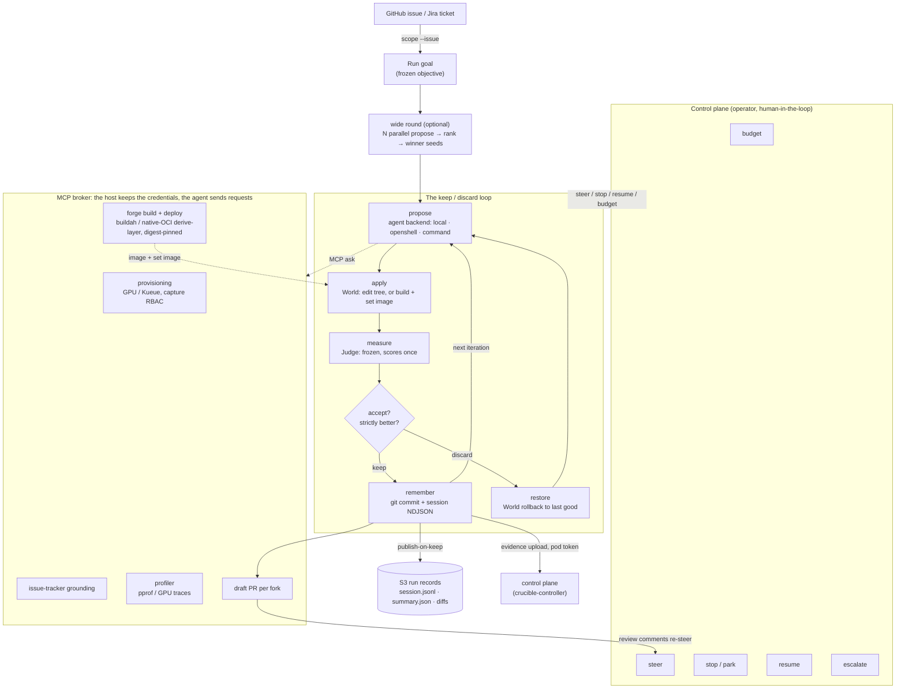

# How the loop works

This diagram shows the autoresearch lane. A goal goes in, and an agent proposes a change.
The engine applies the change to a reversible **world**. A **frozen judge** measures it one
time. The loop keeps the change only if it is strictly better than the best result so far.
Git stores the accepted states, and the operator can steer the run. Privileged operations run
on the host in a broker. The agent can only send requests to the broker.

[Loop control states](./loop-states.md) is a generated diagram of the controls around the
loop: the gates between iterations and the ways a run ends.

## The stages

| Stage | What happens | Deeper |
| --- | --- | --- |
| **Goal** | A GitHub issue or Jira ticket becomes a frozen run objective. The objective does not change after the run starts. | [ADR 0001](./adr/0001-adaptive-harness.md) |
| **wide round** | Optional. `--wide N` runs N independent propose turns in parallel, one for each `[search].approaches` entry. The gate ranks them, and the winner is the start point of the deep loop. With 0 (default), the run starts at propose. | [ADR 0010](./adr/0010-candidate-portfolios-and-search.md) |
| **propose** | The agent reads the history and edits the world toward the goal. A backend (`local`, `openshell`, or `command`) supplies the proposal policy. The engine does not. | [The loop in one read](./crucible.md) |
| **apply** | Makes the candidate live. For a code repository, the edits are the apply step. For a deploy domain, apply builds and sets the image. | [ADR 0005](./adr/0005-engine-side-builds.md), [ADR 0012](./adr/0012-rendered-deployments.md) |
| **measure** | The frozen judge scores the candidate one time. The agent gets a `World` but not the `Judge`, so it cannot change the test that grades it. | [ADR 0001](./adr/0001-adaptive-harness.md) |
| **accept?** | Keeps the candidate only if it is `valid` and its score is strictly better than the best score in the `direction`. Otherwise, restores the last good state. | [Contract](./crucible-contract.md) |
| **as a plan** | Every iteration runs as a work-graph plan (`propose -> apply -> measure -> decide`) through the shared executor. An authored workflow replaces the default graph. | [Work graphs](./work-graphs.md) |
| **remember** | Kept states are Git commits. Each step is an NDJSON session event. Git is the durable store. Each run writes exactly one `shutdown` event as its last line, so the viewer and any published record can tell a clean end from a pod that stopped during the run. | [ADR 0004](./adr/0004-core-loop-state-model.md) |
| **broker** | Provisioning, issue-tracker grounding, the profiler, build and deploy, and draft PRs run on the host. The agent sends requests over MCP. The privileges do not go into its sandbox. | [ADR 0002](./adr/0002-mediated-provisioning-mcp.md), [ADR 0006](./adr/0006-profiling-over-mcp.md) |
| **publish** | On keep, the engine sends the run record to S3 and opens a draft PR for each fork. Authorized review comments steer the run again. A pod that the control plane dispatches uploads its evidence to the controller with its pod token, and the controller shows leaderboards and run pages. The engine binary does not link the controller. | [Contract](./crucible-contract.md) |

## Glossary

Some words have a specific meaning in the loop. **World** and **Judge** are the most
important, because they define the trust boundary.

| Term | Plain English | What it actually is |
| --- | --- | --- |
| **World** | The workspace that the agent can change. | The state that the engine can change and restore: the code tree, and for a deploy domain also the live deployment. `GitWorld` / `CommandWorld`. The agent changes only the World. |
| **Judge** | The measurement script and the pass threshold. | The frozen objective. It runs `measure`, gets `{valid, score, solved}`, and decides keep or discard in the `direction`. `CommandJudge`. The agent cannot change it. |
| **Candidate** | The change that the iteration grades. | One proposed change of the World. The engine applies it and measures it one time. |
| **measure / gate** | The scoring step. | The command that prints `{valid, score, solved?}`. A nonzero exit status makes the result invalid. This is the scoring step of the Judge. |
| **keep / discard** | Accept or reject. | Keep only if the result is `valid` and the score is strictly better than the best score in the `direction`. Otherwise, restore the last good state. |
| **direction** | The meaning of better. | `lower` (for example, p99 latency) or `higher` (for example, success rate). |
| **Agent / backend** | The source of the change. | The proposal policy that edits the World: `local` (the harness on the host), `openshell` (sandboxed), or `command`. `[agent].backend` sets it. |
| **snapshot / restore** | Save point and rollback. | An opaque token for the current World state, and the rollback to it. The default is a Git ref and `git reset --hard`. |
| **Domain** | A problem packaged for the loop. | A `crucible.toml` manifest and some executables (`measure`, and optionally `apply`, `snapshot`, `restore`). Usually no Rust. |
| **Composite domain** | Several domains that run as one. | A list of component domains in one run (for example, a router and the model server behind it), with one combined gate. |
| **Deployment** | The live test environment. | The cluster topology that a deploy domain creates for measurement. |
| **Broker** | The host-side service that keeps credentials. | The MCP service that holds all privileges (provisioning, issue-tracker access, profiler, build and deploy, draft PRs). The agent sends a request, and the broker does the operation. |
| **forge** | The builder. | Image build and deploy in the engine: `buildah` for source builds, and native-OCI `derive_layer` for a base image with an edited file. |
| **publish-on-keep** | Publish a kept result. | For a kept candidate, push the run record to S3 and open or update a draft PR for each fork. |

[The loop in one read](./crucible.md) describes the same model in text.
