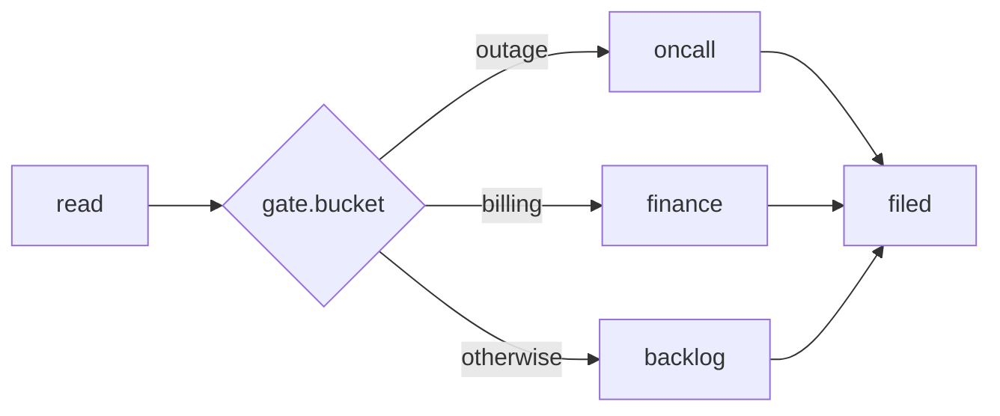

# Branching and review

The task set is fixed at compile time. Three constructs make decisions at run time, and each
has a limit:

- `route()` selects branches.
- `revise` sends work back to an earlier task.
- `over` fans out one instance for each item of a list.

This page describes these three constructs and the related tools: sessions, gates, joins,
advisory tasks, and reports.

The [DSL reference](./dsl-reference.md) lists every argument. [Work graphs](./work-graphs.md)
describes what the executor does with each result.

## Branch on a decision

A `route()` asks typed questions about the output of its dependencies. It records one answer
for each question. A downstream task uses `when` to name the answer that it runs on.



```python
read = command(name = "read", run = "./read.sh", emits = ["bucket"])

gate = route(
    name = "gate",
    depends_on = [read],
    source = read,
    questions = {
        "bucket": choice(
            ask = "Which queue owns this ticket?",
            options = ["outage", "billing", "feature"],
        ),
    },
)

oncall = command(name = "oncall", run = "./act.sh oncall", depends_on = [gate],
                 when = gate.bucket, answers = "outage")
finance = command(name = "finance", run = "./act.sh finance", depends_on = [gate],
                  when = gate.bucket, answers = "billing")
backlog = command(name = "backlog", run = "./act.sh backlog", depends_on = [gate],
                  when = gate.bucket, otherwise = True)

filed = command(name = "filed", run = "./act.sh filed",
                depends_on = [oncall, finance, backlog], join = "passed")
```

If the route does not select the answer of a branch, the branch settles `not_taken`. It does
not dispatch, does not spend, and does not change the verdict. A task that depends on it with
the default `join = "all"` is also not taken. For this reason, `filed` uses `join = "passed"`.

**Source of the answer.** Set exactly one of these two:

| | Answered by | Cost |
| --- | --- | --- |
| `source = read` | A dependency's own output: `read` emits `{"bucket": "billing"}`. | Free and deterministic. |
| `min_confidence = 0.8` | A decision model, through the broker's `decision` capability. An answer below the threshold is recorded as `"uncertain"`. | One model call per route, for all its questions. |

If a source emits a label that the question does not declare, the route fails and the run
stops at that route. If a model-backed route has no decision binding, the engine truncates
the plan before any task spends.

**Question types.**

- `choice(ask, options)` selects one of N labels. `options` can be a dict, and its values
  describe each label for the model.
- `noul(ask)` answers `"yes"` or `"no"`. `when = gate.urgent` without `answers` runs on
  `"yes"`.
- `score(ask, levels)` is an ordinal question. `levels` lists two or more labels, lowest
  first, optionally as a dict of descriptions. It branches as a choice on its most probable
  level (the lower level if two are equal). It also records a `score` in [0, 1], which is the
  expected level position. For `low`, `medium`, `high`, the positions are 0, 0.5, and 1:

```python
"risk": score(ask = "How risky is this change?",
              levels = {"low": "cosmetic", "medium": "one component", "high": "crosses services"}),
```

A `source` answers a score with one level label, not a boolean, and the route records the
position of that level. `"uncertain"` records no score. System One has no ordinal question
type, so the engine asks a model-backed score as a choice over the levels and records it with
`"asked_as": "choice"`.

**Each answer must have a task.** The compiler rejects a route if an answer that a `when` can
see does not reach a task. This includes `"uncertain"`. Use `otherwise = True` to cover the
remaining answers, or use `drop` to declare that an answer goes to no task:

```python
"urgent": noul(ask = "Does the customer need a reply within the hour?", drop = ["no", "uncertain"]),
```

If you add an option to a question, `otherwise` takes the new answer, or the pack does not
compile until a task takes the new label. `examples/route` is the full pack. It has a
model-backed gate and instructions to serve the decision model.

## Let a decision model answer

A decision model reads the inputs of the route and returns a probability for each label of
each question. It does not return free text that an agent must format correctly. Crucible
supports two decision APIs:

- the OpenAI Decisions API (`POST /v1/decisions`, protocol `decisions`);
- any server that implements the System One decision API (`POST /v1/systemone`, protocol
  `system_one`), for example the hosted Jev API or the vLLM DiffusionGemma structured-reads
  server.

The route declares the questions and the confidence that it needs. The route is the same for
both APIs:

```python
read = command(name = "read", run = "./read.sh", emits = ["ticket"])

gate = route(
    name = "gate",
    depends_on = [read],
    min_confidence = 0.8,
    questions = {
        "bucket": choice(
            ask = "Which queue owns this ticket?",
            options = {
                "outage": "the product is down or unusable",
                "billing": "charges, invoices, refunds",
                "feature": "a request for something new",
            },
        ),
        "urgent": noul(
            ask = "Does the customer need a reply within the hour?",
            drop = ["no", "uncertain"],
        ),
    },
)
```

The workflow does not name the endpoint. The person or system that launches the run binds
an endpoint in `CRUCIBLE_INFERENCE`:

```sh
export CRUCIBLE_INFERENCE='{"version":1,"bindings":[{"role":"decision","protocol":"decisions",
  "model":"gpt-6-luna","key_env":"OPENAI_API_KEY"}]}'
crucible plan run --manifest crucible.toml --max-cost 1 --max-time 5m
```

A `decisions` binding without a `url` uses `https://api.openai.com/v1/decisions`. To use a
gateway, set `url`. A `system_one` binding must always name its server:

```sh
export CRUCIBLE_INFERENCE='{"version":1,"bindings":[{"role":"decision","protocol":"system_one",
  "url":"https://api.example.com/v1/systemone","model":"jev-1","key_env":"JEV_API_KEY"}]}'
```

`key_env` names the variable that holds the bearer key. The document does not contain the
key. Without a `decision` binding, the route cannot run, so the engine truncates the plan
before any task spends.

**Model input.** The engine sends one request for each route. The request holds the outputs
of the route's dependencies and each question with its instructions and label descriptions.
System One takes the outputs as a `state` object:

```json
{
  "model": "jev-1",
  "state": {"read": {"ticket": "I was charged twice for the March invoice. No rush, but please refund the duplicate."}},
  "questions": {
    "bucket": {"type": "choice", "instructions": "Which queue owns this ticket?",
               "criteria": {"outage": "the product is down or unusable",
                            "billing": "charges, invoices, refunds",
                            "feature": "a request for something new"}},
    "urgent": {"type": "noul", "instructions": "Does the customer need a reply within the hour?"}
  }
}
```

The OpenAI API takes the same outputs as JSON text in `input`. A noul becomes a `predicate`
question, and a choice becomes a `choice` question with the question id as its name:

```json
{
  "model": "gpt-6-luna",
  "input": "{\"read\":{\"ticket\":\"I was charged twice for the March invoice. No rush, but please refund the duplicate.\"}}",
  "questions": [
    {"type": "choice", "name": "bucket", "instructions": "Which queue owns this ticket?",
     "choices": [{"value": "outage", "description": "the product is down or unusable"},
                 {"value": "billing", "description": "charges, invoices, refunds"},
                 {"value": "feature", "description": "a request for something new"}]},
    {"type": "predicate", "name": "urgent", "instructions": "Does the customer need a reply within the hour?"}
  ]
}
```

The label descriptions are the only definition of each queue that the model gets. Write
them as you would write instructions for a person.

**Run record.** The output of the route is the decision. For each question, it holds the
label, its confidence, and the full distribution that the model returned. The label is the
most probable declared label. The engine ignores any separate choice or confidence value that
the API returns.

```json
{"bucket": {"label": "billing", "confidence": 0.9,
            "probabilities": {"billing": 0.9, "feature": 0.05, "outage": 0.05}},
 "urgent": {"label": "no", "confidence": 0.9, "probabilities": {"no": 0.9, "yes": 0.1}}}
```

If the probability of a label is less than `min_confidence`, the engine records
`"uncertain"`, and `otherwise` or `drop` must cover it. The engine also records `"uncertain"`,
with confidence 0 and an empty distribution, if OpenAI does not answer a question.

**Control plane.** A deployed controller binds the decision model from its provider registry.
On the Providers page, add a default with role `decision` for the playbook class, for the
platform or for one domain. The default names an OpenAI provider (which uses `gpt-6-luna` if
the default names no model) or a custom provider with protocol `decisions` or `system_one`.
Every playbook launch then gets this binding and the provider key, together with the binding
of its agent
([ADR-0065](https://github.com/neuralmagic/crucible/blob/main/gov/adr/ADR-0065-the-controller-hands-the-engine-its-models-as-the-inference-document.toml)).
A controller that you start with `just controller-local` does not read secret values. It
passes its own `CRUCIBLE_*` variables to the runs that it launches. Export
`CRUCIBLE_INFERENCE` before you start it, and give the key variable the same prefix
(`"key_env":"CRUCIBLE_DECISION_KEY"`).

`examples/route` is the runnable pack. It has five sample tickets and instructions to serve
DiffusionGemma yourself.

## Send work back

A task with `revise = <task>` or `revise = [<task>, ...]` is a reviewer. If it fails and
rounds remain, the tasks that it names run again with the verdict. Then the reviewer runs
again.

```python
author = agent(
    name = "author",
    prompt = "Write PROBE.md, a probe that demonstrates the reported bug.",
    session = "author",
    emits_files = ["PROBE.md"],
)

review = command(
    name = "review",
    run = "./check.sh",
    depends_on = [author],
    emits_files = ["evidence/review.json"],
    revise = author,
    max_rounds = 3,
)
```

From the second round, the inputs of the author contain the last verdict of the reviewer
under `revision`. The engine stages the declared files of the reviewer under
`inputs/review/`:

```json
{"round": 2, "max_rounds": 3, "reviewer": "review",
 "review": {"status": "fail", "note": "exit 1: ", "files": true,
            "output": {"accepted": false, "why": "the probe hit an unrelated 400"}}}
```

- **Rounds have a limit.** `max_rounds` is 2 to 5. It has no default.
- **Each round settles.** A passing round makes a commit. The engine discards a failing
  round. The session log records `author[round-1]`, `review[round-1]`, and so on. The verdict
  uses the rows of the last round.
- **Sessions continue.** An author with a `session` continues the same conversation in each
  round, so it knows what it already tried.
- **Chains.** `revise = [pick, build]` sends back a chain. Every listed task runs again in
  dependency order, and then the reviewer runs. You must list every task between a target and
  the reviewer, so that no task in a round reads a stale result.
- **One loop per task.** A loop cannot contain a fan-out. A task cannot be in two loops.
  Loops cannot be nested or chained.

`examples/revise-loop` runs a revise pair through a real OpenShell sandbox with a fake model.

## Fan out

`over = producer.field` maps a task over a list that its dependency emits. There is one instance for each item:

```python
scan = skill(
    name = "scan",
    skill = "skills/scan-issues",
    args = {"repo": param("repo")},
    emits = ["issues"],
)

triage = skill(
    name = "triage",
    skill = "skills/triage-issue",
    depends_on = [scan],
    over = scan.issues,
    max_fanout = 12,
    isolated = True,
    required = False,
    emits = ["classification", "severity"],
    emits_files = ["TRIAGE.md"],
)

roundup = command(
    name = "roundup",
    run = "python3 roundup.py",
    depends_on = [scan, triage],
    join = "passed",
    emits_files = ["REPORT.md"],
)
```

The item is the key of each instance. `triage[123]` is issue 123 in every retry and in every
report row. An instance reads its own key from the reserved `item` input. `max_fanout` sets
the maximum count, and the engine limit is 256. `isolated = True` runs the instances at the
same time in private worktrees, at most eight at a time, and each one starts only while the run
is under `--max-cost`. `required = False` lets the sweep finish when some instances fail.
`join = "passed"` gives `roundup` only the instances that passed. `examples/triage` is the full
pack.

If you know the list at compile time, write the fan-out in Starlark. It unrolls into normal
tasks:

```python
AUDITS = [("headings", True), ("bullets", True), ("freshness", False)]

def auditor(topic, blocking):
    return agent(
        name = "audit-" + topic,
        prompt = prompt_file("prompts/audit.md") + "\nAUDIT: " + topic.upper() + "\n",
        depends_on = [polish],
        isolated = True,
        required = blocking,
        emits = ["findings"],
    )

auditors = [auditor(topic, blocking) for topic, blocking in AUDITS]
```

## Decide per item

A route can also map over a list. It asks one time for each item. A task mapped over the
same list reads the answer for each item with `when`, so the turn for item k runs only if the
answer for item k selects it:

```python
prepare = command(name = "prepare", run = "./stage.sh",
                  emits = {"members": "list", "facts": "object"})

gate = route(
    name = "gate",
    depends_on = [prepare],
    over = prepare.members,
    max_fanout = 120,
    keyed = [prepare.facts],
    min_confidence = 0.8,
    questions = {"depth": choice(
        ask = "How much work does this ticket need?",
        options = {"settled": "the staged facts already answer it",
                   "quick": "a short look", "deep": "a full investigation"},
        drop = ["settled"],
    )},
)

quick = agent(name = "quick", prompt = prompt_file("analyze.md"), effort = "low",
              depends_on = [prepare, gate], over = prepare.members, max_fanout = 120,
              keyed = [prepare.facts], when = gate.depth, answers = "quick")
deep = agent(name = "deep", prompt = prompt_file("analyze.md"), effort = "high",
             depends_on = [prepare, gate], over = prepare.members, max_fanout = 120,
             keyed = [prepare.facts], when = gate.depth, otherwise = True)
```

- **Items pair by key.** Tasks mapped over the same `producer.field` are aligned.
  `quick[T-1]` reads `gate[T-1]`. An aligned dependency gives an instance only its instance
  for the same key, not the whole fan-out.
- **Items that are not taken stay visible.** `quick[T-2]` settles `not_taken`, with the
  answer in its note. It does not fail the fan-out. The fan-out output counts it under
  `not_taken`. An aligned task that joins `all` on it is also not taken.
- **One request for each item.** `max_fanout` limits the number of requests. A resumed run
  keeps the decisions that it has and asks only for the others.
- **`keyed` limits the input.** `prepare.facts` is an object keyed by item. Each instance,
  route or task, gets only its own entry under `facts`. A fan-out of one hundred items does not
  send the facts of every item to every turn.
- **Judge a result file.** `files = ["RESULT.json"]` puts the declared JSON file of a
  dependency in the model state under `files`. A route mapped after the analysis can ask if
  the evidence supports the verdict, and use `when` to send uncertain items to a review lane.
- **Deterministic route first.** A route mapped over the list can read each answer from an
  output object keyed by item (`{"reachable": {"T-1": "no"}}`). Put that route first, and give
  the model route a `when` on it. The model then gets questions only about the items that the
  facts do not decide.

## Keep a conversation

Agent tasks that share a `session` continue one conversation in dependency order:

```python
scribe = session(name = "scribe")

draft = agent(name = "draft", prompt = prompt_file("prompts/draft.md"), session = scribe, emits = ["entries"])
shape = command(name = "shape", run = "./shape.sh", depends_on = [draft])
polish = agent(name = "polish", prompt = prompt_file("prompts/polish.md"), session = scribe, depends_on = [shape])
```

`polish` continues from where `draft` stopped. Each pair of tasks in a session needs a
dependency path between them. A session task cannot be isolated. `session()` can also set the
default harness, model, and effort for its tasks.

`shape`, between the two turns, shows a second pattern: **a command as a gate**. It reads the
declared `entries` of `draft` from `CRUCIBLE_INPUTS`, counts the files on disk, and exits
nonzero if the numbers are different. A bad draft does not get a second, paid turn.

## Joins

The `join` of a task sets what it needs from its dependencies before it runs:

| `join` | Runs when | Receives |
| --- | --- | --- |
| `all` (default) | Every dependency passed. | Every dependency's output. |
| `passed` | Every dependency is terminal and at least one passed. | Only the passing ones. |
| `settled` | Every dependency is terminal, whatever it settled as. | Each one as `{status, note, output, files}`. |

Use `passed` to join branches and to collect fan-outs. Use `settled` for a task that must
see failures, for example a summary that reports which tasks failed.

## Advisory tasks

`required = False` makes a task advisory. If it fails, its dependents are blocked, but the
run can still be valid. Use it for useful checks that must not fail the result: a freshness
audit, a slow benchmark, one instance of a sweep.

A `required` task can be unable to run on the substrate, because the substrate does not
declare its `needs` capability. In that case, the engine truncates the whole plan before it
dispatches any task. Without a required task, the graph cannot produce a valid pass, so the
engine does not start it.

## Report the result

`report()` is a task that the engine owns. It publishes a rendered template to a destination
that the controller configures:

```python
publish = report(
    name = "publish-report",
    destination = {"kind": "slack"},
    template = "reports/slack.md.j2",
    result = roundup,
    required = True,
)
```

The workflow names a destination key. It does not name a URL, channel, or credential.
`result` puts only the declared fields of that task into the message. An agent cannot skip
the call or write the payload.

The template is a Jinja file in the pack. The engine renders it into the card body. The
template can read these values:

| Name | Value |
| --- | --- |
| `verdict` | the run's verdict: `"pass"` when every required main-graph task passed or was not taken, otherwise `"fail"`. Advisory tasks and branches not taken never change it |
| `spent_usd` | total task cost |
| `passed`, `failed` | counts of settled tasks that passed and that did not, advisory and not-taken tasks included |
| `tasks` | the first 20 settled tasks, each with `name`, `status`, `cost_usd` |
| `run`, `run_url` | the run name and its Crucible link |
| `result.name`, `result.status` | the selected task and its terminal status |
| `result.output` | the selected task's declared fields, with their JSON types; defined only when it passed |

A field that the selected task did not declare is not defined. Guard optional reads with
`is defined`. The engine escapes every inserted value for Slack, also with `|safe`. A result
that holds `<!channel>` shows as that literal text. If the body is larger than
`CRUCIBLE_REPORT_BODY_MAX_BYTES` (default and maximum 3000), the report task fails.

```jinja
{{ result.output.summary }}roundup {{ result.status }}
```

`severity_field` names one declared field of `result`. Its value sets the accent color of the card:

```python
publish = report(
    name = "publish-report",
    destination = {"kind": "slack"},
    template = "reports/slack.md.j2",
    result = roundup,
    severity_field = "severity",
)
```

`"good"`, `"warning"`, and `"danger"` set the accent for any verdict. The card shows the
verdict on a separate line. Any other value gives a neutral accent. A selected task that was
skipped or not taken also gives a neutral accent. A selected task that failed, had a
transport failure, or was blocked gives `"danger"`. The field sets only the accent, not part
of the payload. It is a compile error to set `severity_field` without `result`, or to name a
field that `result` does not declare in `emits`.

## Where to look next

<div class="cru-grid">
  <a class="cru-card" href="./dsl-reference.html">
    <p class="cru-card-title">DSL reference <span class="arrow">→</span></p>
    <p>Every constructor, its lane, and its arguments.</p>
  </a>
  <a class="cru-card" href="./work-graphs.html">
    <p class="cru-card-title">Work graphs <span class="arrow">→</span></p>
    <p>Readiness, retries, budget, isolation, and the plan file format.</p>
  </a>
  <a class="cru-card" href="./plan-states.html">
    <p class="cru-card-title">Plan states <span class="arrow">→</span></p>
    <p>The state machine of each task and plan.</p>
  </a>
</div>
