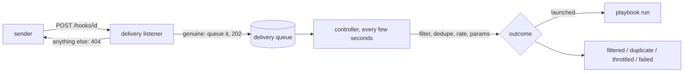

# Launching from webhooks

A webhook launches a registered playbook when a sender outside the controller posts a delivery.
A sender is any system that POSTs JSON to a URL: quay.io after an image push, GitHub after a
release, a CI job, or your own script. The controller verifies the delivery and puts it in a
queue. Within a few seconds, the controller takes the delivery from the queue and runs a small
CEL transform. The transform decides if the delivery launches a run, which event it is, and
which params the launch gets.



The listener does not launch runs. It answers `202` when the delivery is in the queue. The
controller then processes the queue of each webhook in arrival order. Each delivery gets
exactly one outcome, and you can read that outcome later.

## Verifiers

A webhook verifies each delivery with one of two verifiers. You select the verifier when you
create the webhook, and you cannot change it later. To use a different verifier, delete the
webhook and create a new one.

| Verifier | Sender | What a delivery carries |
| --- | --- | --- |
| `path_token` | Any sender: quay.io, GitLab, a CI job, `curl` | The secret as the last path segment: `/hooks/<id>/<token>` |
| `hmac_sha256` | GitHub, or any sender that signs the same way | `sha256=` and the lowercase hex HMAC-SHA256 of the raw body, in the header you name (`x-hub-signature-256`) |

A sender that signs in a different way (a base64 signature, or a signature over a timestamp
and the body) cannot use `hmac_sha256`. Give that sender a `path_token` URL. The token is the
credential.

The controller generates every secret (256 random bits). It shows the secret once, in the
response to the create or rotate request. The controller stores path tokens as SHA-256
digests. It seals HMAC secrets with AES-256-GCM under the webhook key. A controller without a
webhook key rejects `hmac_sha256` webhooks.

If the controller does not record a delivery, the answer is always `404` with
`{"error":"not found"}`. This applies to an unknown or deleted webhook, a paused webhook, a
wrong token or signature, and a body larger than 512 KiB. Webhook ids are random UUIDs, so the
address alone gives no information.

## Creating a webhook

### From the UI

Open a playbook and select **Add webhook**. The default **Sender** is **Custom**, for any
sender that POSTs JSON. With **Custom**, the filter launches every delivery, the dedupe key is
`delivery`, and every param is a fixed value until you derive it. The named senders (quay.io
repository push, GitHub release, GitHub push) set the verifier, the transform, and the params
that they can match by name. If you select **Custom** again, the transform starts from the
beginning. For each param that the playbook declares, select **fixed value** or
**derived (CEL)**. The form checks each expression as you type and marks the location of each
error. **Run preview** evaluates the transform on a sample body and headers. It does not store
anything.

When you save, the form shows the delivery URL and the secret one time. Configure the sender with them:

- **Any sender:** POST JSON to the delivery URL (it includes the token). See
  [A custom sender](#a-custom-sender).
- **quay.io:** repository settings, **Create Notification**, event *Push to Repository*,
  method *Webhook POST*, URL = the delivery URL.
- **GitHub:** repository settings, **Webhooks**, **Add webhook**, payload URL = the delivery URL,
  content type `application/json`, secret = the HMAC secret, then choose the events.

**Webhooks** in the navigation lists every webhook that you can read. The page of a webhook
shows its delivery URL, its transform, the pause/resume, rotate, and delete controls, and its
delivery log. **Edit** opens the form again. Its preview can load any recorded delivery as the
sample.

### A custom sender

Any system that can send an HTTP POST with a JSON body can use a `path_token` webhook:

```sh
curl -X POST -H 'content-type: application/json' \
  -d '{"service": "api", "version": "1.4.2", "env": "staging"}' \
  "$DELIVERY_URL"
```

You choose the body format. Write the transform for that format:

- a filter, for example `body.env == "staging"`;
- a dedupe key, for example `body.service + "@" + body.version`, so that a retried POST
  launches only once;
- a derive for each param, for example `version: body.version`.

To test the transform on a real delivery, load a recorded delivery into the preview of the
edit form. If a sender sometimes omits a key, guard it: `has(body.env) && body.env == "staging"`.

An `hmac_sha256` sender also signs the raw body. It puts the signature in the header that the
webhook names (`x-signature` in this example):

```sh
body='{"service": "api", "version": "1.4.2"}'
sig=$(printf '%s' "$body" | openssl dgst -sha256 -hmac "$SECRET" -hex | sed 's/^.* //')
curl -X POST -H 'content-type: application/json' -H "x-signature: sha256=$sig" \
  -d "$body" "$DELIVERY_URL"
```

The body must be JSON. The controller records any other body with the outcome `failed`.

### From crux

```sh
crux webhook-presets                    # starting points, as JSON
crux webhook-check --file hook.json     # CEL diagnostics, field:line:col; fails on any
crux webhook-create --file hook.json    # prints the webhook, its secret, and delivery URL, once
crux webhooks                           # list
crux webhook <id>                       # one, as JSON
crux webhook-deliveries <id> [--before <delivery-id>] [--limit N]
crux webhook-update <id> --file hook.json
crux webhook-pause <id>                 # its address answers 404; queued deliveries fail
crux webhook-resume <id>
crux webhook-rotate <id>                # new secret, shown once; the old one stops working
crux webhook-delete <id>
crux webhook-preview --file preview.json
```

A create body:

```json
{
  "playbook": "on-image-push",
  "verifier": "path_token",
  "filter": "\"latest\" in body.updated_tags",
  "dedupe": "delivery",
  "derive": { "image": "body.docker_url", "tags": "body.updated_tags" },
  "params": { "release": "3.2" },
  "max_launches_per_hour": 10,
  "retention_days": 14,
  "max_cost": 5,
  "max_time": "30m"
}
```

`params` are fixed values. The controller validates them against the schema of the playbook,
as it does for a launch form. `derive` maps a declared param to the expression that derives
it. A param is fixed or derived, not both. An `hmac_sha256` body also contains
`"header": "x-hub-signature-256"`.

### From the API

`POST /api/webhooks`, `GET /api/webhooks`, `GET|PUT|DELETE /api/webhooks/{id}`,
`POST /api/webhooks/{id}/enabled`, `POST /api/webhooks/{id}/secret`,
`GET /api/webhooks/{id}/deliveries?before=&limit=`, `POST /api/webhooks/preview`,
`POST /api/webhooks/check`, `GET /api/webhooks/cel`, `GET /api/webhooks/presets`. The schemas are
in `/api/openapi.json`. For authorization, a webhook is a standing launch. To read a webhook,
you need `read` on it. To change it, you need `update`. If a save changes what the webhook
launches, the policy also evaluates the save as a launch of the playbook.

## The transform

The transform has three kinds of CEL expression. All of them use the same variables:

| Variable | Value |
| --- | --- |
| `body` | The delivery's JSON body. Integers are `int`, other numbers `double`. |
| `headers` | The recorded headers, names lowercased: `headers["x-github-event"]`. |
| `delivery` | The delivery's id, unique per delivery. |
| `received_at` | When it arrived, RFC 3339. |

- **`filter`** is a bool. A delivery that it rejects ends `filtered`. If there is no filter,
  the value is `true`.
- **`dedupe`** is a string or int, at most 512 bytes. If a key already launched a run, a new
  delivery with that key ends `duplicate`. This is true while the webhook exists, also after
  the controller prunes the delivery that used the key. With `delivery`, each delivery is a
  separate event.
- **`derive.<param>`** returns a string, number, bool, or list of strings for that param.

Functions: `size`, `int`, `uint`, `double`, `string`, `bytes`, `type`, `timestamp`, `duration`,
and on a target `contains`, `startsWith`, `endsWith`, `matches`. Macros: `has`, `all`, `exists`,
`exists_one`, `map`, `filter`. `GET /api/webhooks/cel` returns the same lists. There is no
`join`.

The controller rejects a save if an expression has one of these problems. The error names the
field, and the line and column when the parser knows them:

- it does not parse, it nests brackets more than 32 levels deep, or it is longer than 2 KiB;
- it reads a variable other than the four above, or it calls a function that is not in the
  list above;
- it nests comprehensions more than two levels deep;
- it has a comprehension whose condition or step reads values other than its own variables.
  For example, `body.l.map(x, body.l)` is rejected, and
  `body.items.exists(i, i.tags.exists(t, t == "x"))` is allowed. This rule keeps the
  evaluation time linear in the size of the body.

### Examples

quay.io push of a release tag:

```text
filter  body.updated_tags.exists(t, t.matches("^v[0-9]+"))
dedupe  delivery
image   body.docker_url + ":" + body.updated_tags.filter(t, t.matches("^v"))[0]
```

GitHub release:

```text
filter  headers["x-github-event"] == "release" && body.action == "published"
dedupe  string(body.release.id)
tag     body.release.tag_name
```

The quay.io push payload names the pushed tags but no digest. For this reason, the quay
preset uses `delivery` as the dedupe key, and every push launches a run. If a playbook pushes
the image that it listens to, the rate limit stops it from launching itself in a loop.

## Outcomes

A delivery shows `queued` until the controller processes it, which takes a few seconds at
most. The controller processes deliveries in arrival order. Each delivery stops at the first
step that gives it an outcome:

| Step | Outcome |
| --- | --- |
| The body is not JSON | `failed` |
| The filter is false, or fails | `filtered`, or `failed` |
| The dedupe key cannot be derived | `failed` |
| The key already launched | `duplicate` |
| The hour's launches reached `max_launches_per_hour` | `throttled` (never retried) |
| A param cannot be derived, or the schema refuses it, or the launch is denied | `failed` |
| Otherwise | `launched`, with the launch key |

Failures that a delivery causes do not count toward disabling the webhook. Failures of the
launch do count: the playbook is gone, its stored params do not fit its schema, or the policy
denies it. A webhook that fails `CONTROLLER_SCHEDULE_AUTO_DISABLE_FAILURES` times in sequence
pauses itself. Schedules and watches use the same threshold. When you pause or delete a
webhook, its queued deliveries fail. The controller keeps finished deliveries for
`retention_days` (1 to 90, default 14). `max_launches_per_hour` is 1 to 120.

Any user who can read the webhook can read the body and headers of its deliveries. The
controller does not record a header that can contain a credential (`authorization`, `cookie`,
the signature header).

## Deploying

| Variable | Meaning |
| --- | --- |
| `CONTROLLER_HOOKS_ADDR` | `host:port` the delivery listener binds. Unset serves no listener. |
| `CONTROLLER_HOOKS_PUBLIC_URL` | The listener's public base URL; delivery URLs are built on it. Unset returns only the path. |
| `CONTROLLER_WEBHOOK_KEY_FILE` or `CONTROLLER_WEBHOOK_KEY` | Base64 AES-256 keys, newest first, that seal `hmac_sha256` secrets. Unset refuses `hmac_sha256` webhooks. |

The listener uses a different port from the API, so a deployment can publish only the
listener. In the Helm chart, `webhooks.enabled` adds the `hooks` container, the Service port,
and a Route on the external host for the `/hooks` path only. `webhooks.key.existingSecret`
mounts the webhook key. The webhook key is separate from `CONTROLLER_CREDENTIAL_KEY`, which
also enables offline credentials at sign-in.

Generate a key with `head -c 32 /dev/urandom | base64`. To rotate the key, put the new key
first. Keep the old key after it until you rotate every secret that it sealed.

## Trying it locally

`just controller-local` serves the delivery listener on `127.0.0.1:8871` (set `HOOKS_PORT` to
change it). It generates a webhook key one time in its state directory. A pack with only
commands can test webhooks without an agent:

```sh
mkdir -p /tmp/image-pushed && cd /tmp/image-pushed
cat > crucible.toml <<'EOF'
[workspace]
inject = ["announce.sh"]

[agent]
backend = "command"
agent_cmd = "true"
goal = "Record which image a registry push named."

[workflow]
type = "playbook"
file = "workflow.star"
EOF
cat > workflow.star <<'EOF'
params = {
    "image": {"type": "string", "required": True, "pattern": "^quay\\.io/"},
    "tags": {"type": "list<string>", "default": ["latest"]},
}

announce = command(name = "announce", run = "./announce.sh")

workflow(type = "playbook", tasks = [announce], result = announce)
EOF
printf '#!/bin/sh\necho "$CRUCIBLE_INPUTS"\n' > announce.sh && chmod +x announce.sh

crux draft-create image-pushed --description "Record which image a registry push named"
crux draft-push image-pushed /tmp/image-pushed --base-version 1
crux draft-publish image-pushed --playbook on-image-push
```

Create a quay webhook for `on-image-push`, with the body above or in the UI. Then post a push
as quay.io does, to the `delivery_url` that the create command printed:

```sh
curl -X POST --data '{"repository":"org/img","docker_url":"quay.io/org/img","updated_tags":["latest"]}' \
  "$DELIVERY_URL"
crux webhook-deliveries <id>
```

The controller processes the delivery within a few seconds. `POST /api/reconcile` processes
it immediately. A GitHub delivery to an `hmac_sha256` webhook signs its body:

```sh
sig="sha256=$(printf '%s' "$BODY" | openssl dgst -sha256 -hmac "$SECRET" | awk '{print $NF}')"
curl -X POST -H "X-GitHub-Event: release" -H "X-Hub-Signature-256: $sig" --data "$BODY" "$DELIVERY_URL"
```

## Troubleshooting

| Symptom | Cause |
| --- | --- |
| The sender sees `404` | Wrong id or token, a changed or rotated secret, a paused webhook, a signature over a different body, or a body over 512 KiB. |
| The sender sees `503` | The controller could not record the delivery, or it is rejecting load. The sender retries. |
| `filtered` | The filter was false. Load the delivery into the preview of the edit form to find the cause. |
| Stays `queued` | The owner of the webhook must sign in again, or the controller is not running its launch loop. |
| `failed` with `no key "x"` | An expression read a key that the payload does not have. Guard a field with `has(body.x)` and a header with `"x" in headers` before the expression reads it. |
| `duplicate` | The dedupe key already launched a run. Use `delivery` if each delivery is a separate event. |
| The save rejects `hmac_sha256` | The controller has no webhook key. |

[ADR-0055](https://github.com/neuralmagic/crucible/blob/main/gov/adr/ADR-0055-webhook-triggers-verified-deliveries-land-in-an-inbox-and-cel-maps-them-to-a-launch.toml)
records the design. The webhook clauses of [RFC-0003](./rfc/RFC-0003.md) give the
requirements.
