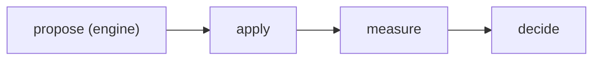

# Work graphs

A **plan** is a versioned DAG of **tasks** that a deterministic executor runs. A task is an
agent turn, a command that the plan defines, or a reducer that the engine owns. The executor
advances the plan. A task does not select the next task.

The engine supplies a default loop graph and a wide-tournament template. A person or a pack
can supply a plan as TOML or JSON through the `plan` CLI. Workflow admission keeps the graph
shape separate from authority. An orchestrator must declare each workflow type and each engine
operation that it can execute safely.

## Running a plan

```sh
# compile and print it, without executing
crucible plan show --file plan.toml
crucible plan show --file plan.toml --mermaid      # flowchart source
crucible plan show --file plan.toml --render       # PNG, inline if the terminal supports it

# execute: command tasks run as subprocesses, agent tasks through the real harness
crucible plan run --file plan.toml --manifest crucible.toml

# execute without a manifest: agent tasks run a stand-in command instead
crucible plan run --file plan.toml --agent-cmd ./role.sh

# replace the manifest's [agent] harness and model for this run; a task that pins its own keeps it
crucible plan run --manifest crucible.toml --harness codex --model gpt-5.6-luna
```

`--cap <name>` (repeatable) declares a capability of the substrate. See *needs* below.

`plan run` exits with a nonzero status if the plan does not reach a valid verdict.

## File format

```toml
version = 1                 # the only format version accepted today
# reason = "..."            # reserved for a future replan protocol

[budget]
usd = 5.0                   # required, positive; execution fails closed on overrun

[params]                    # optional; command and evaluate tasks read it as inputs["params"]
topic = "slag"

[[task]]
name = "propose"            # unique within the plan
kind = "agent"
prompt = "..."
model = "claude-opus-4-6"   # optional per-task overrides of the manifest's [agent]
harness = "claude"
effort = "high"
session = "solver"         # optional durable logical conversation

[[task]]
name = "measure"
kind = "command"
command = "./bench.sh"
depends_on = ["propose"]
needs = "gpu"               # default "any"
required = true             # default true
isolation = "worktree"      # optional
join = "all"                # default "all"
emits = ["score"]           # optional declared output fields; absent = undeclared
                            # or typed: emits = { score = "number", tier = ["high", "low"] }
timeout = "20m"             # optional per-attempt limit; agent, command, and evaluate only

[[task]]
name = "pick"
kind = "top_k"
k = 1
direction = "lower"         # or "higher"
depends_on = ["measure"]
```

### Task kinds

| Kind | What it runs |
| --- | --- |
| `agent` | One agent turn. `harness`, `model`, and `effort` override the `[agent]` defaults of the manifest for the task. `session` enables durable continuation. |
| `command` | A command that the plan defines. It returns JSON on its last stdout line. |
| `evaluate` | A measurement command. `pass = false` rejects the result. A `threshold` with a `direction` grades a numeric `score`. |
| `top_k` | A reducer that the engine owns. It keeps the `k` best inputs by their `score` field. It needs at least one dependency. |
| `engine` | An operation that a capability owns (`propose`, `apply`, `measure`, `grade`, `decide`, or `measure_diff`). Only an orchestrator that admits it can execute it. |

A workflow can declare and order engine nodes, but that does not give it authority to run
them. Admission needs the matching capabilities, for example `workflow.autoresearch`,
`engine.apply`, and `engine.measure`. The generic plan runner rejects engine nodes because it
has no `World` and no frozen `Judge`.

A command string alone is not a trust boundary. If a command runs a script that must stay
trusted after an agent task edits the workspace, declare that script as a frozen
`[[workspace.inject]]` in the manifest. Before each task, the plan runner restores frozen
injects in the workspace of the task. This includes isolated worktrees.

A logical `session` is serial state, so each pair of tasks that share a session must have a
dependency path between them. A session task cannot use disposable worktree isolation. The
private ledger keeps only an opaque harness cursor and the count of completed turns. The
engine does not copy that cursor or the native Claude transcript into the plan or the public
session log. Normal streamed harness events keep their usual visibility. The native Claude
Code transcript stays in its private local store, or in a mode-0600 engine store that the
engine restores into each new OpenShell sandbox. If you omit `session`, each turn starts a
new conversation.

### Task output

The output of a task is JSON. It becomes the input of the task's dependents.

- `command`: the last non-empty stdout line. A nonzero exit status is a measured failure. A
  spawn failure is a transport failure. Upstream outputs arrive as a JSON object keyed by task
  name, in the file that `CRUCIBLE_INPUTS_FILE` names. `CRUCIBLE_TASK` gives the task name. The
  same JSON is also in `CRUCIBLE_INPUTS` if it is 64 KiB or smaller. If it is larger, the
  variable is not set, because Linux rejects an environment string larger than 128 KiB. Read
  the file.
- `agent` with `--manifest`: the turn writes one JSON object to `PLAN_TASK_RESULT.json` in the
  workspace root. If the file is missing after a normal turn, this is a measured failure. An
  explicit spawn, harness, or stream error is a transport failure and follows the retry policy.
- `agent` with `--agent-cmd`: the stand-in gets `CRUCIBLE_PROMPT`, `CRUCIBLE_HARNESS`,
  `CRUCIBLE_MODEL`, and `CRUCIBLE_EFFORT`. It returns JSON on its last stdout line.
- `evaluate`: needs a JSON object. `pass = false` fails the task, and a malformed `pass` also
  fails it. A `threshold` with a `direction` compares the numeric `score` (`lower` is `<=`,
  `higher` is `>=`). Without a threshold, a successful command passes unless `pass` is false.

`top_k` reads a finite numeric `score` from each input, so an upstream task that ranks must
emit a score. You can declare this: `emits = ["score"]` on an `agent`, `command`, or `evaluate`
task names the fields that its JSON output must contain. Before the run starts, validation
rejects these tasks if their declared emits do not include `score`: a `top_k` dependency, a
`grade` score source or tiebreak, and a thresholded `evaluate`. At run time, if a passing
attempt does not have a declared field, the engine changes it to a measured failure at the
producing task. The engine does not retry it, and it blocks dependents. The error appears at
the task that caused it, not downstream. An empty or absent `emits` declares nothing, and the
engine does not check it. `top_k` and `engine` tasks cannot declare emits, because the engine
defines their outputs.

`emits` can also declare the type of each field, as a dict from field name to type:

```python
scan = command(
    name = "scan",
    run = "./scan.sh",
    emits = {"targets": "list", "count": "integer", "severity": ["high", "low"]},
)
```

A type is `"string"`, `"integer"` (a number with no fractional part), `"number"`,
`"boolean"`, `"list"`, `"object"`, or a list of labels. A list of labels declares a string
that is equal to one of the labels. Labels are identifiers, as route labels are. The list form
of `emits` is still valid, and it declares only that the field is present.

At run time, if a passing attempt has a field of the wrong type, or a string that is not one
of its labels, it is a measured failure at the producing task. This is the same as a missing
field. The note names the field, the value type that arrived, and the declared type. A task
that settled itself as skipped or failed does not have to supply its fields.

At compile time, before any spend, the compiler checks the types at each place where the
graph reads a field:

- `over = scan.targets` needs a field declared `"list"`. The error points to the `over`
  argument.
- A `top_k` dependency, a `grade` score source or tiebreak, and a thresholded `evaluate` need
  `score` declared `"number"` or `"integer"`.
- `route(source = scan, ...)` needs the field of each question declared as labels that the
  question answers (its options, or `yes`/`no`, plus `uncertain`), or as `"boolean"` for a
  `noul`. The compiler rejects `"string"`, because it does not limit which label arrives.

The compiler does not check a field declared without a type (list form) or a task without
`emits`. The generated TOML holds the types as a table (`emits = { score = "number" }`). The
`plan_admitted` event lists each field with its type.

### Schema types

`schema_file(path)` reads a JSON Schema (draft 2020-12) from the pack. You can use it as a
type in `emits` and in the dict form of `emits_files`:

```python
plan = command(
    name = "plan",
    run = "./plan.sh",
    emits = {"lanes": schema_file("crucible/schemas/lanes.json"), "tickets": "integer"},
    emits_files = {"RESULT.json": schema_file("crucible/schemas/result.json"), "REPORT.md": None},
)
```

The compiler puts the schema content into the plan, so a change to the schema changes the
plan digest. These are compile errors at the call, and the compiler fetches nothing: a file
that is not a valid 2020-12 schema, a file that declares a different `$schema`, and a file
that references a remote `$ref`. At run time, the producing task fails, as for a wrong type,
in these cases: the schema rejects a field of a passing output, or a declared file is not JSON
or does not match. The note gives the first three errors as instance path and message:
`output field "lanes" does not match its schema: /1: value is not of type "string"`. Notes do
not repeat the rejected value.

Each consumer checks the schema exactly. It reads `type`, `const`, `enum`, local `$ref`,
`allOf`, and every branch of `anyOf`/`oneOf`. It rejects a schema if it cannot prove the
requirement:

- `over` needs `"type": "array"` whose `items` (and any `prefixItems`) are strings that the
  schema can prove: `"type": "string"`, or a `const`/`enum` of strings. The item names a mapped
  instance. For this reason, `{"type": "array"}` without `items`, or
  `"items": {"type": "integer"}`, is a compile error at the `over` argument.
- A score needs a numeric `type`, and its `const`/`enum` must contain only numbers.
- A `route(source = ...)` question needs every value that the schema limits (`const`, `enum`,
  or `"type": "boolean"`, which answers `yes`/`no`) to be a label that the question accepts.
  The compiler rejects a schema that limits no value, as it rejects `"string"`.

A route source can limit a question to a finite set of answers, with a label list,
`"boolean"`, or a schema. In that case, a `when` that names a label that the source cannot give
is a compile error ("can never be answered"). Such a label needs no task, and `otherwise`
covers only the labels that the source can give. A schema without one top-level type does not
satisfy any consumer. On the wire, a schema is its JSON text (`{ schema = "..." }` in the TOML,
`{ path = "RESULT.json", schema = "..." }` for a file), because TOML cannot hold the null
values that schemas often contain.

### Repair

An agent task can repair its own output before the engine fails it:

```python
plan = agent(
    name = "plan",
    prompt = prompt_file("prompts/plan.md"),
    emits = {"lanes": schema_file("crucible/schemas/lanes.json")},
    emits_files = {"RESULT.json": schema_file("crucible/schemas/result.json")},
    repair = 2,
)
```

A turn can pass but have output that misses a declared field or file, or does not match a
type or schema. In that case, the engine continues the same conversation with the validation
notes (masked as above). It tells the agent to repair the output and files in place, and then
checks again. It does this up to `repair` times (at most 3).

Repairs run in the `timeout` of the attempt, and their cost counts against the run budget. A
repair does not start if the attempt has already spent the remaining budget. Repairs are not
retries: `attempts` stays 1. When no repairs remain, the task fails with the same note as
without repairs. Each mapped instance repairs separately. A task without a `session` gets a
conversation for the attempt. A task in a session continues that session. `command` and
`evaluate` do not accept `repair`.

The `task_result` event of the task records each repair under `repairs`, as
`{label, round, of, cost_usd, notes}`, with labels such as `audit[RHAI-1] repair 1/2`.

## Execution semantics

[Plan execution states](./plan-states.md) is a generated diagram of how the executor walks a
graph, the states of one task, and how the plan ends.

**Readiness.** A task dispatches when its dependencies are terminal and its join is
satisfied. Dispatch follows declaration order, so the event stream is deterministic.

**Truncation fails closed.** If a `required` task cannot run on this substrate (its `needs` is
not in the declared caps, or a dependency cannot run), the engine truncates the whole plan and
dispatches *no* task. A truncated DAG cannot produce a valid pass. If an advisory task is in
the same position, the engine skips it and its dependents, and validity does not change.

**Failure.** If a `required` task fails, the plan stops. All tasks that did not dispatch are
blocked. An advisory failure blocks only its dependents.

**Early completion.** In a playbook, a passing main-graph task can return `"complete": true`,
with an optional `"reason"` string. This ends the run. No other main-graph task dispatches.
Tasks that did not dispatch stay unsettled, not blocked. Epilogue tasks still run. The run is
valid unless a required task already settled with a status other than pass. The shutdown
outcome is `complete`, with the reason. Both fields are reserved, so `emits` cannot list them.
A revised task that completes ends its loop without another review. A mapped instance that
completes ends the run after its node folds.

**Retries apply only to transport failures.** Transport failures retry, up to a limit (2 by
default). A measured failure does not run again.

**Budget.** The cost of an attempt is known only after the attempt completes. For this reason,
an attempt in progress can report a total larger than `budget.usd`. Any overrun makes the plan
invalid and blocks all further dispatches and retries. A spend equal to the budget is valid
only if no other retry or task is necessary.

**Time.** Elapsed time is known at all times, so it limits each attempt while the attempt
runs. Each attempt has a deadline: the `timeout` of its task, counted from the start of the
attempt, or the `--max-time` limit of the run if that is earlier. A task without `timeout`
runs only under the run limit. At the deadline, the runner stops the whole process group of
the attempt (a command and all processes that it started, or the agent turn). The task
settles as a measured failure with a note that names the limit:
`timed out: the task ran past its 20m limit`. The engine does not retry it, because a retry
would use the same time again. A required task that times out stops the plan, as any other
failure does. If the run limit ends an attempt, the run ends on that limit, and all tasks that
did not dispatch settle as blocked. A playbook rejects a `timeout` longer than `--max-time`
before it dispatches a task. In a concurrent batch, each task has its own deadline.

### `needs`

The substrate capability that a task needs. `"any"` runs on all substrates. You must declare
any other value with `--cap`. If you do not, the task cannot run. `plan show` reports the
truncation verdict before any spend.

### `isolation`

`isolation = "worktree"` gives the task a private clone of the workspace, with its
uncommitted state. This has two effects:

- Isolated tasks that are ready at the same time run **concurrently**. Without isolation, they
  would all write the one `PLAN_TASK_RESULT.json` in the shared workspace.
- The engine **discards** the edits of the task. Only the declared output leaves the task.
  Use isolation for review and analysis. Do not use it for a task whose diff must be kept.

A runner that cannot isolate rejects the task. It does not run the task in the shared
workspace.

### `join`

`join = "all"` (default) needs every dependency to pass. `join = "passed"` waits for every
dependency, then collects the passing dependencies. There must be at least one. If no
dependency can run or pass, the task fails.

### `revise`

A reviewer sends a failing verdict back to the tasks that it names, for a limited number of
rounds. Only playbooks support `revise`. It is the only repetition that the graph declares.

```python
author = agent(
    name = "author",
    prompt = "Write PROBE.md, a probe that demonstrates the reported bug.",
    session = "author",
    emits_files = ["PROBE.md"],
)

review = command(
    name = "review",
    run = "./check.sh",
    depends_on = [author],
    emits_files = ["evidence/review.json"],
    revise = author,
    max_rounds = 3,
)
```

`review` runs against the draft as any dependent does. If it fails and rounds remain,
`author` runs again, and then `review` runs again. This continues until `review` passes or
the third round ends. Any other outcome of the reviewer ends the loop. The loop also ends if a
revision fails and the reviewer is blocked. The engine checks the limits before each round.

`revise` also accepts a list, for a fix that needs more than one task to run again:

```python
confirm = evaluate(
    name = "confirm",
    run = "python3 tools/probe.py --rung confirm",
    depends_on = [rig],
    revise = [pick, build, rig],
    max_rounds = 3,
)
```

The targets and the reviewer are the body of the loop. Each round runs the body one task at
a time in dependency order. Each task uses its own `join` and `when`. If `build` fails, it
blocks a reviewer with `join = "all"`, and the loop ends. A reviewer with `join = "settled"`
sees the failure and can send the chain back. The loop starts after every task outside the body
that a body task reads has settled. A task outside the body that reads a body task waits until
the loop ends.

From the second round, the inputs of each target contain the reserved `revision` key:

```json
{"round": 2, "max_rounds": 3, "reviewer": "review",
 "review": {"status": "fail", "note": "exit 1: ", "files": true,
            "output": {"accepted": false, "why": "the probe hit an unrelated 400"}}}
```

`files` tells if the engine staged the declared files of the reviewer from that failing
round. The engine stages them under `inputs/<reviewer>/`, where a `join = "settled"` consumer
also finds them. The reviewer does not get `revision`. A body task that declares a `session`
continues it in each round, so it knows what it already tried.

Each round settles separately. A passing round makes a commit, and the engine discards a
failing round. Each round reports as `task[round-N]`, the same naming that the instances of a
mapped node use. When the loop ends, each task reports one row under its own name. The row
holds its last round and the spend of all rounds. Only these rows decide the verdict. A
dependent reads the last round.

The limit is 2 to 5, and it has no default. Validation rejects:

- a target that the reviewer does not depend on, directly or through other tasks;
- a body that omits a task on a path between two of its tasks (that task would read a result
  that a later round replaces);
- a body task that is not an agent, command, or evaluate task, or that fans out;
- a task in two bodies;
- a reviewer that is also a target.

If the number of repetitions depends on what a task finds, put that repetition inside one
task.

## The loop as a plan

Each loop iteration runs as an `autoresearch` workflow that capabilities admit. Without an
authored workflow, the default workflow expands to normal tasks:



The author defines the task names and the tasks between the engine operations. The result of
an `autoresearch` workflow must be a decision that a frozen measurement feeds, with apply and
proposal ancestors. A `custom` workflow has no shape requirement. The outer orchestrator
admits it only if it declares `workflow.custom`.

```toml
[workflow]
type = "autoresearch"
result = "keep-if-better"

[[workflow.task]]
name = "invent"
kind = "engine"
op = "propose"
session = "solver"

[[workflow.task]]
name = "review"
kind = "command"
command = "./review.sh"
depends_on = ["invent"]

[[workflow.task]]
name = "deploy-preview"
kind = "engine"
op = "apply"
depends_on = ["review"]

[[workflow.task]]
name = "benchmark"
kind = "engine"
op = "measure"
depends_on = ["deploy-preview"]

[[workflow.task]]
name = "keep-if-better"
kind = "engine"
op = "decide"
source = "benchmark"
depends_on = ["benchmark"]
```

To admit this workflow, the orchestrator needs `workflow.autoresearch`, `engine.propose`,
`engine.apply`, `engine.measure`, and `engine.decide`. Because the workflow binds `solver`, it
also needs `agent.session.persist`. A custom orchestrator can admit `type = "custom"` and any
subset of the operations that it implements. Task-level `needs` still controls where an
admitted task can run. Workflow capabilities control which operations the orchestrator is
authorized to run.

Each iteration writes `plan_admitted` and `task_result` lines to the session log, in addition
to the decision and session events. The loop driver keeps cross-round state, keep/discard,
and all controls between rounds (parking, steering, re-scoping, budget). The wide round runs
as a template that the engine compiles from `[search]`.

The templates have no budget of their own. The driver owns the run budget and checks it
between rounds, so the engine still measures and decides a turn that goes over the limit.

### Authored measurement subgraphs

You can still use `measure()`. To make the measurement steps visible in the graph, use
`evaluate()` and `grade()`. Dependencies define the rungs, isolated peers can run
concurrently, and `grade()` selects the score source for `decide()`.

```python
candidate = propose(name = "invent")
live = apply(name = "deploy", depends_on = [candidate])

refcheck = evaluate(
    name = "cpu-reference",
    run = "./refcheck.sh",
    depends_on = [live],
)
diff = evaluate(
    name = "single-gpu-diff",
    run = "./diff.sh",
    depends_on = [refcheck],
    threshold = 0.001,
    direction = "lower",
    needs = "gpu",
    isolated = True,
)
latency = evaluate(
    name = "latency",
    run = "./latency.sh",
    depends_on = [diff],
    direction = "lower",
    threshold = 12.5,
    isolated = True,
)
racecheck = evaluate(
    name = "racecheck",
    run = "./racecheck.sh",
    depends_on = [diff],
    required = False,
    isolated = True,
)
measurement = grade(
    name = "final-grade",
    evidence = [diff, latency, racecheck],
    score = latency,
)
decision = decide(name = "choose", measurement = measurement)
workflow(
    type = "autoresearch",
    tasks = [candidate, live, refcheck, diff, latency, racecheck, measurement, decision],
    result = decision,
)
```

The renderer groups `evaluate` and `grade` as **Measurement** and keeps the edges. During
`crucible scope`, validation writes the admitted graph to `WORKFLOW.png`. Agents cannot
replace this file.

### Run-scoped epilogue tasks

`stage = "epilogue"` on a `[[workflow.task]]` removes the task from the graph of each
iteration. In Starlark, set `stage = "epilogue"` on `agent()`, `command()`, or `evaluate()`.
The epilogue subgraph runs one time, after the loop ends cleanly (finished, budget, or
solved). It runs against the final kept candidate, and only if the run kept a candidate. Use
it for slow checks, for example a 90-minute `compute-sanitizer` racecheck or a slow
performance benchmark.

The `CRUCIBLE_INPUTS` of each task holds the kept candidate under the reserved `kept` key:
`{"iter", "score", "tiebreak", "sha", "snapshot", "note"}`. Dependencies cannot cross stages.
Engine operations cannot be in the epilogue. The workflow `result` must be in the iteration
stage.

In a playbook, the epilogue runs after the main graph completes or fails. It reads the
reserved `outcome` input: `{"exit", "tasks": {name: {"status", "note", "output", "files"}}}`.
Each entry is the same as the value that a `join = "settled"` consumer gets, with
`per_instance`. The engine stages the declared files of each main-graph task under
`inputs/<name>/` (for a mapped node, under `inputs/<node>[<key>]/`). It stages files from
failed tasks and from passing tasks. `files` tells if the files of that task are present. A
skipped, blocked, or transport-failed task stages no files.

Epilogue results are advisory. They cannot undo the keep of the candidate. The engine writes
their rows to the session log and RESULTS.md (`epilogue` / `epilogue-skip` /
`epilogue-fail`). The PR body gets an "Epilogue checks (advisory)" section, with failures
marked **FAILED**.

`report(name = "publish-report", destination = {"kind": "slack"}, template = "reports/slack.md.j2",
result = roundup, required = True)` is the publication epilogue that the engine owns. A
destination is a key that the engine knows, not a URL or a secret name. `slack` is the only
destination. The optional `result` selector puts only the declared JSON fields of that
main-graph task into a Block Kit card that the engine builds. The card does not show prompts,
stdout, workspaces, undeclared fields, raw Slack blocks, channels, or credentials. The default
limit for the selected output is 16 KiB encoded. An operator can set a different limit, up to
64 KiB, with `CRUCIBLE_REPORT_RESULT_MAX_BYTES`. `CRUCIBLE_REPORT_BODY_MAX_BYTES` limits the
rendered template body (default and maximum 3000, the Slack section limit). Data that is too
large fails. The engine does not truncate it. For a required report, a render or delivery
failure fails the workflow. An agent does not have to call a tool to send the report.

## Worked example

`examples/revise-loop` is the smallest revise loop. An agent writes a draft probe. A command
rejects the first draft, which the agent wrote without a verdict. The revision, which the agent
wrote with the verdict, passes. `just revise-loop-e2e` runs it in real OpenShell sandboxes on
local podman with a `claude` image that has no model. It checks the rounds, the continued
session, and the commits.

`examples/adversarial-review` puts a review task between a code node and the gate below it. It
has a single-reviewer shape and a two-reviewer panel shape. The panel runs isolated reviewers
concurrently and joins them on a policy gate. The correctness reviewer blocks, and the
copy-edit reviewer is advisory. It runs at no cost against a stand-in manifest, or against real
models with the live manifest.
